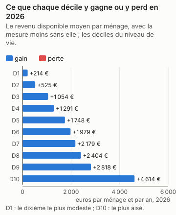
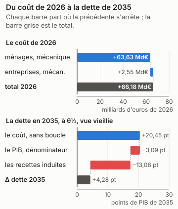
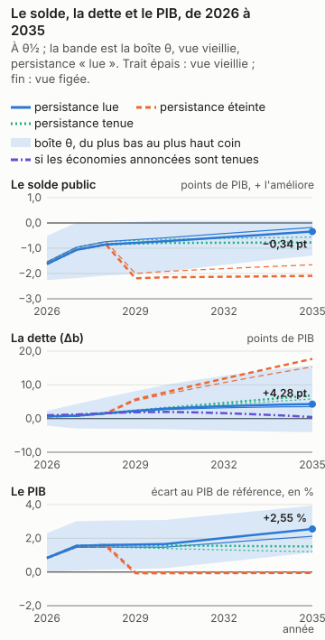
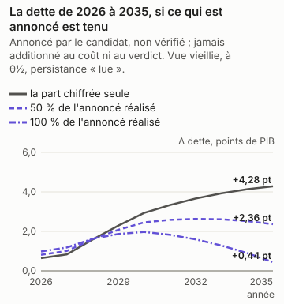
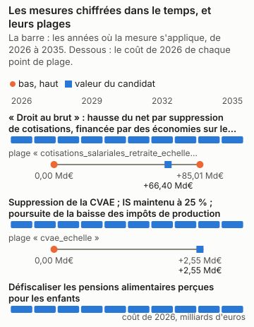

# Gabriel Attal : la part chiffrée du programme, en trois réponses

<!-- Généré par `impots etude ecrire presidentielle_attal` depuis reports/etudes/presidentielle_attal/ ; ne pas éditer à la main. -->

## Ce que dit cette étude

La part chiffrée du programme coûte 66,18 Md€ au budget sur le droit et les revenus de 2026, comme si elle s'appliquait cette année-là, avant tout changement de comportement. Les ménages y voient leur revenu disponible changer en moyenne de +214 € par an dans le dixième le plus modeste à +4 614 € dans le dixième le plus aisé ; les entreprises paient 2,55 Md€ de moins. L'outil ne dit pas ce que les comportements y changent : il n'ouvre pas aux cotisations des salariés le canal de l'offre de travail qu'il ouvre à la CSG, un choix du modèle, et la page dit pourquoi. En 2035, la dette publique serait plus haute de 4,28 points de PIB, au milieu des fourchettes publiées et sous les hypothèses de croissance, de taux et de dépense de la page ; la dette monte dans 65 % des tirages du calcul d'incertitude, et l'outil ne tranche pas : cette part du programme peut faire monter ou baisser la dette selon les hypothèses. L'effet sur l'activité n'est lu que pour l'impôt sur le revenu et les cotisations des salariés, pas pour la part des entreprises, qui agit sur la dette sans effet sur l'activité. Sans aucun effet sur l'activité, la dette serait plus haute de 20,45 points de PIB : le coût seul, sans la boucle macro. La boucle lit les cotisations des salariés dans la variante « cotisations sociales salariés » de Mésange (G2017/04, folio 110). Elle porte sur les salariés des branches marchandes et rend son effet par une baisse du salaire brut (−2,49 % à dix ans) et du coût du travail ; le coût de l'outil, lui, tient le salaire brut fixe, et tout va au salaire net. Le retour que la boucle lit est donc probablement surestimé, et la dette de tête trop basse d'autant, d'un écart que l'outil ne mesure pas. Le choc vaut jusqu'à 2,65 fois celui de la variante, d'un point de PIB, que la boucle lit comme linéaire. En regard du chiffre de tête, à θ½ et vue vieillie : si les salaires se forment comme dans la variante salariale de Mésange (un super-brut visé, folios 137 et 138), la dette serait plus haute de 8,91 points. Ces nombres valent pour la seule part chiffrée, pas pour le programme entier.

Gabriel Attal, Renaissance, a déclaré sa candidature à l'élection présidentielle de 2027. Son programme a été relevé le 12/11/2026 ; le relevé compte ses mesures, celles qui énoncent un paramètre, et celles que cet outil chiffre. Il dit plus bas pourquoi il ne chiffre pas les autres.

| mesures relevées | dont qui énoncent un paramètre | chiffrées par l'outil | part des mesures paramétrées |
|---|---|---|---|
| 37 | 21 | 3 | 14 % |

Pour la part chiffrée, ces mesures ensemble, trois réponses : ce qu'elle coûte et qui y gagne ; ce qu'elle coûte une fois les comportements et l'économie pris en compte ; ce qu'elle fait à la dette en 2035. **La dette porte sur la seule part du programme que l'outil chiffre, pas sur le programme : les mesures refusées, dites plus bas une à une avec leur « porte » (ce qui manque à l'outil pour les chiffrer), n'y sont pas, et un programme chiffré en partie peut paraître creuser ou baisser la dette pour une raison qui tient à l'outil (D-319).**

Chaque nombre dépend de ce qui est dit à côté de lui. Le coût de la première année est mécanique : personne ne change de comportement. La bande dit ce que les comportements y changent quand une étude publiée permet de le dire. La dette en 2035 dépend d'hypothèses de croissance, de taux et de dépenses nommées en bas de page, et de θ, la position de chaque réponse dans sa fourchette publiée : θ½ est le milieu, et les coins de la boîte placent chaque réponse aux deux bornes de sa fourchette. Le calcul d'incertitude (Monte-Carlo) tire aussi l'effet sur l'activité au-delà de ces bornes, de l'écart qui sépare les études entre elles : le verdict, qui le lit, et « selon θ », qui lit la boîte, peuvent donc différer.

## En bref

| programme | la première année | le chiffrage officiel | dette en 2035, à θ½ | verdict | selon θ |
|---|---|---|---|---|---|
| la part chiffrée (3 mesures sur 21 paramétrées, 37 relevées) | +66,18 Md€ | — | +4,28 pt | dépend (65 % des tirages en hausse) | dépend de θ |

Le verdict se lit sur le Monte-Carlo (D-345) : « hausse » quand au moins 90 % des tirages font monter la dette, vue vieillie, « baisse » quand au moins 90 % la font baisser, « dépend » entre les deux. « Selon θ » dit ce que la boîte θ en dit, sans probabilité : un seul signe à θ½ et à chaque coin, ou non.

Un coût positif coûte au budget, un coût négatif lui rapporte. La dette est en points de PIB, dans la vue vieillie et sous la persistance « lue » de l'effet macro de chaque mesure, Mésange lu à ses horizons ; « selon θ » lit les deux vues sous cette persistance seule (D-336). « Éteint » et « tenu » sont des sensibilités, données plus bas, hors du verdict.

## La part chiffrée

*Gabriel Attal (Renaissance), programme relevé le 2026-11-12 — la part chiffrée : a16_droit_au_brut, a18_suppression_cvae, a22_pensions_alimentaires*

3 mesures chiffrées sur 21 paramétrées et 37 relevées. La réforme est celle des mesures chiffrées du programme, ensemble, à la valeur du candidat ; les autres n'y sont pas.

### 1. Ce qu'il coûte, et qui y gagne

*Source du graphique : `reports/etudes/presidentielle_attal/premiere_annee_pres2027_attal_programme.json` ; tracé par `impots.graphiques`. Ses nombres reposent sur : L2, la simulation mécanique ; les déciles sont ceux de la population (L1).*

La part chiffrée coûte **66,18 Md€** la première année (2026) : +63,63 Md€ pour les ménages, sur la population de 2024 au droit de 2026, et +2,55 Md€ pour les entreprises, sur celles de 2023.

| décile | ménages | niveau de vie moyen | delta moyen | gagnants | perdants |
|---|---|---|---|---|---|
| 1 | 3 105 439 | 8 733 € | +214 € | 28 % | 0 % |
| 2 | 3 105 989 | 14 008 € | +525 € | 36 % | 0 % |
| 3 | 3 105 379 | 17 392 € | +1 054 € | 52 % | 0 % |
| 4 | 3 104 866 | 20 386 € | +1 291 € | 52 % | 0 % |
| 5 | 3 104 805 | 23 095 € | +1 748 € | 61 % | 0 % |
| 6 | 3 105 390 | 25 856 € | +1 979 € | 60 % | 0 % |
| 7 | 3 105 062 | 28 962 € | +2 179 € | 61 % | 0 % |
| 8 | 3 106 224 | 32 877 € | +2 404 € | 61 % | 0 % |
| 9 | 3 104 805 | 38 656 € | +2 818 € | 62 % | 0 % |
| 10 | 3 105 795 | 57 879 € | +4 614 € | 69 % | 0 % |

Les déciles sont ceux du niveau de vie de la population simulée. Toute structure
plus fine qu'un décile est un artefact de l'imputation, pas un résultat.

| taille | entreprises | touchées | impôt en plus |
|---|---|---|---|
| micro | 2 548 832 | 68 276 | -342 M€ |
| PME | 162 238 | 131 727 | -497 M€ |
| ETI | 6 995 | 6 995 | -782 M€ |
| GE | 311 | 311 | -930 M€ |

Population d'entreprises synthétique : effectifs et agrégats par secteur × taille issus de sources publiques, financiers de chaque entreprise tirés paramétriquement à l'intérieur de sa cellule. Résultats au niveau secteur × taille uniquement — aucun résultat par entreprise, aucune affirmation sur le haut de la distribution. La CFE n'est pas simulée : elle dépend de valeurs locatives communales et de milliers de taux locaux, et une imitation plausible serait pire qu'un trou déclaré.

### 2. Avec les comportements et l'économie

*Source du graphique : `reports/etudes/presidentielle_attal/premiere_annee_pres2027_attal_programme.json` et `reports/etudes/presidentielle_attal/predictif_pres2027_attal_programme.json` (sa décomposition, D-349) ; tracé par `impots.graphiques`. Ses nombres reposent sur : L2 pour le coût mécanique, L3 pour les comportements, L4 pour la dette, sous hypothèses.*

La bande et l'éventail ne lisent que la part des ménages : aucun canal des comportements ne lit une réforme des entreprises, et aucune variante de Mésange ne porte leurs impôts. La dette, plus bas, compte les deux parts.

**Bande comportementale : aucune, et la raison est donnée.** Ce n'est pas faute d'une étude publiée : les cotisations à la charge des salariés baissent le salaire net horaire comme la CSG, et l'outil chiffre la réponse des heures à la CSG sur les revenus d'activité (le canal de l'offre de travail, Bargain, Orsini et Peichl). C'est un choix du modèle de n'ouvrir ce canal qu'à la CSG (D-220) : une seule variation du salaire net par personne y suffit, l'assiette de la CSG étant presque tout le brut, quand celle des cotisations de retraite est en partie plafonnée ; le canal n'a pas été étendu aux cotisations. La mesure reste donc mécanique.

**Éventail macro : refusé.** L'éventail ne se compose pas quand les mesures poussent l'activité en sens contraires : il mêlerait les produits de l'une et de l'autre. La dette, plus bas, lit l'effet de chaque mesure sur l'activité à part, dans Mésange.

Ce que la chaîne ne lit pas, et pourquoi :

* **IS et investissement des entreprises** — aucune variante d'IS dans Mésange 2017, et aucune réestimation publiée depuis.
* **transferts** — Mésange n'a pas de variante de transfert.
* **créations d'entreprises** — C8 est un indice illustratif de la couche entreprises, en points de taux de création de sociétés, jamais une recette : la trajectoire chiffre le coût d'une baisse d'IS (D-244), pas les sociétés qu'elle ferait naître (§6.3, D-221).
* **R&D et CIR** — C9 est un indice illustratif de la couche entreprises, en euros de R&D, jamais une recette.

### 3. La dette en 2035

*Source du graphique : `reports/etudes/presidentielle_attal/predictif_pres2027_attal_programme.json`, rejoué année par année par `impots.predictif.rejouer`, qui redonne chacun de ses Δb et chaque coin de sa boîte ; tracé par `impots.graphiques`. Ses nombres reposent sur : L4, sous hypothèses : le cadre nommé en bas de page, et θ.*

| persistance | vue | Δ dette 2035, à θ½ | aux coins de la boîte |
|---|---|---|---|
| Effet macro lu dans Mésange à 1, 2, 3, 5 et 10 ans (spécification centrale), interpolé linéairement entre eux | vieillie | +4,28 pt | de -4,04 pt à +15,78 pt |
| Effet macro lu dans Mésange à 1, 2, 3, 5 et 10 ans (spécification centrale), interpolé linéairement entre eux | figée | +3,52 pt | de -3,47 pt à +13,25 pt |

En points de PIB de 2035, la dette avec la mesure moins la dette sans elle, l'effet macro lu dans Mésange à ses horizons (persistance « lue », D-336). La vue vieillie fait vieillir la population chaque année avec les salaires ; la vue figée la garde telle qu'elle est. Sous cette persistance, son effet sur la dette en 2035 **dépend de θ** : son signe change d'un coin de la boîte, ou d'une vue, à l'autre.

**Le verdict**, lu sur le Monte-Carlo (D-345) : son effet sur la dette en 2035 **dépend des hypothèses** : moins de 90 % des tirages s'accordent sur son signe, vue vieillie.

**Ce que la boucle lit, et ce que l'outil ne mesure pas.** La boucle lit les cotisations des salariés dans la variante « cotisations sociales salariés » de Mésange (G2017/04, folio 110). Elle porte sur les salariés des branches marchandes et rend son effet par une baisse du salaire brut (−2,49 % à dix ans) et du coût du travail ; le coût de l'outil, lui, tient le salaire brut fixe, et tout va au salaire net. Le retour que la boucle lit est donc probablement surestimé, et la dette de tête trop basse d'autant, d'un écart que l'outil ne mesure pas. Le choc vaut jusqu'à 2,65 fois celui de la variante, d'un point de PIB, que la boucle lit comme linéaire. En regard du chiffre de tête, à θ½ et vue vieillie : sans aucun effet sur l'activité, la dette serait plus haute de 20,45 points ; si les salaires se forment comme dans la variante salariale de Mésange (un super-brut visé, folios 137 et 138), la dette serait plus haute de 8,91 points.

**Les sensibilités, hors du verdict.** Les deux persistances que les pages lisaient avant la persistance « lue » (D-336), sur les mêmes passes : l'effet macro éteint après trois ans, ou tenu au niveau de la troisième année. Mésange ne porte ni l'une ni l'autre ; elles disent ce que le choix de la persistance pèse, et n'entrent pas dans le verdict.

| persistance | vue | Δ dette 2035, à θ½ | aux coins de la boîte |
|---|---|---|---|
| Effet macro éteint après trois ans | vieillie | +17,69 pt | de +15,07 pt à +20,29 pt |
| Effet macro éteint après trois ans | figée | +15,34 pt | de +13,39 pt à +17,28 pt |
| Effet macro tenu au niveau de la troisième année | vieillie | +6,87 pt | de -2,72 pt à +19,27 pt |
| Effet macro tenu au niveau de la troisième année | figée | +5,80 pt | de -2,32 pt à +16,34 pt |

**La distribution, à côté de la boîte.** La boîte dit jusqu'où Δb va quand chaque effet parcourt sa fourchette publiée : ce n'est pas une probabilité. Le Monte-Carlo en est une, sous des lois déclarées : Lois du magasin, ligne par ligne ; copule gaussienne de corrélation ρ entre les lignes d'un même article, indépendance entre articles ; décalage du multiplicateur normal centré réduit, multiplicateur Mésange + z × écart-type IMK censuré à zéro ; indépendant des lignes. (ρ = 0,8, 2000 tirages, persistance « lue », D-336). D'autres lois donneraient une autre réponse.

| vue | P(hausse de la dette en 2035) | quantile 5 % | médiane | quantile 95 % | ce qui pèse le plus (Sobol, total) |
|---|---|---|---|---|---|
| vieillie | 65 % | -5,01 pt | +4,66 pt | +20,27 pt | le multiplicateur 0,98 |
| figée | 64 % | -4,23 pt | +3,83 pt | +17,25 pt | le multiplicateur 0,98 |

**D'où vient Δb.** La dette de 2035 en trois marches, à θ½ sous la persistance « lue » : le coût après comportements, sans la boucle macro ; ce que le PIB plus haut ou plus bas change au seul ratio, comme dénominateur ; ce que les recettes induites par l'activité y changent. Les trois font la ligne du tableau (D-349).

| vue | le coût, sans boucle | le PIB, dénominateur | les recettes induites | Δ dette 2035 |
|---|---|---|---|---|
| vieillie | +20,45 pt | -3,09 pt | -13,08 pt | +4,28 pt |
| figée | +17,42 pt | -2,52 pt | -11,39 pt | +3,52 pt |

**Au taux de marché.** La dette ajoutée est chargée au taux implicite de 2025 (D-336). Chargée à 3,5 %, hypothèse déclarée d'une OAT à dix ans de fin 2026 : +4,93 pt en vue vieillie, contre +4,28 pt ; +4,09 pt en vue figée, contre +3,52 pt.

**Si les salaires se forment autrement.** Mésange publie une sensibilité de ses variantes à la formation des salaires (folios 137 et 138) : une courbe de Phillips pour les cotisations employeurs et la TVA, un super-brut visé pour les cotisations salariés, la CSG et l'IR. Le multiplicateur y est recentré, à écart-type, persistance et recettes induites par point de PIB inchangés ; Mésange n'imprime pas le solde de la variante, que la page suppose proportionnel au PIB (D-349). C'est une sensibilité, hors du verdict.

| vue | Δ dette 2035, à θ½ | aux coins de la boîte | P(hausse) | verdict |
|---|---|---|---|---|
| vieillie | +8,91 pt | de -1,93 pt à +20,18 pt | 78 % | dépend |
| figée | +7,69 pt | de -1,52 pt à +17,18 pt | 79 % | dépend |

### La dette en 2035, si les économies annoncées sont tenues et les dépenses annoncées faites

*Source du graphique : `reports/etudes/presidentielle_attal/predictif_pres2027_attal_programme.json`, `programmes/attal.json` et `reports/macro/variante_depense_publique.json`, lus par `impots.predictif.annonce` ; tracé par `impots.graphiques`. Ses nombres reposent sur : L4 pour la part chiffrée, sous hypothèses ; annoncé pour le reste.*

**Une lecture à part : annoncée par le candidat, non vérifiée.** La dette plus haut est celle de la part chiffrée ; les économies de dépense que le programme annonce, que l'outil ne microsimule pas, n'y entrent pas, et ses dépenses non plus (D-319). Ici, les montants par an que le candidat attache lui-même à ses mesures de dépense publique sont lus par la variante « dépense publique » de Mésange, son effet sur le PIB et sur le solde, et s'ajoutent à la dette de la part chiffrée. Ni le coût de la part chiffrée ni le verdict ne les lisent (D-380).

| mesure | montant annoncé, par an | sens | calendrier annoncé |
|---|---|---|---|
| « Frein d'urgence » dès l'arrivée à l'Élysée | +20,00 Md€ | économie | dès 2027 ; compris dans les 150 Md€ du quinquennat (a1) : ne pas additionner |
| Suppression d'un échelon de collectivité (« big bang territorial ») | +7,00 Md€ | économie | chaque année (« plus de 7 milliards ») ; comprise dans les 150 Md€ du quinquennat (a1) : ne pas additionner |
| Doublement des subventions à la géoénergie, financé sur des budgets sous-consommés (biomasse) | +160 M€ | dépense | par an dès 2027 : le niveau des subventions doublées (la moitié existe déjà), que le candidat dit financé par des budgets sous-consommés, « sans dépense supplémentaire » |

| part réalisée | solde annoncé, par an | Δ dette 2035, vue vieillie | Δ dette 2035, vue figée |
|---|---|---|---|
| 0 % | +0 € | +4,28 pt | +3,52 pt |
| 50 % | +13,42 Md€ | +2,36 pt | +1,59 pt |
| 100 % | +26,84 Md€ | +0,44 pt | -0,35 pt |

À θ½, sous la persistance « lue ». À une part réalisée nulle, la ligne est la dette de la part chiffrée, plus haut ; le solde est positif quand il améliore les comptes publics.

**Ce que la variante suppose.** La variante « dépense publique » de Mésange est un composite, pas un instrument (D-214, page 106 du PDF) : 8 % d'investissement public, 25 % de rémunérations publiques, 9 % de prestations en nature, 12 % de consommations intermédiaires, 46 % de prestations sociales en espèces. La lire suppose que chaque euro annoncé tombe sur la dépense dans ces proportions, quoi que la mesure dise ; les transferts n'ont pas de variante à eux, et une économie sur les prestations lit la même moyenne. Montant atteint dès la première année du chemin et tenu en part du PIB de cette année-là : le calendrier que le candidat énonce est montré, pas lu. Choc de la variante en volume, lu comme des euros : prix de la réforme tenus constants (D-214, condition 4). Ligne de solde lue sous la dépense gelée en volume seule (note 70, D-214). Variantes superposées : Mésange est linéaire (D-230), et ce qu'annonce le candidat s'ajoute à la part chiffrée sans interaction.

**Pas lues** — un montant par an dans le paramètre, sans sens ni horizon déclarés : à porter dans `declare` pour être lu : Plan d'économies sur le quinquennat, deux tiers sur le social.

**Pas lues** — hors de la dépense publique : sa porte relève d'un autre module (retraites, prestations, salaires, entreprises) : Pilier de capitalisation et plan d'épargne retraite ouvert par l'État à chaque naissance, abondable jusqu'à 18 ans avec avantage fiscal.

*Annoncé par le candidat, non vérifié ; jamais additionné au coût de l'outil ni au verdict (D-319, D-380).*

### L'écart au chiffrage officiel

La part chiffrée n'est pas un cas enregistré : ses mesures le sont, une à une, avant que le juge ne publie. Le juge est le chiffrage des programmes de l'Institut Montaigne, attendu au premier trimestre 2027.

* `pres2027_attal_a16_droit_au_brut`, enregistré le 2026-11-01 : +75,66 Md€ en 2026, tolérance de 25 % ou 200 M€ ; le juge n'a pas publié.
* `pres2027_attal_a18_suppression_cvae`, enregistré le 2026-11-01 : +3,53 Md€ en 2026, tolérance de 30 % ou 200 M€ ; le juge n'a pas publié.
* `pres2027_attal_a22_pensions_alimentaires`, enregistré le 2026-11-12 : +219 M€ en 2026, tolérance de 25 % ou 200 M€ ; le juge n'a pas publié.

## Chaque mesure seule, et leur interaction

Chaque mesure chiffrée passe aussi seule, en entier : sa première année et son chemin annuel jusqu'en 2035, dans le cadre de la part chiffrée, sur la même population et le même code. La part chiffrée n'est pas la somme de ses mesures : deux mesures se rencontrent dans le barème, dans les prestations sous condition de ressources, dans la boucle macro, et dans la dette, que chacune creuse sur le PIB que l'autre a changé. L'écart, la part chiffrée moins la somme des mesures, est dit sur sa ligne, « interaction » : il n'est réparti entre aucune mesure.

**Les mesures seules : absentes, et la raison est donnée.** Les passes des mesures seules n'ont pas tourné : `impots etude lancer presidentielle_attal` les lance, après celles de la part chiffrée. Les rapports de cette page viennent d'une série qui ne les avait pas.

## Ce que bouge chaque paramètre

Chaque mesure chiffrée a une plage : le lecteur peut la régler, du bas au haut. Trois points la parcourent, le bas, la valeur du candidat et le haut. Chaque point est la mesure seule, mécanique (personne ne change de comportement), sur la population vieillie jusqu'en 2026 ; sa dette reporte la première année en part de PIB jusqu'en 2035, un calcul rapide qui ne refait pas chaque année. Elle ne se compare donc pas à celle de la part chiffrée, plus haut, que le calcul complet chiffre année par année avec les comportements et la boucle macro. Leur coût diffère aussi de celui de la part chiffrée : celle-ci est chiffrée sur la population de 2024 au droit de 2026, les plages sur la population vieillie jusqu'en 2026. Quand un programme a plusieurs paramètres, chacun se règle seul, les autres restant à la valeur du candidat.

*Source du graphique : `programmes/attal.json` et `reports/etudes/presidentielle_attal/plages/`, ses 6 points de plage ; tracé par `impots.graphiques`. Ses nombres reposent sur : L2 pour les coûts ; la valeur du candidat est celle du programme, le bas et le haut des hypothèses.*

### « Droit au brut » : hausse du net par suppression de cotisations, financée par des économies sur le modèle social

*Le programme : +250 € nets/mois au salaire médian (2 200 € nets), dès début 2027.*

Ce que l'outil en lit : Au salaire médian de 2026 (34 000 € brut par an, 2 243 € nets par mois), supprimer toutes les cotisations retraite salariales rend 3 845 € nets par an (mesuré par le moteur). Le candidat énonce un gain, +250 € nets par mois au salaire médian, pas un taux : l'échelle de 0,22 rend 3 000 € par an. Elle s'applique à tous les salaires, ce que la mesure ne précise pas. Plage de 0 (toutes supprimées) à 1 (la mesure retirée).

| `cotisations_salariales_retraite_echelle` | valeur | coût 2026 | dette en 2035, mécanique, sans comportements ni boucle |
|---|---|---|---|
| le bas | 0 | +85,01 Md€ | +26,26 pt |
| le candidat | 0,22 | +66,40 Md€ | +20,51 pt |
| le haut | 1 | +0 € | +0,00 pt |

### Suppression de la CVAE ; IS maintenu à 25 % ; poursuite de la baisse des impôts de production

*Le programme : CVAE = 0 ; IS à 25 %.*

Ce que l'outil en lit : La CVAE est supprimée sur le droit de 2026 (son barème mis à l'échelle 0). L'IS reste à 25 %, son taux de 2026 : aucun bouton à régler. La « poursuite de la baisse des impôts de production » n'a pas de taux et n'est pas chiffrée. La plage va de la suppression (0) au droit de 2026 (1).

| `cvae_echelle` | valeur | coût 2026 | dette en 2035, mécanique, sans comportements ni boucle |
|---|---|---|---|
| le bas | 0 | +2,55 Md€ | absente |
| le candidat | 0 | +2,55 Md€ | absente |
| le haut | 1 | +0 € | absente |

**Dette : absente, et la raison est donnée.** Le droit que règle « cvae_echelle » en 2028 change dans l'horizon : reporter la première année, comme le fait ce calcul rapide, la tiendrait à tort à son droit de 2026 jusqu'en 2035. La dette de la valeur du candidat est celle de la part chiffrée, que le calcul complet chiffre chaque année sous le droit de cette année (D-254).

### Défiscaliser les pensions alimentaires perçues pour les enfants

*Le programme : exclusion du revenu imposable.*

Ce que l'outil en lit : « Pour les enfants » : toutes celles qu'impute la population le sont. Les pensions alimentaires perçues (1AO à 1DO) sortent du revenu imposable du parent qui les reçoit, entières : le bouton de l'étape 4 (D-383), sans plafond par enfant. Les pensions sont celles qu'impute la population, perçues par les parents isolés pour leurs enfants (5,55 Md€ en 2024, vieillies par les prix) : celles que reçoit un parent en couple ou un ex-conjoint pour lui-même ne sont pas portées. Les prestations qui comptent la pension ne bougent pas. Contre le droit de 2026. Pas de plage : la mesure est un oui ou un non.

## Le programme, mesure par mesure

Une mesure est chiffrée, refusée ou vague. Une mesure refusée n'est pas une mesure à zéro : sa « porte » dit ce qui manque à l'outil, ce qu'il devrait savoir faire pour la chiffrer. Une mesure vague n'énonce ni taux ni montant.

| mesure | ce que dit le candidat | sort | pourquoi |
|---|---|---|---|
| Plan d'économies sur le quinquennat, deux tiers sur le social | 150 Md€ sur 5 ans — montant annoncé : 150 Md€ (total sur le quinquennat (cinq ans), sans calendrier annuel donné par le candidat ; comprend le frein d'urgence de 20 Md€ (a2) et les 7 Md€ par an de l'organisation (a9) : ne pas additionner) ; non lu comme montant annuel : un total sur le quinquennat, sans annuel (D-381). | refusée : la dépense publique (`depense_publique`) | Un plan d'économies sans dépense désignée une à une : la dépense n'est qu'un scénario du calcul de la dette. |
| « Frein d'urgence » dès l'arrivée à l'Élysée | 20 Md€ dès 2027 | refusée : la dépense publique (`depense_publique`) | Des économies sans dépense désignée : la dépense n'est qu'un scénario du calcul de la dette. |
| Déficit public sous 3 % avant 2032 | < 3 % du PIB avant 2032 | refusée : une hypothèse du calcul de la dette (`chaine`) | Une trajectoire de déficit est une hypothèse du calcul de la dette, pas une réforme : aucun bouton ne la règle. |
| Zéro déficit en 2037, inscrit dans une loi de programmation sur dix ans | 0 % du PIB en 2037 | refusée : une hypothèse du calcul de la dette (`chaine`) | Une trajectoire de déficit est une hypothèse du calcul de la dette, pas une réforme : aucun bouton ne la règle. |
| Équilibre strict de la Sécurité sociale | équilibre en 2032 (page mesure) ; « en trois ans » (lettre du 15/10/2026) : les deux se contredisent | refusée : une hypothèse du calcul de la dette (`chaine`) | Un solde cible de la Sécurité sociale est une hypothèse du calcul de la dette, pas une réforme : aucun bouton ne le règle. |
| Double règle d'or (budgets à l'équilibre d'ici dix ans ; dépenses courantes au plus égales aux dépenses d'avenir), par référendum, instaurée en sept ans | équilibre d'ici 10 ans ; règle en 7 ans | refusée : une hypothèse du calcul de la dette (`chaine`) | Une règle d'or est une hypothèse du calcul de la dette (un solde et une dépense cibles), pas une réforme. |
| « Impunité zéro » : départ des ministres qui ne tiennent pas leur budget ; démission du gouvernement après 3 ans de dérive sans crise | 3 ans | vague | Une sanction politique, sans taux ni montant. |
| Suppression de postes dans l'État et les collectivités, par départs volontaires avec prime et non-remplacement, sans licenciement ; Éducation, Armées, Justice et Intérieur épargnés | 100 000 postes | refusée : la dépense publique (`depense_publique`) | Les effectifs publics sont une dépense que le moteur ne microsimule pas : seulement un scénario de dépense du calcul de la dette. |
| Suppression d'un échelon de collectivité (« big bang territorial ») | 1 échelon ; plus de 7 Md€ d'économies par an (lettre du 15/10/2026) | vague | L'échelon supprimé n'est pas nommé : seule l'économie est chiffrée, et la dépense des collectivités n'est pas microsimulée. |
| « Année blanche » sur l'ensemble des prestations sociales au budget 2028, petites retraites épargnées | gel en 2028 | refusée : l'indexation année par année (`indexation`) | Le bouton existe (indexations, un coefficient par prestation et par année), mais les « petites retraites épargnées » demandent un seuil de pension que le bouton, uniforme, ne dit pas. Le gel tombe en 2028 ; il se mesurerait contre l'indexation légale sur les prix, la référence du but 21. |
| Réforme de l'assurance chômage dès le début du mandat ; économies réaffectées à la baisse des cotisations | 5 Md€ d'économies ; ≥ 100 000 emplois | refusée : une prestation que le moteur ne porte pas (`prestations_hors_modele`) | L'assurance chômage n'est pas dans le moteur, et la baisse de cotisations qu'elle financerait n'a pas de taux. |
| Plan contre la dérive des arrêts maladie | non chiffré | vague | Ni mesure ni montant : un plan annoncé. |
| Système universel sans âge légal : départ selon la durée de cotisation, avec décote et surcote | aucun paramètre | vague | Ni durée de cotisation, ni taux de décote ou de surcote. |
| Pilier de capitalisation et plan d'épargne retraite ouvert par l'État à chaque naissance, abondable jusqu'à 18 ans avec avantage fiscal | 1 000 € à la naissance ; 660 M€ par an | refusée : les droits à la retraite (`retraites`) | Un plan d'épargne retraite doté de 1 000 € à la naissance : la population ne porte ni épargne retraite ni régime par capitalisation. |
| Fléchage obligatoire de l'intéressement et de la participation vers l'épargne retraite | 50 % | refusée : une donnée des ménages (`donnee_menages`) | L'intéressement, la participation et l'épargne retraite ne sont pas dans la population. |
| « Droit au brut » : hausse du net par suppression de cotisations, financée par des économies sur le modèle social | +250 € nets/mois au salaire médian (2 200 € nets), dès début 2027 | chiffrée | Au salaire médian de 2026 (34 000 € brut par an, 2 243 € nets par mois), supprimer toutes les cotisations retraite salariales rend 3 845 € nets par an (mesuré par le moteur). Le candidat énonce un gain, +250 € nets par mois au salaire médian, pas un taux : l'échelle de 0,22 rend 3 000 € par an. Elle s'applique à tous les salaires, ce que la mesure ne précise pas. Plage de 0 (toutes supprimées) à 1 (la mesure retirée). |
| Aucune hausse d'impôts pendant 5 ans ; retour sur « plusieurs taxes décidées depuis la dissolution » | 0 hausse sur 5 ans | vague | Aucune taxe nommée ni chiffrée : un engagement, pas un paramètre. |
| Suppression de la CVAE ; IS maintenu à 25 % ; poursuite de la baisse des impôts de production | CVAE = 0 ; IS à 25 % | chiffrée | La CVAE est supprimée sur le droit de 2026 (son barème mis à l'échelle 0). L'IS reste à 25 %, son taux de 2026 : aucun bouton à régler. La « poursuite de la baisse des impôts de production » n'a pas de taux et n'est pas chiffrée. La plage va de la suppression (0) au droit de 2026 (1). |
| Loi de programmation économique, fiscale et énergétique sur dix ans, qui garantit le CIR et le pacte Dutreil | 10 ans | vague | Une durée sans taux ni montant : la stabilité promise ne règle aucun paramètre. |
| Crédit d'impôt productivité pour l'adoption de l'IA par les PME et ETI | non chiffré | vague | Ni taux ni assiette du crédit d'impôt. |
| Pas de hausse des droits de succession ni de la fiscalité de l'assurance-vie ; faciliter les donations aux petits-enfants comme aux enfants | aucun montant | vague | Ni abattement ni barème énoncés. |
| Défiscaliser les pensions alimentaires perçues pour les enfants | exclusion du revenu imposable | chiffrée | « Pour les enfants » : toutes celles qu'impute la population le sont. Les pensions alimentaires perçues (1AO à 1DO) sortent du revenu imposable du parent qui les reçoit, entières : le bouton de l'étape 4 (D-383), sans plafond par enfant. Les pensions sont celles qu'impute la population, perçues par les parents isolés pour leurs enfants (5,55 Md€ en 2024, vieillies par les prix) : celles que reçoit un parent en couple ou un ex-conjoint pour lui-même ne sont pas portées. Les prestations qui comptent la pension ne bougent pas. Contre le droit de 2026. Pas de plage : la mesure est un oui ou un non. |
| Revalorisation des enseignants | +200 € nets/mois dès la rentrée 2027, jusqu'à +500 € en milieu de carrière | refusée : la distribution des salaires (`salaires`) | Le traitement des enseignants est un salaire public : la population ne les distingue pas, et ses salaires sont des données. |
| Plan IA « France 2040 », à parité public et privé ; part publique financée par des économies (arrêts maladie, gel des prestations) | 200 Md€ sur 10 ans — montant annoncé : 100 Md€ (total sur dix ans : la moitié publique des 200 Md€ « partagés à égalité entre financement public et privé » ; aucun montant annuel donné) ; non lu comme montant annuel : un total sur dix ans (D-381). | refusée : la dépense publique (`depense_publique`) | Un investissement public sur dix ans est une dépense que le moteur ne microsimule pas. |
| Plan Eau financé par redéploiement de crédits | 600 M€ (400 du Plan eau, 200 du Fonds vert) | refusée : la dépense publique (`depense_publique`) | Un redéploiement de 600 M€ de crédits est une dépense que le moteur ne microsimule pas. |
| Bouclier tarifaire sur le prix de l'eau du quotidien | non chiffré | vague | Ni prix plafond ni montant. |
| Carburant : aides directes ciblées sur les travailleurs dépendants de leur véhicule, plutôt qu'une baisse générale de taxes | non chiffré, aide « temporaire et ciblée » | vague | Ni montant de l'aide ni public chiffré. |
| Stabilité des prix de l'électricité sur cinq ans | 5 ans (pas de niveau de prix) | vague | Une durée sans niveau de prix. |
| Plan « Messmer II » : 14 EPR, part des fossiles à 30 % en 2035, prix cibles de l'électricité | ≈ 75 €/MWh (nouveau nucléaire) ; < 50 €/MWh (industriels exposés) ; fossiles 40 % en 2030 et 30 % en 2035 | refusée : un secteur hors du modèle (`secteur`) | Le nucléaire et le prix de l'électricité sont un secteur hors du modèle : ni parc, ni prix de gros, ni facture des ménages. |
| Leasing social élargi aux voitures électriques d'occasion, bonus électrique sur l'occasion | non chiffré | vague | Ni montant du bonus ni loyer du leasing. |
| Doublement des subventions à la géoénergie, financé sur des budgets sous-consommés (biomasse) | 160 M€/an dès début 2027 | refusée : la dépense publique (`depense_publique`) | Une subvention de 160 M€ par an est une dépense que le moteur ne microsimule pas. |
| Extension de l'intéressement aux petites structures | non chiffré | vague | Ni seuil d'effectif ni régime fiscal ou social énoncés. |
| Réduire d'un quart la charge administrative des entreprises | −25 % | refusée : rien, une formalité (`hors_champ`) | La charge administrative est une formalité : ni impôt ni prestation que le moteur porte. |
| Prélèvement sur les revenus des réseaux sociaux en France, affecté à la santé mentale des jeunes | 2 % des revenus des réseaux sociaux en France | refusée : un secteur hors du modèle (`secteur`) | Un prélèvement sur le chiffre d'affaires des réseaux sociaux : ce secteur numérique n'est pas une assiette du modèle des entreprises. |
| Carte « famille monoparentale » (transports, loisirs, culture, vacances, garde d'enfants), sur le modèle de la carte famille nombreuse | aucun montant ni taux de réduction | vague | Ni réduction chiffrée ni montant : des avantages annoncés. |
| « Droit au répit » : heures de garde en soirée, le week-end et en urgence pour les parents seuls, avec les CAF et les collectivités | aucun nombre d'heures ni montant | vague | Ni nombre d'heures, ni prise en charge, ni montant. |
| Fiscalité du portage du foncier agricole revue, pour la transmission et l'installation des jeunes agriculteurs | aucun taux ni abattement | vague | Ni impôt désigné, ni taux, ni abattement. |

Les portes, de celle qui ouvrirait le plus de mesures à celle qui en ouvrirait le moins :

* 6 mesures — la dépense publique, que le moteur ne simule pas ménage par ménage : elle n'entre dans la dette que comme une hypothèse de dépense (`depense_publique`).
* 4 mesures — une hypothèse du calcul de la dette année par année, pas une réforme : règle budgétaire, trajectoire de déficit (`chaine`).
* 2 mesures — l'assiette d'un secteur hors du modèle : audiovisuel, nucléaire, aérien, infrastructures, dépôts, justice (`secteur`).
* 1 mesure — une donnée des ménages : plus-values, épargne, logement (`donnee_menages`).
* 1 mesure — rien : une formalité ou une procédure (`hors_champ`).
* 1 mesure — l'indexation des pensions et des prestations année par année (`indexation`).
* 1 mesure — une prestation que le moteur ne porte pas : assurance chômage, prestation fusionnée ou neuve (`prestations_hors_modele`).
* 1 mesure — les droits à la retraite (âges, durées, régimes) : la population ne vieillit pas en âge et ses pensions sont des données (`retraites`).
* 1 mesure — la distribution des salaires : SMIC, point d'indice, indexation des salaires (`salaires`).

## Ce que le candidat annonce, à part

Le programme annonce lui-même un montant pour 4 de ses mesures. Ces montants ne sont pas vérifiés et ne s'ajoutent jamais au chiffrage de l'outil : la part réalisée dit ce qui s'en réaliserait, de rien à tout. Le solde est l'effet annoncé sur les comptes publics, positif quand ils s'améliorent. Le relevé, fait à la main, ne retient que les montants que le programme attache à une mesure comme un effet annuel ; d'autres montants cités dans le tableau des mesures (des totaux sur plusieurs années, des enveloppes) n'y sont pas, et il peut en avoir manqué (D-378).

| part réalisée | solde annoncé |
|---|---|
| 0 % | +0 € |
| 50 % | +13,09 Md€ |
| 100 % | +26,18 Md€ |

*déclaré par le candidat, non vérifié ; jamais additionné au chiffrage du moteur (D-319)*

## Ce qui a bougé depuis la série précédente

La série précédente a tourné sur `601b442` ; ce qu'elle disait est figé dans `reports/etudes/presidentielle_attal/avant/serie.json` avant que celle-ci ne remplace ses rapports (D-350). Son verdict lisait la boîte θ ; celui-ci lit le Monte-Carlo.

| | la première année, avant → après | dette à θ½, avant → après | verdict, avant → après |
|---|---|---|---|
| la part chiffrée (3 mesures sur 21 paramétrées, 37 relevées) | +65,69 Md€ → +66,18 Md€ | +4,21 pt → +4,28 pt | dépend de θ → dépend |

Ce qui touche chaque ligne :

* **la part chiffrée (3 mesures sur 21 paramétrées, 37 relevées)** : le secteur public modélisé statut par statut (D-346), la CVAE et la C3S déduites de l'IS (D-347), le verdict lu sur le Monte-Carlo (D-345).

Là où une seule correction touche une ligne, l'écart avant → après est ce qu'elle pèse (D-352) ; ailleurs, les corrections ne se séparent pas sans un calcul refait sans chacune, qui n'est pas fait.

## D'où viennent ces nombres

Les passes ont tourné sur 2 commits, conteneur cloud, 15 Go, 4 cœurs, deux files ; chaque rapport nomme le sien. Un commit après le premier rejoint l'étude quand sa passe témoin, `plages/a16_droit_au_brut__cotisations_salariales_retraite_echelle__bas.json` rejouée sur lui, redonne son rapport à l'identique, hors date, commit et lieu (D-335) :

* `aa22293`, le premier.
* `d4f3f7f`, rejoint par `reports/etudes/presidentielle_attal/temoins/d4f3f7f.json`, témoin du 2026-11-13.

Cadre du calcul année par année jusqu'en 2035 : Croissance réelle 1 %, prix 2 % ; Taux implicite tenu à son niveau de 2025 ; Dépenses gelées en volume ; droit reconduit tel qu'openfisca le porte ; θ½ sur toutes les lignes ; comportements et boucle macro appliqués.

*Population vieillie mécaniquement de 2024 à 2035 — salaires 3,0 % par an, prix 2,0 % par an, hypothèses DÉCLARÉES et non prévues (3 % ronds, le rythme du PIB nominal du scénario). La structure des ménages, les âges et les poids n'ont PAS bougé : c'est la France de l'année de base avec l'argent de l'année d'arrivée, et cela biaise vers l'immobilité démographique. **Cette population n'est plus calibrée** : les totaux dépensés au registre le sont sur l'année de base, et il n'existe pas de total publié pour une année future. Toute ligne de réconciliation sur cette année refuse un verdict de tolérance plutôt que d'en donner un qui se lirait comme une validation.*

Le secteur public est modélisé statut par statut (D-346) : un titulaire est payé d'un traitement indiciaire et de primes, et cotise à son régime ; un contractuel cotise au régime général, sans allègement. L'enquête Emploi dit titulaire ou contractuel et la fonction publique, pas le corps ni l'indice : la part des primes est la moyenne qu'openfisca porte, la même pour tous.

**La vérification de ses instruments.** Le niveau que le moteur donne à chaque instrument que la page chiffre, contre son total publié, sur 2022, 2023 et 2024 (`docs/verification/GRILLE.md`, D-364) : l'écart moyen, son étendue, et les années qui tiennent la tolérance écrite avant le calcul.

* Cotisations à la charge des salariés : −9,7 % en moyenne, de −11,0 % à −8,2 % ; 2 années sur 3 dans sa tolérance.
* Foyers imposés : +6,2 % en moyenne, de +2,1 % à +9,4 % ; 3 années sur 3 dans sa tolérance.
* Impôt sur le revenu au barème, avant réductions et crédits : −7,9 % en moyenne, de −9,8 % à −6,0 % ; 2 années sur 2 dans sa tolérance.

Un écart de niveau ne se reporte pas tel quel sur le chiffrage : le coût d'une mesure est la différence de deux passes sur la même population, et ce qui manque aux deux passes s'y annule en partie.

* `reports/etudes/presidentielle_attal/premiere_annee_pres2027_attal_programme.json`, `reports/etudes/presidentielle_attal/predictif_pres2027_attal_programme.json`
* `reports/etudes/presidentielle_attal/plages/`, les 6 points des plages
* `reports/etudes/presidentielle_attal/mesures/<mesure>/`, la première année et le chemin de chaque mesure seule
