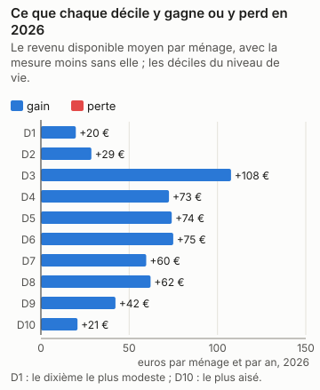
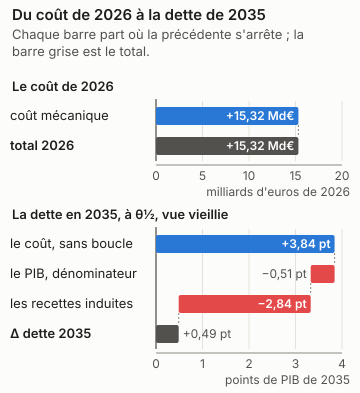
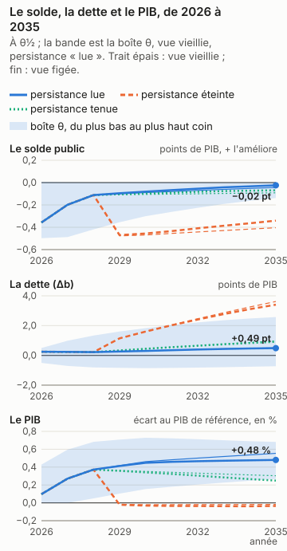
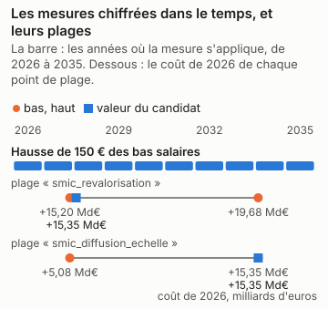

# Karim Bouamrane : la part chiffrée du programme, en trois réponses

<!-- Généré par `impots etude ecrire presidentielle_bouamrane` depuis reports/etudes/presidentielle_bouamrane/ ; ne pas éditer à la main. -->

## Ce que dit cette étude

La part chiffrée du programme coûte 15,32 Md€ au budget sur le droit et les revenus de 2026, comme si elle s'appliquait cette année-là, avant tout changement de comportement. Les ménages y voient leur revenu disponible changer en moyenne de +20 € par an dans le dixième le plus modeste à +21 € dans le dixième le plus aisé, le plus touché étant le 3e dixième (+108 €). L'outil ne dit pas ce que les comportements y changent : aucune étude publiée ne le permet ici, et la page dit pourquoi. En 2035, la dette publique serait plus haute de 0,49 point de PIB, au milieu des fourchettes publiées et sous les hypothèses de croissance, de taux et de dépense de la page ; la dette monte dans 59 % des tirages du calcul d'incertitude, et l'outil ne tranche pas : cette part du programme peut faire monter ou baisser la dette selon les hypothèses. L'effet sur l'activité n'est lu que pour l'impôt sur le revenu, la CSG, les cotisations des salariés et les cotisations des employeurs. Sans aucun effet sur l'activité, la dette serait plus haute de 3,84 points de PIB : le coût seul, sans la boucle macro. La boucle lit les cotisations des salariés dans la variante « cotisations sociales salariés » de Mésange (G2017/04, folio 110). Elle porte sur les salariés des branches marchandes et rend son effet par une baisse du salaire brut (−2,49 % à dix ans) et du coût du travail ; le coût de l'outil, lui, tient le salaire brut fixe, et tout va au salaire net. Le retour que la boucle lit est donc probablement surestimé, et la dette de tête trop basse d'autant, d'un écart que l'outil ne mesure pas. Le choc vaut jusqu'à 0,01 fois celui de la variante, d'un point de PIB, que la boucle lit comme linéaire. En regard du chiffre de tête, à θ½ et vue vieillie : si les salaires se forment comme dans la variante salariale de Mésange (un super-brut visé, folios 137 et 138), la dette serait plus haute de 1,12 point. Ces nombres valent pour la seule part chiffrée, pas pour le programme entier.

Karim Bouamrane, PS, a déclaré sa candidature à l'élection présidentielle de 2027. Son programme a été relevé le 12/11/2026 ; le relevé compte ses mesures, celles qui énoncent un paramètre, et celles que cet outil chiffre. Il dit plus bas pourquoi il ne chiffre pas les autres.

| mesures relevées | dont qui énoncent un paramètre | chiffrées par l'outil | part des mesures paramétrées |
|---|---|---|---|
| 4 | 1 | 1 | 100 % |

Pour la part chiffrée, cette seule mesure, trois réponses : ce qu'elle coûte et qui y gagne ; ce qu'elle coûte une fois les comportements et l'économie pris en compte ; ce qu'elle fait à la dette en 2035. **La dette porte sur la seule part du programme que l'outil chiffre, pas sur le programme : les mesures refusées, dites plus bas une à une avec leur « porte » (ce qui manque à l'outil pour les chiffrer), n'y sont pas, et un programme chiffré en partie peut paraître creuser ou baisser la dette pour une raison qui tient à l'outil (D-319).**

Chaque nombre dépend de ce qui est dit à côté de lui. Le coût de la première année est mécanique : personne ne change de comportement. La bande dit ce que les comportements y changent quand une étude publiée permet de le dire. La dette en 2035 dépend d'hypothèses de croissance, de taux et de dépenses nommées en bas de page, et de θ, la position de chaque réponse dans sa fourchette publiée : θ½ est le milieu, et les coins de la boîte placent chaque réponse aux deux bornes de sa fourchette. Le calcul d'incertitude (Monte-Carlo) tire aussi l'effet sur l'activité au-delà de ces bornes, de l'écart qui sépare les études entre elles : le verdict, qui le lit, et « selon θ », qui lit la boîte, peuvent donc différer.

## En bref

| programme | la première année | le chiffrage officiel | dette en 2035, à θ½ | verdict | selon θ |
|---|---|---|---|---|---|
| la part chiffrée (1 mesure sur 1 paramétrée, 4 relevées) | +15,32 Md€ | — | +0,49 pt | dépend (59 % des tirages en hausse) | dépend de θ |

Le verdict se lit sur le Monte-Carlo (D-345) : « hausse » quand au moins 90 % des tirages font monter la dette, vue vieillie, « baisse » quand au moins 90 % la font baisser, « dépend » entre les deux. « Selon θ » dit ce que la boîte θ en dit, sans probabilité : un seul signe à θ½ et à chaque coin, ou non.

Un coût positif coûte au budget, un coût négatif lui rapporte. La dette est en points de PIB, dans la vue vieillie et sous la persistance « lue » de l'effet macro de chaque mesure, Mésange lu à ses horizons ; « selon θ » lit les deux vues sous cette persistance seule (D-336). « Éteint » et « tenu » sont des sensibilités, données plus bas, hors du verdict.

## La part chiffrée

*Karim Bouamrane (PS), programme relevé le 2026-11-12 — la part chiffrée : hausse_salaires_150*

1 mesures chiffrées sur 1 paramétrées et 4 relevées. La réforme est celle des mesures chiffrées du programme, ensemble, à la valeur du candidat ; les autres n'y sont pas.

### 1. Ce qu'il coûte, et qui y gagne

*Source du graphique : `reports/etudes/presidentielle_bouamrane/premiere_annee_pres2027_bouamrane_programme.json` ; tracé par `impots.graphiques`. Ses nombres reposent sur : L2, la simulation mécanique ; les déciles sont ceux de la population (L1).*

La mesure coûte **15,32 Md€** la première année (2026), sur la population de 2024 au droit de 2026.

| décile | ménages | niveau de vie moyen | delta moyen | gagnants | perdants |
|---|---|---|---|---|---|
| 1 | 3 105 392 | 9 086 € | +20 € | 8 % | 10 % |
| 2 | 3 106 035 | 14 127 € | +29 € | 8 % | 19 % |
| 3 | 3 105 379 | 17 504 € | +108 € | 17 % | 18 % |
| 4 | 3 104 866 | 20 518 € | +73 € | 13 % | 22 % |
| 5 | 3 104 805 | 23 184 € | +74 € | 11 % | 8 % |
| 6 | 3 105 390 | 25 938 € | +75 € | 11 % | 5 % |
| 7 | 3 105 062 | 29 037 € | +60 € | 10 % | 5 % |
| 8 | 3 105 369 | 32 966 € | +62 € | 9 % | 3 % |
| 9 | 3 105 660 | 38 679 € | +42 € | 7 % | 3 % |
| 10 | 3 105 795 | 57 952 € | +21 € | 4 % | 2 % |

Les déciles sont ceux du niveau de vie de la population simulée. Toute structure
plus fine qu'un décile est un artefact de l'imputation, pas un résultat.

### 2. Avec les comportements et l'économie

*Source du graphique : `reports/etudes/presidentielle_bouamrane/premiere_annee_pres2027_bouamrane_programme.json` et `reports/etudes/presidentielle_bouamrane/predictif_pres2027_bouamrane_programme.json` (sa décomposition, D-349) ; tracé par `impots.graphiques`. Ses nombres reposent sur : L2 pour le coût mécanique, L3 pour les comportements, L4 pour la dette, sous hypothèses.*

**Bande comportementale : aucune, et la raison est donnée.** Cette réforme est plus grande que celles sur lesquelles les élasticités ont été estimées : la bande est une extrapolation, élargie et signalée comme telle.

**Éventail macro : refusé.** L'éventail ne se compose pas quand les mesures poussent l'activité en sens contraires : il mêlerait les produits de l'une et de l'autre. La dette, plus bas, lit l'effet de chaque mesure sur l'activité à part, dans Mésange.

Ce que la chaîne ne lit pas, et pourquoi :

* **IS et investissement des entreprises** — aucune variante d'IS dans Mésange 2017, et aucune réestimation publiée depuis.
* **transferts** — Mésange n'a pas de variante de transfert.
* **créations d'entreprises** — C8 est un indice illustratif de la couche entreprises, en points de taux de création de sociétés, jamais une recette : la trajectoire chiffre le coût d'une baisse d'IS (D-244), pas les sociétés qu'elle ferait naître (§6.3, D-221).
* **R&D et CIR** — C9 est un indice illustratif de la couche entreprises, en euros de R&D, jamais une recette.

### 3. La dette en 2035

*Source du graphique : `reports/etudes/presidentielle_bouamrane/predictif_pres2027_bouamrane_programme.json`, rejoué année par année par `impots.predictif.rejouer`, qui redonne chacun de ses Δb et chaque coin de sa boîte ; tracé par `impots.graphiques`. Ses nombres reposent sur : L4, sous hypothèses : le cadre nommé en bas de page, et θ.*

| persistance | vue | Δ dette 2035, à θ½ | aux coins de la boîte |
|---|---|---|---|
| Effet macro lu dans Mésange à 1, 2, 3, 5 et 10 ans (spécification centrale), interpolé linéairement entre eux | vieillie | +0,49 pt | de -0,73 pt à +2,57 pt |
| Effet macro lu dans Mésange à 1, 2, 3, 5 et 10 ans (spécification centrale), interpolé linéairement entre eux | figée | +0,51 pt | de -0,89 pt à +2,84 pt |

En points de PIB de 2035, la dette avec la mesure moins la dette sans elle, l'effet macro lu dans Mésange à ses horizons (persistance « lue », D-336). La vue vieillie fait vieillir la population chaque année avec les salaires ; la vue figée la garde telle qu'elle est. Sous cette persistance, son effet sur la dette en 2035 **dépend de θ** : son signe change d'un coin de la boîte, ou d'une vue, à l'autre.

**Le verdict**, lu sur le Monte-Carlo (D-345) : son effet sur la dette en 2035 **dépend des hypothèses** : moins de 90 % des tirages s'accordent sur son signe, vue vieillie.

**Ce que la boucle lit, et ce que l'outil ne mesure pas.** La boucle lit les cotisations des salariés dans la variante « cotisations sociales salariés » de Mésange (G2017/04, folio 110). Elle porte sur les salariés des branches marchandes et rend son effet par une baisse du salaire brut (−2,49 % à dix ans) et du coût du travail ; le coût de l'outil, lui, tient le salaire brut fixe, et tout va au salaire net. Le retour que la boucle lit est donc probablement surestimé, et la dette de tête trop basse d'autant, d'un écart que l'outil ne mesure pas. Le choc vaut jusqu'à 0,01 fois celui de la variante, d'un point de PIB, que la boucle lit comme linéaire. En regard du chiffre de tête, à θ½ et vue vieillie : sans aucun effet sur l'activité, la dette serait plus haute de 3,84 points ; si les salaires se forment comme dans la variante salariale de Mésange (un super-brut visé, folios 137 et 138), la dette serait plus haute de 1,12 point.

**Les sensibilités, hors du verdict.** Les deux persistances que les pages lisaient avant la persistance « lue » (D-336), sur les mêmes passes : l'effet macro éteint après trois ans, ou tenu au niveau de la troisième année. Mésange ne porte ni l'une ni l'autre ; elles disent ce que le choix de la persistance pèse, et n'entrent pas dans le verdict.

| persistance | vue | Δ dette 2035, à θ½ | aux coins de la boîte |
|---|---|---|---|
| Effet macro éteint après trois ans | vieillie | +3,41 pt | de +3,06 pt à +3,81 pt |
| Effet macro éteint après trois ans | figée | +3,62 pt | de +3,14 pt à +4,15 pt |
| Effet macro tenu au niveau de la troisième année | vieillie | +0,91 pt | de -0,49 pt à +3,48 pt |
| Effet macro tenu au niveau de la troisième année | figée | +0,97 pt | de -0,62 pt à +3,81 pt |

**La distribution, à côté de la boîte.** La boîte dit jusqu'où Δb va quand chaque effet parcourt sa fourchette publiée : ce n'est pas une probabilité. Le Monte-Carlo en est une, sous des lois déclarées : Lois du magasin, ligne par ligne ; copule gaussienne de corrélation ρ entre les lignes d'un même article, indépendance entre articles ; décalage du multiplicateur normal centré réduit, multiplicateur Mésange + z × écart-type IMK censuré à zéro ; indépendant des lignes. (ρ = 0,8, 2000 tirages, persistance « lue », D-336). D'autres lois donneraient une autre réponse.

| vue | P(hausse de la dette en 2035) | quantile 5 % | médiane | quantile 95 % | ce qui pèse le plus (Sobol, total) |
|---|---|---|---|---|---|
| vieillie | 59 % | -0,86 pt | +0,56 pt | +3,62 pt | le multiplicateur 0,99 |
| figée | 59 % | -1,04 pt | +0,59 pt | +3,96 pt | le multiplicateur 0,99 |

**D'où vient Δb.** La dette de 2035 en trois marches, à θ½ sous la persistance « lue » : le coût après comportements, sans la boucle macro ; ce que le PIB plus haut ou plus bas change au seul ratio, comme dénominateur ; ce que les recettes induites par l'activité y changent. Les trois font la ligne du tableau (D-349).

| vue | le coût, sans boucle | le PIB, dénominateur | les recettes induites | Δ dette 2035 |
|---|---|---|---|---|
| vieillie | +3,84 pt | -0,51 pt | -2,84 pt | +0,49 pt |
| figée | +4,18 pt | -0,60 pt | -3,08 pt | +0,51 pt |

**Au taux de marché.** La dette ajoutée est chargée au taux implicite de 2025 (D-336). Chargée à 3,5 %, hypothèse déclarée d'une OAT à dix ans de fin 2026 : +0,60 pt en vue vieillie, contre +0,49 pt ; +0,62 pt en vue figée, contre +0,51 pt.

**Si les salaires se forment autrement.** Mésange publie une sensibilité de ses variantes à la formation des salaires (folios 137 et 138) : une courbe de Phillips pour les cotisations employeurs et la TVA, un super-brut visé pour les cotisations salariés, la CSG et l'IR. Le multiplicateur y est recentré, à écart-type, persistance et recettes induites par point de PIB inchangés ; Mésange n'imprime pas le solde de la variante, que la page suppose proportionnel au PIB (D-349). C'est une sensibilité, hors du verdict.

| vue | Δ dette 2035, à θ½ | aux coins de la boîte | P(hausse) | verdict |
|---|---|---|---|---|
| vieillie | +1,12 pt | de -0,51 pt à +3,28 pt | 71 % | dépend |
| figée | +1,13 pt | de -0,67 pt à +3,55 pt | 69 % | dépend |

**Brut d'IS.** Les cotisations employeurs se déduisent du bénéfice : ce qu'elles changent, l'IS des entreprises bénéficiaires le change en sens inverse, jusqu'à 25 % du montant au taux normal. La passe des ménages ne le chiffre pas ; le coût de la première année et la dette en sont bruts, et l'effet net est plus petit.

### La dette en 2035, si les économies annoncées sont tenues

**Une lecture à part : annoncée par le candidat, non vérifiée.** La dette plus haut est celle de la part chiffrée ; les économies de dépense que le programme annonce, que l'outil ne microsimule pas, n'y entrent pas, et ses dépenses non plus (D-319). Ici, les montants par an que le candidat attache lui-même à ses mesures de dépense publique sont lus par la variante « dépense publique » de Mésange, son effet sur le PIB et sur le solde, et s'ajoutent à la dette de la part chiffrée. Ni le coût de la part chiffrée ni le verdict ne les lisent (D-380).

Le programme n'attache de montant par an à aucune de ses mesures de dépense publique : il n'y a rien à lire.

*Annoncé par le candidat, non vérifié ; jamais additionné au coût de l'outil ni au verdict (D-319, D-380).*

### L'écart au chiffrage officiel

La part chiffrée n'est pas un cas enregistré : ses mesures le sont, une à une, avant que le juge ne publie. Le juge est le chiffrage des programmes de l'Institut Montaigne, attendu au premier trimestre 2027.

* `pres2027_bouamrane_hausse_salaires_150`, enregistré le 2026-11-12 : +15,39 Md€ en 2026, tolérance de 40 % ou 200 M€ ; le juge n'a pas publié.

## Chaque mesure seule, et leur interaction

Le programme n'a qu'une mesure chiffrée : la part chiffrée est cette mesure seule, et ses nombres sont ceux de plus haut. Il n'y a ni somme des mesures ni interaction.

## Ce que bouge chaque paramètre

Chaque mesure chiffrée a une plage : le lecteur peut la régler, du bas au haut. Trois points la parcourent, le bas, la valeur du candidat et le haut. Chaque point est la mesure seule, mécanique (personne ne change de comportement), sur la population vieillie jusqu'en 2026 ; sa dette reporte la première année en part de PIB jusqu'en 2035, un calcul rapide qui ne refait pas chaque année. Elle ne se compare donc pas à celle de la part chiffrée, plus haut, que le calcul complet chiffre année par année avec les comportements et la boucle macro. Leur coût diffère aussi de celui de la part chiffrée : celle-ci est chiffrée sur la population de 2024 au droit de 2026, les plages sur la population vieillie jusqu'en 2026. Quand un programme a plusieurs paramètres, chacun se règle seul, les autres restant à la valeur du candidat.

*Source du graphique : `programmes/bouamrane.json` et `reports/etudes/presidentielle_bouamrane/plages/`, ses 6 points de plage ; tracé par `impots.graphiques`. Ses nombres reposent sur : L2 pour les coûts ; la valeur du candidat est celle du programme, le bas et le haut des hypothèses.*

### Hausse de 150 € des bas salaires

*Le programme : 150 € par mois ; ni SMIC seul ni bas salaires précisés.*

Ce que l'outil en lit : « 150 euros d'augmentation » des bas salaires, sans dire le champ ni si l'euro est net ou brut. Traduction : le SMIC relevé de 150 € par mois, et les salaires au-dessus par la diffusion, la seule hausse des bas salaires que le moteur sait faire ; ce n'est pas 150 € pour chacun d'eux. Le bouton est un coefficient sur le SMIC horaire brut de chaque mois de 2026, qui en porte deux : 12,02 € de janvier à mai (1 823,03 € bruts par mois), 12,31 € de juin à décembre (1 867,02 €), 1 848,69 € en moyenne. Le coefficient retenu, 1,0811, lit 150 € bruts sur le SMIC moyen de l'année ; la plage va de 1,0803 (150 € bruts sur celui de juin) à 1,1039 (150 € nets sur celui de janvier). Le net est le brut moins les prélèvements salariaux d'un non-cadre sous le plafond (vieillesse 7,30 %, Agirc-Arrco et CEG 4,01 %, CSG et CRDS 9,70 % sur 98,25 % du brut), soit 79,16 % du brut, sans mutuelle ni prévoyance. La diffusion au-dessus du nouveau SMIC, entre 1 et 1,5 SMIC dans le privé, est une hypothèse déclarée (D-380) : le profil à un an avec effets fixes d'entreprise de Koubi et Lhommeau (Insee, Les salaires en France 2007), le plus large des quatre publiés, à l'échelle 0 pour la valeur du candidat (le premier jour, la loi seule relève les salaires horaires sous le nouveau SMIC), sa plage allant jusqu'à 1 (le profil entier). La mesure se mesure contre le SMIC de l'arbre de 2026. Le coût ne compte pas le salaire que paie un employeur privé ; il compte celui que paie l'État employeur (les agents publics relevés au SMIC), les cotisations, la CSG et l'impôt qui montent, la prime d'activité qui bouge, et les allègements généraux, qui suivent le SMIC : un SMIC relevé les élargit aussi pour les salaires qui ne bougent pas.

| `smic_revalorisation` | valeur | coût 2026 | dette en 2035, mécanique, sans comportements ni boucle |
|---|---|---|---|
| le bas | 1,0803 | +15,20 Md€ | +4,69 pt |
| le candidat | 1,0811 | +15,35 Md€ | +4,74 pt |
| le haut | 1,1039 | +19,68 Md€ | +6,08 pt |

| `smic_diffusion_echelle` | valeur | coût 2026 | dette en 2035, mécanique, sans comportements ni boucle |
|---|---|---|---|
| le bas | 0 | +15,35 Md€ | +4,74 pt |
| le candidat | 0 | +15,35 Md€ | +4,74 pt |
| le haut | 1 | +5,08 Md€ | +1,57 pt |

## Le programme, mesure par mesure

Une mesure est chiffrée, refusée ou vague. Une mesure refusée n'est pas une mesure à zéro : sa « porte » dit ce qui manque à l'outil, ce qu'il devrait savoir faire pour la chiffrer. Une mesure vague n'énonce ni taux ni montant.

| mesure | ce que dit le candidat | sort | pourquoi |
|---|---|---|---|
| Hausse de 150 € des bas salaires | 150 € par mois ; ni SMIC seul ni bas salaires précisés | chiffrée | « 150 euros d'augmentation » des bas salaires, sans dire le champ ni si l'euro est net ou brut. Traduction : le SMIC relevé de 150 € par mois, et les salaires au-dessus par la diffusion, la seule hausse des bas salaires que le moteur sait faire ; ce n'est pas 150 € pour chacun d'eux. Le bouton est un coefficient sur le SMIC horaire brut de chaque mois de 2026, qui en porte deux : 12,02 € de janvier à mai (1 823,03 € bruts par mois), 12,31 € de juin à décembre (1 867,02 €), 1 848,69 € en moyenne. Le coefficient retenu, 1,0811, lit 150 € bruts sur le SMIC moyen de l'année ; la plage va de 1,0803 (150 € bruts sur celui de juin) à 1,1039 (150 € nets sur celui de janvier). Le net est le brut moins les prélèvements salariaux d'un non-cadre sous le plafond (vieillesse 7,30 %, Agirc-Arrco et CEG 4,01 %, CSG et CRDS 9,70 % sur 98,25 % du brut), soit 79,16 % du brut, sans mutuelle ni prévoyance. La diffusion au-dessus du nouveau SMIC, entre 1 et 1,5 SMIC dans le privé, est une hypothèse déclarée (D-380) : le profil à un an avec effets fixes d'entreprise de Koubi et Lhommeau (Insee, Les salaires en France 2007), le plus large des quatre publiés, à l'échelle 0 pour la valeur du candidat (le premier jour, la loi seule relève les salaires horaires sous le nouveau SMIC), sa plage allant jusqu'à 1 (le profil entier). La mesure se mesure contre le SMIC de l'arbre de 2026. Le coût ne compte pas le salaire que paie un employeur privé ; il compte celui que paie l'État employeur (les agents publics relevés au SMIC), les cotisations, la CSG et l'impôt qui montent, la prime d'activité qui bouge, et les allègements généraux, qui suivent le SMIC : un SMIC relevé les élargit aussi pour les salaires qui ne bougent pas. |
| Hausse de la prime d'activité | aucun montant | vague | Ni le montant ni le paramètre de la prime d'activité ne sont énoncés. |
| Chèque énergie élargi | aucun montant | vague | Ni le montant ni le public du chèque énergie ne sont énoncés. |
| Baisse de la CSG sur les salaires jusqu'au salaire médian | jusqu'au salaire médian ; aucun taux | vague | Aucun taux de CSG n'est énoncé, seulement le champ des salaires visés. |

## Ce que le candidat annonce, à part

Le programme n'annonce, pour aucune de ses mesures, un montant que le relevé ait trouvé.

## D'où viennent ces nombres

Les passes ont tourné sur le commit `aa22293`, conteneur cloud, 15 Go, 4 cœurs, deux files. Cadre du calcul année par année jusqu'en 2035 : Croissance réelle 1 %, prix 2 % ; Taux implicite tenu à son niveau de 2025 ; Dépenses gelées en volume ; droit reconduit tel qu'openfisca le porte ; θ½ sur toutes les lignes ; comportements et boucle macro appliqués.

*Population vieillie mécaniquement de 2024 à 2035 — salaires 3,0 % par an, prix 2,0 % par an, hypothèses DÉCLARÉES et non prévues (3 % ronds, le rythme du PIB nominal du scénario). La structure des ménages, les âges et les poids n'ont PAS bougé : c'est la France de l'année de base avec l'argent de l'année d'arrivée, et cela biaise vers l'immobilité démographique. **Cette population n'est plus calibrée** : les totaux dépensés au registre le sont sur l'année de base, et il n'existe pas de total publié pour une année future. Toute ligne de réconciliation sur cette année refuse un verdict de tolérance plutôt que d'en donner un qui se lirait comme une validation.*

Le secteur public est modélisé statut par statut (D-346) : un titulaire est payé d'un traitement indiciaire et de primes, et cotise à son régime ; un contractuel cotise au régime général, sans allègement. L'enquête Emploi dit titulaire ou contractuel et la fonction publique, pas le corps ni l'indice : la part des primes est la moyenne qu'openfisca porte, la même pour tous.

**La vérification de ses instruments.** Le niveau que le moteur donne à chaque instrument que la page chiffre, contre son total publié, sur 2022, 2023 et 2024 (`docs/verification/GRILLE.md`, D-364) : l'écart moyen, son étendue, et les années qui tiennent la tolérance écrite avant le calcul.

* Réduction générale dégressive : −17,5 % en moyenne, de −18,5 % à −16,7 % ; 0 année sur 3 dans sa tolérance.
* Cotisations effectives des employeurs au sens D121 (hors impôts sur les salaires, pension de l'État et salaires hors brut) : +3,1 % en moyenne, de +1,6 % à +4,3 % ; 3 années sur 3 dans sa tolérance.

Un écart de niveau ne se reporte pas tel quel sur le chiffrage : le coût d'une mesure est la différence de deux passes sur la même population, et ce qui manque aux deux passes s'y annule en partie.

* `reports/etudes/presidentielle_bouamrane/premiere_annee_pres2027_bouamrane_programme.json`, `reports/etudes/presidentielle_bouamrane/predictif_pres2027_bouamrane_programme.json`
* `reports/etudes/presidentielle_bouamrane/plages/`, les 6 points des plages
