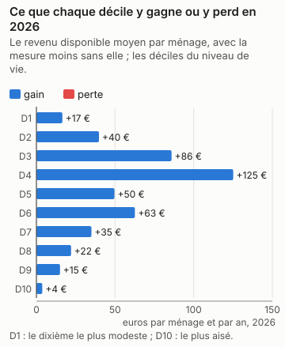
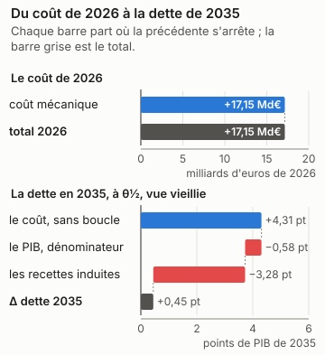
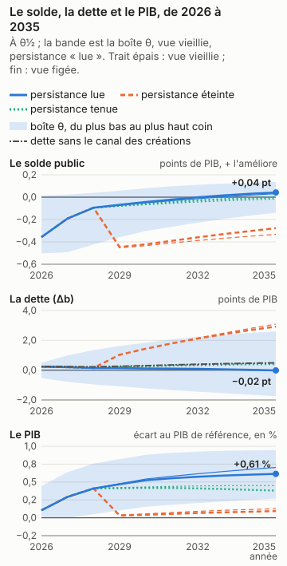
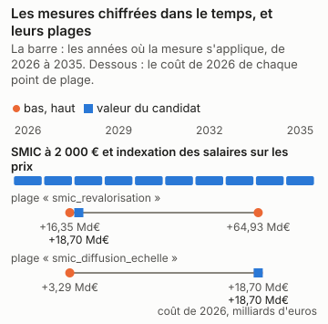

# Anasse Kazib : la part chiffrée du programme, en trois réponses

<!-- Généré par `impots etude ecrire presidentielle_kazib` depuis reports/etudes/presidentielle_kazib/ ; ne pas éditer à la main. -->

## Ce que dit cette étude

La part chiffrée du programme coûte 17,15 Md€ au budget sur le droit et les revenus de 2026, comme si elle s'appliquait cette année-là, avant tout changement de comportement. Les ménages y voient leur revenu disponible changer en moyenne de +17 € par an dans le dixième le plus modeste à +4 € dans le dixième le plus aisé, le plus touché étant le 4e dixième (+125 €). L'outil ne dit pas ce que les comportements y changent : aucune étude publiée ne le permet ici, et la page dit pourquoi. En 2035, la dette publique serait plus haute de 0,45 point de PIB, au milieu des fourchettes publiées et sous les hypothèses de croissance, de taux et de dépense de la page ; la dette monte dans 58 % des tirages du calcul d'incertitude, et l'outil ne tranche pas : cette part du programme peut faire monter ou baisser la dette selon les hypothèses. L'effet sur l'activité n'est lu que pour l'impôt sur le revenu, la CSG, les cotisations des salariés et les cotisations des employeurs. Sans aucun effet sur l'activité, la dette serait plus haute de 4,31 points de PIB : le coût seul, sans la boucle macro. La boucle lit les cotisations des salariés dans la variante « cotisations sociales salariés » de Mésange (G2017/04, folio 110). Elle porte sur les salariés des branches marchandes et rend son effet par une baisse du salaire brut (−2,49 % à dix ans) et du coût du travail ; le coût de l'outil, lui, tient le salaire brut fixe, et tout va au salaire net. Le retour que la boucle lit est donc probablement surestimé, et la dette de tête trop basse d'autant, d'un écart que l'outil ne mesure pas. Le choc vaut jusqu'à 0,00 fois celui de la variante, d'un point de PIB, que la boucle lit comme linéaire. En regard du chiffre de tête, à θ½ et vue vieillie : si les salaires se forment comme dans la variante salariale de Mésange (un super-brut visé, folios 137 et 138), la dette serait plus haute de 1,20 point. Ces nombres valent pour la seule part chiffrée, pas pour le programme entier.

Anasse Kazib, Révolution permanente, a déclaré sa candidature à l'élection présidentielle de 2027. Son programme a été relevé le 12/11/2026 ; le relevé compte ses mesures, celles qui énoncent un paramètre, et celles que cet outil chiffre. Il dit plus bas pourquoi il ne chiffre pas les autres.

| mesures relevées | dont qui énoncent un paramètre | chiffrées par l'outil | part des mesures paramétrées |
|---|---|---|---|
| 7 | 3 | 1 | 33 % |

Pour la part chiffrée, cette seule mesure, trois réponses : ce qu'elle coûte et qui y gagne ; ce qu'elle coûte une fois les comportements et l'économie pris en compte ; ce qu'elle fait à la dette en 2035. **La dette porte sur la seule part du programme que l'outil chiffre, pas sur le programme : les mesures refusées, dites plus bas une à une avec leur « porte » (ce qui manque à l'outil pour les chiffrer), n'y sont pas, et un programme chiffré en partie peut paraître creuser ou baisser la dette pour une raison qui tient à l'outil (D-319).**

Chaque nombre dépend de ce qui est dit à côté de lui. Le coût de la première année est mécanique : personne ne change de comportement. La bande dit ce que les comportements y changent quand une étude publiée permet de le dire. La dette en 2035 dépend d'hypothèses de croissance, de taux et de dépenses nommées en bas de page, et de θ, la position de chaque réponse dans sa fourchette publiée : θ½ est le milieu, et les coins de la boîte placent chaque réponse aux deux bornes de sa fourchette. Le calcul d'incertitude (Monte-Carlo) tire aussi l'effet sur l'activité au-delà de ces bornes, de l'écart qui sépare les études entre elles : le verdict, qui le lit, et « selon θ », qui lit la boîte, peuvent donc différer.

## En bref

| programme | la première année | le chiffrage officiel | dette en 2035, à θ½ | sans le canal des créations | verdict | selon θ |
|---|---|---|---|---|---|---|
| la part chiffrée (1 mesure sur 3 paramétrées, 7 relevées) | +17,15 Md€ | — | +0,45 pt | +0,57 pt | dépend (58 % des tirages en hausse) | dépend de θ |

**La dette lit le canal des créations d'entreprises, une hypothèse non validée** (décision du propriétaire, D-400) : ce qu'une hausse ou une baisse des prélèvements sur les entreprises et le capital, cotisations patronales comprises, fait aux sociétés qui se créent, et ce qu'elles produisent. Aucune source ne redonne ce total. La dette, le verdict et « selon θ » le lisent ; la colonne « sans le canal » donne la dette sans lui, à θ½, sur les mêmes passes. Le canal, ses paramètres et ses sources sont dits avec la dette de chaque mesure. Les points de plage, chiffrés sans comportement ni boucle, ne le lisent pas.

Le verdict se lit sur le Monte-Carlo (D-345) : « hausse » quand au moins 90 % des tirages font monter la dette, vue vieillie, « baisse » quand au moins 90 % la font baisser, « dépend » entre les deux. « Selon θ » dit ce que la boîte θ en dit, sans probabilité : un seul signe à θ½ et à chaque coin, ou non.

Un coût positif coûte au budget, un coût négatif lui rapporte. La dette est en points de PIB, dans la vue vieillie et sous la persistance « lue » de l'effet macro de chaque mesure, Mésange lu à ses horizons ; « selon θ » lit les deux vues sous cette persistance seule (D-336). « Éteint » et « tenu » sont des sensibilités, données plus bas, hors du verdict.

## La part chiffrée

*Anasse Kazib (Révolution permanente), programme relevé le 2026-11-12 — la part chiffrée : smic_2000*

1 mesures chiffrées sur 3 paramétrées et 7 relevées. La réforme est celle des mesures chiffrées du programme, ensemble, à la valeur du candidat ; les autres n'y sont pas.

### 1. Ce qu'il coûte, et qui y gagne

*Source du graphique : `reports/etudes/presidentielle_kazib/premiere_annee_pres2027_kazib_programme.json` ; tracé par `impots.graphiques`. Ses nombres reposent sur : L2, la simulation mécanique ; les déciles sont ceux de la population (L1).*

La mesure coûte **17,15 Md€** la première année (2026), sur la population de 2024 au droit de 2026.

| décile | ménages | niveau de vie moyen | delta moyen | gagnants | perdants |
|---|---|---|---|---|---|
| 1 | 3 104 707 | 9 077 € | +17 € | 9 % | 12 % |
| 2 | 3 105 483 | 14 036 € | +40 € | 11 % | 20 % |
| 3 | 3 106 617 | 17 045 € | +86 € | 16 % | 20 % |
| 4 | 3 104 834 | 20 061 € | +125 € | 23 % | 23 % |
| 5 | 3 105 397 | 22 552 € | +50 € | 9 % | 23 % |
| 6 | 3 104 668 | 25 359 € | +63 € | 11 % | 7 % |
| 7 | 3 106 643 | 28 842 € | +35 € | 7 % | 7 % |
| 8 | 3 105 024 | 33 089 € | +22 € | 6 % | 4 % |
| 9 | 3 105 452 | 39 668 € | +15 € | 4 % | 4 % |
| 10 | 3 104 928 | 59 761 € | +4 € | 2 % | 2 % |

Les déciles sont ceux du niveau de vie de la population simulée. Toute structure
plus fine qu'un décile est un artefact de l'imputation, pas un résultat.

### 2. Avec les comportements et l'économie

*Source du graphique : `reports/etudes/presidentielle_kazib/premiere_annee_pres2027_kazib_programme.json` et `reports/etudes/presidentielle_kazib/predictif_pres2027_kazib_programme.json` (sa décomposition, D-349) ; tracé par `impots.graphiques`. Ses nombres reposent sur : L2 pour le coût mécanique, L3 pour les comportements, L4 pour la dette, sous hypothèses.*

**Bande comportementale : aucune, et la raison est donnée.** Cette réforme est plus grande que celles sur lesquelles les élasticités ont été estimées : la bande est une extrapolation, élargie et signalée comme telle.

**Éventail macro : refusé.** L'éventail ne se compose pas quand les mesures poussent l'activité en sens contraires : il mêlerait les produits de l'une et de l'autre. La dette, plus bas, lit l'effet de chaque mesure sur l'activité à part, dans Mésange.

Ce que la chaîne ne lit pas, et pourquoi :

* **IS et investissement des entreprises** — aucune variante d'IS dans Mésange 2017, et aucune réestimation publiée depuis.
* **transferts** — Mésange n'a pas de variante de transfert.
* **créations d'entreprises** — Canal ouvert dans la dette (but 22), hypothèse non validée : C8 reste l'indice de la couche entreprises.
* **R&D et CIR** — C9 est un indice illustratif de la couche entreprises, en euros de R&D, jamais une recette.

### 3. La dette en 2035

*Source du graphique : `reports/etudes/presidentielle_kazib/predictif_pres2027_kazib_programme.json`, rejoué année par année par `impots.predictif.rejouer`, qui redonne chacun de ses Δb et chaque coin de sa boîte ; tracé par `impots.graphiques`. Ses nombres reposent sur : L4, sous hypothèses : le cadre nommé en bas de page, et θ.*

| persistance | vue | Δ dette 2035, à θ½ | aux coins de la boîte |
|---|---|---|---|
| Effet macro lu dans Mésange à 1, 2, 3, 5 et 10 ans (spécification centrale), interpolé linéairement entre eux | vieillie | +0,45 pt | de -1,07 pt à +2,96 pt |
| Effet macro lu dans Mésange à 1, 2, 3, 5 et 10 ans (spécification centrale), interpolé linéairement entre eux | figée | +0,35 pt | de -1,35 pt à +3,09 pt |

En points de PIB de 2035, la dette avec la mesure moins la dette sans elle, l'effet macro lu dans Mésange à ses horizons (persistance « lue », D-336). La vue vieillie fait vieillir la population chaque année avec les salaires ; la vue figée la garde telle qu'elle est. Sous cette persistance, son effet sur la dette en 2035 **dépend de θ** : son signe change d'un coin de la boîte, ou d'une vue, à l'autre.

**Le verdict**, lu sur le Monte-Carlo (D-345) : son effet sur la dette en 2035 **dépend des hypothèses** : moins de 90 % des tirages s'accordent sur son signe, vue vieillie.

**Les créations d'entreprises, une hypothèse non validée.** La dette de cette page lit le canal des créations d'entreprises, par décision du propriétaire (D-400) : les variations des prélèvements sur les entreprises et le capital déplacent le taux d'entrée des sociétés, qui survivent, montent en charge et produisent ; leurs recettes entrent au solde, leur activité au PIB. Aucune source ne redonne ce total. La dette sans ce canal, sur les mêmes passes, est donnée à côté.

| persistance | vue | Δ dette 2035, à θ½ | sans le canal | ce que le canal y change |
|---|---|---|---|---|
| lue | vieillie | +0,45 pt | +0,57 pt | -0,13 pt |
| lue | figée | +0,35 pt | +0,48 pt | -0,13 pt |

La productivité relative des sociétés nouvelles, rapportée à la société moyenne, est la ligne θ du canal : 0,5 au centre (θ½), de 0, le canal éteint, à 1. Aucune source ne la chiffre pour les sociétés qu'un impôt fait naître ou disparaître. Sa boîte, toutes les autres lignes à θ½, va de +0,32 pt à +0,57 pt en 2035, vue vieillie, persistance « lue ». Le Monte-Carlo du verdict lit le canal à sa productivité centrale, sans la tirer : sa loi n'est pas déclarée.

L'élasticité : 0,043 point de taux d'entrée par point de taux apparent de prélèvement sur le profit, de 0 à 0,2 ; Da Rin, Di Giacomo et Sembenelli, Journal of Public Economics 95 (2011), tableau 4 et pages 21 et 22 : leur estimation intra-groupe au centre, le milieu de leurs estimations en variables instrumentales et intra-groupe en borne haute, lus sur un taux apparent et non sur leur taux effectif (D-245, D-247) ; le centre est dans l'intervalle de confiance de l'estimation française entre secteurs (D-426), décision du propriétaire (D-427). Survie annuelle 0,9, montée en charge sur 5 ans, taille relative à maturité 0,1, valeur ajoutée des sociétés 0,6 du PIB, assiette 0,092 du PIB ; les valeurs fixées par D-402.

Les instruments lus, en euros de prélèvement, recettes positives, rien d'autre (ni le nom de qui propose la mesure, ni son sens) : l'IS, sa contribution sociale, la CEBGE, le PFU, les prélèvements sociaux du capital et les cotisations patronales, nettes des allègements. Les cotisations patronales font jouer le canal, comme l'IS : elles sont aussi dans la boucle macro de Mésange, dont la variante « cotisations employeurs » porte déjà la réponse de l'activité au coût du travail. Ce double compte est un choix du propriétaire (13 novembre 2026), dit ici plutôt que caché. La CVAE et la C3S ne sont pas lues (D-440, décision du propriétaire) : la loi ne les fait pas payer à une société qui entre, la CVAE étant due par qui exerce l'activité au premier janvier de l'année, puis à un taux nul sous un seuil de chiffre d'affaires, la C3S au-delà d'un seuil seulement, que la société nouvelle du canal n'atteint pas (D-436) ; ce qu'une réforme de ces impôts induit sur l'IS reste lu. Le PFU et les prélèvements sociaux du capital sont lus comme une charge sur le profit distribué, comme le taux virtuel de l'IPP qui joint l'IS et le PFU.

**Ce que la boucle lit, et ce que l'outil ne mesure pas.** La boucle lit les cotisations des salariés dans la variante « cotisations sociales salariés » de Mésange (G2017/04, folio 110). Elle porte sur les salariés des branches marchandes et rend son effet par une baisse du salaire brut (−2,49 % à dix ans) et du coût du travail ; le coût de l'outil, lui, tient le salaire brut fixe, et tout va au salaire net. Le retour que la boucle lit est donc probablement surestimé, et la dette de tête trop basse d'autant, d'un écart que l'outil ne mesure pas. Le choc vaut jusqu'à 0,00 fois celui de la variante, d'un point de PIB, que la boucle lit comme linéaire. En regard du chiffre de tête, à θ½ et vue vieillie : sans aucun effet sur l'activité, la dette serait plus haute de 4,31 points ; si les salaires se forment comme dans la variante salariale de Mésange (un super-brut visé, folios 137 et 138), la dette serait plus haute de 1,20 point.

**Les sensibilités, hors du verdict.** Les deux persistances que les pages lisaient avant la persistance « lue » (D-336), sur les mêmes passes : l'effet macro éteint après trois ans, ou tenu au niveau de la troisième année. Mésange ne porte ni l'une ni l'autre ; elles disent ce que le choix de la persistance pèse, et n'entrent pas dans le verdict.

| persistance | vue | Δ dette 2035, à θ½ | aux coins de la boîte |
|---|---|---|---|
| Effet macro éteint après trois ans | vieillie | +3,83 pt | de +3,32 pt à +4,41 pt |
| Effet macro éteint après trois ans | figée | +3,83 pt | de +3,16 pt à +4,56 pt |
| Effet macro tenu au niveau de la troisième année | vieillie | +0,94 pt | de -0,80 pt à +4,02 pt |
| Effet macro tenu au niveau de la troisième année | figée | +0,86 pt | de -1,05 pt à +4,17 pt |

**La distribution, à côté de la boîte.** La boîte dit jusqu'où Δb va quand chaque effet parcourt sa fourchette publiée : ce n'est pas une probabilité. Le Monte-Carlo en est une, sous des lois déclarées : Lois du magasin, ligne par ligne ; copule gaussienne de corrélation ρ entre les lignes d'un même article, indépendance entre articles ; décalage du multiplicateur normal centré réduit, multiplicateur Mésange + z × écart-type IMK censuré à zéro ; indépendant des lignes. (ρ = 0,8, 2000 tirages, persistance « lue », D-336). D'autres lois donneraient une autre réponse.

| vue | P(hausse de la dette en 2035) | quantile 5 % | médiane | quantile 95 % | ce qui pèse le plus (Sobol, total) |
|---|---|---|---|---|---|
| vieillie | 58 % | -1,10 pt | +0,53 pt | +4,05 pt | le multiplicateur 0,99 |
| figée | 56 % | -1,38 pt | +0,45 pt | +4,21 pt | le multiplicateur 0,99 |

**D'où vient Δb.** La dette de 2035 en trois marches, à θ½ sous la persistance « lue » : le coût après comportements, sans la boucle macro ; ce que le PIB plus haut ou plus bas change au seul ratio, comme dénominateur ; ce que les recettes induites par l'activité y changent. Les trois font la ligne du tableau (D-349).

| vue | le coût, sans boucle | le PIB, dénominateur | les recettes induites | Δ dette 2035 |
|---|---|---|---|---|
| vieillie | +4,31 pt | -0,58 pt | -3,28 pt | +0,45 pt |
| figée | +4,46 pt | -0,67 pt | -3,44 pt | +0,35 pt |

**Au taux de marché.** La dette ajoutée est chargée au taux implicite de 2025 (D-336). Chargée à 3,5 %, hypothèse déclarée d'une OAT à dix ans de fin 2026 : +0,57 pt en vue vieillie, contre +0,45 pt ; +0,47 pt en vue figée, contre +0,35 pt.

**Si les salaires se forment autrement.** Mésange publie une sensibilité de ses variantes à la formation des salaires (folios 137 et 138) : une courbe de Phillips pour les cotisations employeurs et la TVA, un super-brut visé pour les cotisations salariés, la CSG et l'IR. Le multiplicateur y est recentré, à écart-type, persistance et recettes induites par point de PIB inchangés ; Mésange n'imprime pas le solde de la variante, que la page suppose proportionnel au PIB (D-349). C'est une sensibilité, hors du verdict.

| vue | Δ dette 2035, à θ½ | aux coins de la boîte | P(hausse) | verdict |
|---|---|---|---|---|
| vieillie | +1,20 pt | de -0,81 pt à +3,80 pt | 70 % | dépend |
| figée | +1,05 pt | de -1,10 pt à +3,89 pt | 65 % | dépend |

**Brut d'IS.** Les cotisations employeurs se déduisent du bénéfice : ce qu'elles changent, l'IS des entreprises bénéficiaires le change en sens inverse, jusqu'à 25 % du montant au taux normal. La passe des ménages ne le chiffre pas ; le coût de la première année et la dette en sont bruts, et l'effet net est plus petit.

### La dette en 2035, si les économies annoncées sont tenues

**Une lecture à part : annoncée par le candidat, non vérifiée.** La dette plus haut est celle de la part chiffrée ; les économies de dépense que le programme annonce, que l'outil ne microsimule pas, n'y entrent pas, et ses dépenses non plus (D-319). Ici, les montants par an que le candidat attache lui-même à ses mesures de dépense publique sont lus par la variante « dépense publique » de Mésange, son effet sur le PIB et sur le solde, et s'ajoutent à la dette de la part chiffrée. Ni le coût de la part chiffrée ni le verdict ne les lisent (D-380).

Le programme n'attache de montant par an à aucune de ses mesures de dépense publique : il n'y a rien à lire.

*Annoncé par le candidat, non vérifié ; jamais additionné au coût de l'outil ni au verdict (D-319, D-380).*

### L'écart au chiffrage officiel

La part chiffrée n'est pas un cas enregistré : ses mesures le sont, une à une, avant que le juge ne publie. Le juge est le chiffrage des programmes de l'Institut Montaigne, attendu au premier trimestre 2027.

* `pres2027_kazib_smic_2000`, enregistré le 2026-11-12 : +15,53 Md€ en 2026, tolérance de 40 % ou 200 M€ ; le juge n'a pas publié.

## Chaque mesure seule, et leur interaction

Le programme n'a qu'une mesure chiffrée : la part chiffrée est cette mesure seule, et ses nombres sont ceux de plus haut. Il n'y a ni somme des mesures ni interaction.

## Ce que bouge chaque paramètre

Chaque mesure chiffrée a une plage : le lecteur peut la régler, du bas au haut. Trois points la parcourent, le bas, la valeur du candidat et le haut. Chaque point est la mesure seule, mécanique (personne ne change de comportement), sur la population vieillie jusqu'en 2026 ; sa dette reporte la première année en part de PIB jusqu'en 2035, un calcul rapide qui ne refait pas chaque année. Elle ne se compare donc pas à celle de la part chiffrée, plus haut, que le calcul complet chiffre année par année avec les comportements et la boucle macro. Leur coût diffère aussi de celui de la part chiffrée : celle-ci est chiffrée sur la population de 2024 au droit de 2026, les plages sur la population vieillie jusqu'en 2026. Quand un programme a plusieurs paramètres, chacun se règle seul, les autres restant à la valeur du candidat.

*Source du graphique : `programmes/kazib.json` et `reports/etudes/presidentielle_kazib/plages/`, ses 6 points de plage ; tracé par `impots.graphiques`. Ses nombres reposent sur : L2 pour les coûts ; la valeur du candidat est celle du programme, le bas et le haut des hypothèses.*

### SMIC à 2 000 € et indexation des salaires sur les prix

*Le programme : 2 000 € (net ou brut non précisé).*

Ce que l'outil en lit : Le SMIC porté à 2 000 € par mois. Le bouton est un coefficient sur le SMIC horaire brut de chaque mois de 2026, qui en porte deux : 12,02 € de janvier à mai (1 823,03 € bruts par mois), 12,31 € de juin à décembre (1 867,02 €), 1 848,69 € en moyenne. Le candidat ne dit pas si les 2 000 € sont nets ou bruts. Le SMIC de la loi est un brut : la valeur retenue lit 2 000 € bruts en moyenne sur l'année (coefficient 1,0818) ; la plage va de 1,0712 (2 000 € bruts atteints depuis le SMIC de juin) à 1,3859 (2 000 € nets atteints depuis celui de janvier). Le net est le brut moins les prélèvements salariaux d'un non-cadre sous le plafond (vieillesse 7,30 %, Agirc-Arrco et CEG 4,01 %, CSG et CRDS 9,70 % sur 98,25 % du brut), soit 79,16 % du brut, sans mutuelle ni prévoyance. L'indexation de l'ensemble des salaires sur les prix n'est pas chiffrée : seul le SMIC l'est. La diffusion au-dessus du nouveau SMIC, entre 1 et 1,5 SMIC dans le privé, est une hypothèse déclarée (D-380) : le profil à un an avec effets fixes d'entreprise de Koubi et Lhommeau (Insee, Les salaires en France 2007), le plus large des quatre publiés, à l'échelle 0 pour la valeur du candidat (le premier jour, la loi seule relève les salaires horaires sous le nouveau SMIC), sa plage allant jusqu'à 1 (le profil entier). La mesure se mesure contre le SMIC de l'arbre de 2026. Le coût ne compte pas le salaire que paie un employeur privé ; il compte celui que paie l'État employeur (les agents publics relevés au SMIC), les cotisations, la CSG et l'impôt qui montent, la prime d'activité qui bouge, et les allègements généraux, qui suivent le SMIC : un SMIC relevé les élargit aussi pour les salaires qui ne bougent pas.

| `smic_revalorisation` | valeur | coût 2026 | dette en 2035, mécanique, sans comportements ni boucle |
|---|---|---|---|
| le bas | 1,0712 | +16,35 Md€ | +5,05 pt |
| le candidat | 1,0818 | +18,70 Md€ | +5,78 pt |
| le haut | 1,3859 | +64,93 Md€ | +20,06 pt |

| `smic_diffusion_echelle` | valeur | coût 2026 | dette en 2035, mécanique, sans comportements ni boucle |
|---|---|---|---|
| le bas | 0 | +18,70 Md€ | +5,78 pt |
| le candidat | 0 | +18,70 Md€ | +5,78 pt |
| le haut | 1 | +3,29 Md€ | +1,02 pt |

## Le programme, mesure par mesure

Une mesure est chiffrée, refusée ou vague. Une mesure refusée n'est pas une mesure à zéro : sa « porte » dit ce qui manque à l'outil, ce qu'il devrait savoir faire pour la chiffrer. Une mesure vague n'énonce ni taux ni montant.

| mesure | ce que dit le candidat | sort | pourquoi |
|---|---|---|---|
| SMIC à 2 000 € et indexation des salaires sur les prix | 2 000 € (net ou brut non précisé) | chiffrée | Le SMIC porté à 2 000 € par mois. Le bouton est un coefficient sur le SMIC horaire brut de chaque mois de 2026, qui en porte deux : 12,02 € de janvier à mai (1 823,03 € bruts par mois), 12,31 € de juin à décembre (1 867,02 €), 1 848,69 € en moyenne. Le candidat ne dit pas si les 2 000 € sont nets ou bruts. Le SMIC de la loi est un brut : la valeur retenue lit 2 000 € bruts en moyenne sur l'année (coefficient 1,0818) ; la plage va de 1,0712 (2 000 € bruts atteints depuis le SMIC de juin) à 1,3859 (2 000 € nets atteints depuis celui de janvier). Le net est le brut moins les prélèvements salariaux d'un non-cadre sous le plafond (vieillesse 7,30 %, Agirc-Arrco et CEG 4,01 %, CSG et CRDS 9,70 % sur 98,25 % du brut), soit 79,16 % du brut, sans mutuelle ni prévoyance. L'indexation de l'ensemble des salaires sur les prix n'est pas chiffrée : seul le SMIC l'est. La diffusion au-dessus du nouveau SMIC, entre 1 et 1,5 SMIC dans le privé, est une hypothèse déclarée (D-380) : le profil à un an avec effets fixes d'entreprise de Koubi et Lhommeau (Insee, Les salaires en France 2007), le plus large des quatre publiés, à l'échelle 0 pour la valeur du candidat (le premier jour, la loi seule relève les salaires horaires sous le nouveau SMIC), sa plage allant jusqu'à 1 (le profil entier). La mesure se mesure contre le SMIC de l'arbre de 2026. Le coût ne compte pas le salaire que paie un employeur privé ; il compte celui que paie l'État employeur (les agents publics relevés au SMIC), les cotisations, la CSG et l'impôt qui montent, la prime d'activité qui bouge, et les allègements généraux, qui suivent le SMIC : un SMIC relevé les élargit aussi pour les salaires qui ne bougent pas. |
| Semaine de 28 heures | 28 heures | refusée : la distribution des salaires (`salaires`) | Le moteur ne porte ni les heures travaillées ni la distribution des salaires qu'une semaine de 28 heures déplacerait. |
| Retraite à 60 ans, 55 ans pour les métiers pénibles, sans condition d'annuités | 60 ans ; 55 ans ; pas de durée requise | refusée : les droits à la retraite (`retraites`) | L'âge légal n'est pas un paramètre du moteur : la population ne vieillit pas en âge et ses pensions sont des données. |
| Interdiction des licenciements et des suppressions de postes | aucun paramètre | vague | Une interdiction, sans paramètre fiscal ni social. |
| Expropriation sans indemnité des secteurs stratégiques | aucun paramètre | vague | Aucun périmètre chiffré ni paramètre fiscal n'est énoncé. |
| Fin de la sous-traitance, CDI pour tous | aucun paramètre | vague | Une règle du contrat de travail, sans paramètre fiscal ni social. |
| Crédits militaires réaffectés à la santé, à l'éducation et aux transports gratuits | aucun montant | vague | Ni le montant réaffecté ni l'étendue de la gratuité des transports ne sont énoncés. |

Les portes, de celle qui ouvrirait le plus de mesures à celle qui en ouvrirait le moins :

* 1 mesure — les droits à la retraite (âges, durées, régimes) : la population ne vieillit pas en âge et ses pensions sont des données (`retraites`).
* 1 mesure — la distribution des salaires : SMIC, point d'indice, indexation des salaires (`salaires`).

## Ce que le candidat annonce, à part

Le programme n'annonce, pour aucune de ses mesures, un montant que le relevé ait trouvé.

## Ce qui a bougé depuis la série précédente

La série précédente a tourné sur `5a68669` ; ce qu'elle disait est figé dans `reports/etudes/presidentielle_kazib/avant/serie.json` avant que celle-ci ne remplace ses rapports (D-350). Son verdict lisait la boîte θ ; celui-ci lit le Monte-Carlo.

| | la première année, avant → après | dette à θ½, avant → après | verdict, avant → après |
|---|---|---|---|
| la part chiffrée (1 mesure sur 3 paramétrées, 7 relevées) | +15,44 Md€ → +17,15 Md€ | +0,38 pt → +0,45 pt | dépend de θ → dépend |

Ce qui touche chaque ligne :

* **la part chiffrée (1 mesure sur 3 paramétrées, 7 relevées)** : le secteur public modélisé statut par statut (D-346), le verdict lu sur le Monte-Carlo (D-345).

Là où une seule correction touche une ligne, l'écart avant → après est ce qu'elle pèse (D-352) ; ailleurs, les corrections ne se séparent pas sans un calcul refait sans chacune, qui n'est pas fait.

## D'où viennent ces nombres

Les passes ont tourné sur le commit `01a24df`, conteneur cloud, 15 Go, 4 cœurs, une file. Cadre du calcul année par année jusqu'en 2035 : Croissance réelle 1 %, prix 2 % ; Taux implicite tenu à son niveau de 2025 ; Dépenses gelées en volume ; droit reconduit tel qu'openfisca le porte ; θ½ sur toutes les lignes ; comportements et boucle macro appliqués.

*Population vieillie mécaniquement de 2024 à 2035 — salaires 3,0 % par an, prix 2,0 % par an, hypothèses DÉCLARÉES et non prévues (3 % ronds, le rythme du PIB nominal du scénario). La structure des ménages, les âges et les poids n'ont PAS bougé : c'est la France de l'année de base avec l'argent de l'année d'arrivée, et cela biaise vers l'immobilité démographique. **Cette population n'est plus calibrée** : les totaux dépensés au registre le sont sur l'année de base, et il n'existe pas de total publié pour une année future. Toute ligne de réconciliation sur cette année refuse un verdict de tolérance plutôt que d'en donner un qui se lirait comme une validation.*

Le secteur public est modélisé statut par statut (D-346) : un titulaire est payé d'un traitement indiciaire et de primes, et cotise à son régime ; un contractuel cotise au régime général, sans allègement. L'enquête Emploi dit titulaire ou contractuel et la fonction publique, pas le corps ni l'indice : la part des primes est la moyenne qu'openfisca porte, la même pour tous.

**La vérification de ses instruments.** Le niveau que le moteur donne à chaque instrument que la page chiffre, contre son total publié, sur 2022, 2023 et 2024 (`docs/verification/GRILLE.md`, D-364) : l'écart moyen, son étendue, et les années qui tiennent la tolérance écrite avant le calcul.

* Réduction générale dégressive : +8,0 % en moyenne, de +6,8 % à +9,1 % ; 3 années sur 3 dans sa tolérance.
* Cotisations effectives des employeurs au sens D121 (hors impôts sur les salaires, pension de l'État et salaires hors brut) : −3,5 % en moyenne, de −5,0 % à −2,3 % ; 3 années sur 3 dans sa tolérance.

Un écart de niveau ne se reporte pas tel quel sur le chiffrage : le coût d'une mesure est la différence de deux passes sur la même population, et ce qui manque aux deux passes s'y annule en partie.

* `reports/etudes/presidentielle_kazib/premiere_annee_pres2027_kazib_programme.json`, `reports/etudes/presidentielle_kazib/predictif_pres2027_kazib_programme.json`
* `reports/etudes/presidentielle_kazib/plages/`, les 6 points des plages
