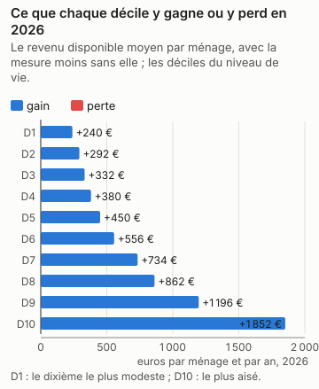
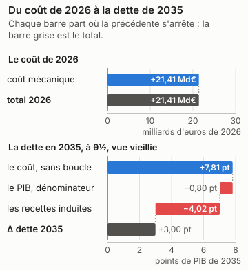
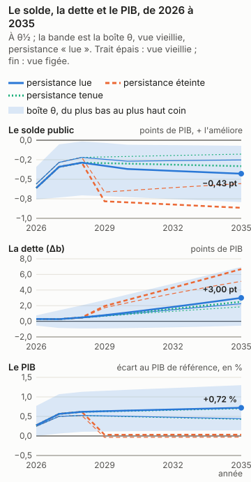
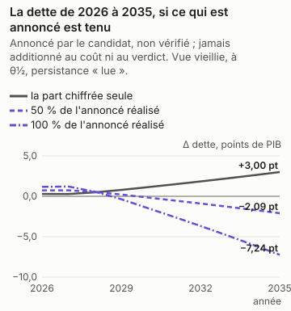
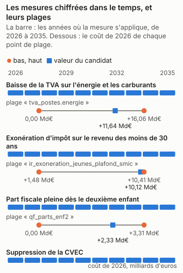

# Marine Le Pen : la part chiffrée du programme, en trois réponses

<!-- Généré par `impots etude ecrire presidentielle_le_pen` depuis reports/etudes/presidentielle_le_pen/ ; ne pas éditer à la main. -->

## Ce que dit cette étude

La part chiffrée du programme coûte 21,41 Md€ au budget sur le droit et les revenus de 2026, comme si elle s'appliquait cette année-là, avant tout changement de comportement. Les ménages y voient leur revenu disponible changer en moyenne de +240 € par an dans le dixième le plus modeste à +1 852 € dans le dixième le plus aisé. L'outil ne dit pas ce que les comportements y changent : aucune étude publiée ne le permet ici, et la page dit pourquoi. En 2035, la dette publique serait plus haute de 3,00 points de PIB, au milieu des fourchettes publiées et sous les hypothèses de croissance, de taux et de dépense de la page ; la dette monte dans 79 % des tirages du calcul d'incertitude, et l'outil ne tranche pas : cette part du programme peut faire monter ou baisser la dette selon les hypothèses. L'effet sur l'activité n'est lu que pour l'impôt sur le revenu et la TVA. Sans aucun effet sur l'activité, la dette serait plus haute de 7,81 points de PIB : le coût seul, sans la boucle macro. Ces nombres valent pour la seule part chiffrée, pas pour le programme entier.

Marine Le Pen, Rassemblement national (RN), a déclaré sa candidature à l'élection présidentielle de 2027. Son programme a été relevé le 12/11/2026 ; le relevé compte ses mesures, celles qui énoncent un paramètre, et celles que cet outil chiffre. Il dit plus bas pourquoi il ne chiffre pas les autres.

| mesures relevées | dont qui énoncent un paramètre | chiffrées par l'outil | part des mesures paramétrées |
|---|---|---|---|
| 36 | 25 | 4 | 16 % |

Pour la part chiffrée, ces mesures ensemble, trois réponses : ce qu'elle coûte et qui y gagne ; ce qu'elle coûte une fois les comportements et l'économie pris en compte ; ce qu'elle fait à la dette en 2035. **La dette porte sur la seule part du programme que l'outil chiffre, pas sur le programme : les mesures refusées, dites plus bas une à une avec leur « porte » (ce qui manque à l'outil pour les chiffrer), n'y sont pas, et un programme chiffré en partie peut paraître creuser ou baisser la dette pour une raison qui tient à l'outil (D-319).**

Chaque nombre dépend de ce qui est dit à côté de lui. Le coût de la première année est mécanique : personne ne change de comportement. La bande dit ce que les comportements y changent quand une étude publiée permet de le dire. La dette en 2035 dépend d'hypothèses de croissance, de taux et de dépenses nommées en bas de page, et de θ, la position de chaque réponse dans sa fourchette publiée : θ½ est le milieu, et les coins de la boîte placent chaque réponse aux deux bornes de sa fourchette. Le calcul d'incertitude (Monte-Carlo) tire aussi l'effet sur l'activité au-delà de ces bornes, de l'écart qui sépare les études entre elles : le verdict, qui le lit, et « selon θ », qui lit la boîte, peuvent donc différer.

## En bref

| programme | la première année | le chiffrage officiel | dette en 2035, à θ½ | verdict | selon θ |
|---|---|---|---|---|---|
| la part chiffrée (4 mesures sur 25 paramétrées, 36 relevées) | +21,41 Md€ | — | +3,00 pt | dépend (79 % des tirages en hausse) | dépend de θ |

Le verdict se lit sur le Monte-Carlo (D-345) : « hausse » quand au moins 90 % des tirages font monter la dette, vue vieillie, « baisse » quand au moins 90 % la font baisser, « dépend » entre les deux. « Selon θ » dit ce que la boîte θ en dit, sans probabilité : un seul signe à θ½ et à chaque coin, ou non.

Un coût positif coûte au budget, un coût négatif lui rapporte. La dette est en points de PIB, dans la vue vieillie et sous la persistance « lue » de l'effet macro de chaque mesure, Mésange lu à ses horizons ; « selon θ » lit les deux vues sous cette persistance seule (D-336). « Éteint » et « tenu » sont des sensibilités, données plus bas, hors du verdict.

## La part chiffrée

*Marine Le Pen (Rassemblement national (RN)), programme relevé le 2026-11-12 — la part chiffrée : lp20_tva_energie, lp21_ir_moins_30_ans, lp22_part_pleine_2e_enfant, lp26_suppression_cvec*

4 mesures chiffrées sur 25 paramétrées et 36 relevées. La réforme est celle des mesures chiffrées du programme, ensemble, à la valeur du candidat ; les autres n'y sont pas.

### 1. Ce qu'il coûte, et qui y gagne

*Source du graphique : `reports/etudes/presidentielle_le_pen/premiere_annee_pres2027_le_pen_programme.json` ; tracé par `impots.graphiques`. Ses nombres reposent sur : L2, la simulation mécanique ; les déciles sont ceux de la population (L1).*

La mesure coûte **21,41 Md€** la première année (2026), sur la population de 2024 au droit de 2026.

| décile | ménages | niveau de vie moyen | delta moyen | gagnants | perdants |
|---|---|---|---|---|---|
| 1 | 3 105 439 | 8 733 € | +240 € | 100 % | 0 % |
| 2 | 3 105 989 | 14 008 € | +292 € | 100 % | 0 % |
| 3 | 3 105 379 | 17 392 € | +332 € | 100 % | 0 % |
| 4 | 3 104 866 | 20 386 € | +380 € | 100 % | 0 % |
| 5 | 3 104 805 | 23 095 € | +450 € | 100 % | 0 % |
| 6 | 3 105 390 | 25 856 € | +556 € | 100 % | 0 % |
| 7 | 3 105 062 | 28 962 € | +734 € | 100 % | 0 % |
| 8 | 3 106 224 | 32 877 € | +862 € | 100 % | 0 % |
| 9 | 3 104 805 | 38 656 € | +1 196 € | 100 % | 0 % |
| 10 | 3 105 795 | 57 879 € | +1 852 € | 100 % | 0 % |

Les déciles sont ceux du niveau de vie de la population simulée. Toute structure
plus fine qu'un décile est un artefact de l'imputation, pas un résultat.

### 2. Avec les comportements et l'économie

*Source du graphique : `reports/etudes/presidentielle_le_pen/premiere_annee_pres2027_le_pen_programme.json` et `reports/etudes/presidentielle_le_pen/predictif_pres2027_le_pen_programme.json` (sa décomposition, D-349) ; tracé par `impots.graphiques`. Ses nombres reposent sur : L2 pour le coût mécanique, L3 pour les comportements, L4 pour la dette, sous hypothèses.*

**Bande comportementale : aucune, et la raison est donnée.** Aucun canal fondé sur des preuves ne couvre cet instrument : le chiffre reste purement mécanique.

**L'effet sur l'économie**, l'éventail macro (la fourchette de ce que des multiplicateurs publiés disent du PIB et de l'emploi), **dans l'étendue des estimations**, le choc ne dépassant pas ceux sur lesquels les multiplicateurs ont été estimés ; 99 % de la mesure a un multiplicateur publié ; conjoncture supposée normale, ni récession ni surchauffe :

* **PIB, à 1 an** : [-5,46 Md€ ; +21,27 Md€], central +7,90 Md€
* **PIB, à 2 ans** : [+3,37 Md€ ; +28,67 Md€], central +15,73 Md€
* **PIB, à 3 ans** : [+3,67 Md€ ; +29,83 Md€], central +17,12 Md€
* **emploi, à 1 an** : [-17,80 ; +61,14] milliers ETP, central +22,57
* **emploi, à 2 ans** : [+14,52 ; +156,74] milliers ETP, central +84,53
* **emploi, à 3 ans** : [+24,67 ; +214,32] milliers ETP, central +120,45

> Couche macro (L4) : ordre de grandeur et composition, pas une prévision. L'éventail des estimations crédibles pour un même choc est large — la dispersion entre études publiées est du même ordre que la valeur centrale elle-même. C'est une propriété de la littérature, pas de ce modèle.

Ce que la chaîne ne lit pas, et pourquoi :

* **IS et investissement des entreprises** — aucune variante d'IS dans Mésange 2017, et aucune réestimation publiée depuis.
* **transferts** — Mésange n'a pas de variante de transfert.
* **créations d'entreprises** — C8 est un indice illustratif de la couche entreprises, en points de taux de création de sociétés, jamais une recette : la trajectoire chiffre le coût d'une baisse d'IS (D-244), pas les sociétés qu'elle ferait naître (§6.3, D-221).
* **R&D et CIR** — C9 est un indice illustratif de la couche entreprises, en euros de R&D, jamais une recette.

### 3. La dette en 2035

*Source du graphique : `reports/etudes/presidentielle_le_pen/predictif_pres2027_le_pen_programme.json`, rejoué année par année par `impots.predictif.rejouer`, qui redonne chacun de ses Δb et chaque coin de sa boîte ; tracé par `impots.graphiques`. Ses nombres reposent sur : L4, sous hypothèses : le cadre nommé en bas de page, et θ.*

| persistance | vue | Δ dette 2035, à θ½ | aux coins de la boîte |
|---|---|---|---|
| Effet macro lu dans Mésange à 1, 2, 3, 5 et 10 ans (spécification centrale), interpolé linéairement entre eux | vieillie | +3,00 pt | de -0,56 pt à +6,96 pt |
| Effet macro lu dans Mésange à 1, 2, 3, 5 et 10 ans (spécification centrale), interpolé linéairement entre eux | figée | +2,25 pt | de -0,31 pt à +5,18 pt |

En points de PIB de 2035, la dette avec la mesure moins la dette sans elle, l'effet macro lu dans Mésange à ses horizons (persistance « lue », D-336). La vue vieillie fait vieillir la population chaque année avec les salaires ; la vue figée la garde telle qu'elle est. Sous cette persistance, son effet sur la dette en 2035 **dépend de θ** : son signe change d'un coin de la boîte, ou d'une vue, à l'autre.

**Le verdict**, lu sur le Monte-Carlo (D-345) : son effet sur la dette en 2035 **dépend des hypothèses** : moins de 90 % des tirages s'accordent sur son signe, vue vieillie.

**Les sensibilités, hors du verdict.** Les deux persistances que les pages lisaient avant la persistance « lue » (D-336), sur les mêmes passes : l'effet macro éteint après trois ans, ou tenu au niveau de la troisième année. Mésange ne porte ni l'une ni l'autre ; elles disent ce que le choix de la persistance pèse, et n'entrent pas dans le verdict.

| persistance | vue | Δ dette 2035, à θ½ | aux coins de la boîte |
|---|---|---|---|
| Effet macro éteint après trois ans | vieillie | +6,68 pt | de +5,78 pt à +7,67 pt |
| Effet macro éteint après trois ans | figée | +5,12 pt | de +4,62 pt à +5,72 pt |
| Effet macro tenu au niveau de la troisième année | vieillie | +2,50 pt | de -0,85 pt à +6,96 pt |
| Effet macro tenu au niveau de la troisième année | figée | +1,85 pt | de -0,50 pt à +5,21 pt |

**La distribution, à côté de la boîte.** La boîte dit jusqu'où Δb va quand chaque effet parcourt sa fourchette publiée : ce n'est pas une probabilité. Le Monte-Carlo en est une, sous des lois déclarées : Lois du magasin, ligne par ligne ; copule gaussienne de corrélation ρ entre les lignes d'un même article, indépendance entre articles ; décalage du multiplicateur normal centré réduit, multiplicateur Mésange + z × écart-type IMK censuré à zéro ; indépendant des lignes. (ρ = 0,8, 2000 tirages, persistance « lue », D-336). D'autres lois donneraient une autre réponse.

| vue | P(hausse de la dette en 2035) | quantile 5 % | médiane | quantile 95 % | ce qui pèse le plus (Sobol, total) |
|---|---|---|---|---|---|
| vieillie | 79 % | -1,44 pt | +3,13 pt | +7,81 pt | le multiplicateur 0,98 |
| figée | 80 % | -0,87 pt | +2,35 pt | +5,79 pt | le multiplicateur 0,98 |

**D'où vient Δb.** La dette de 2035 en trois marches, à θ½ sous la persistance « lue » : le coût après comportements, sans la boucle macro ; ce que le PIB plus haut ou plus bas change au seul ratio, comme dénominateur ; ce que les recettes induites par l'activité y changent. Les trois font la ligne du tableau (D-349).

| vue | le coût, sans boucle | le PIB, dénominateur | les recettes induites | Δ dette 2035 |
|---|---|---|---|---|
| vieillie | +7,81 pt | -0,80 pt | -4,02 pt | +3,00 pt |
| figée | +5,79 pt | -0,48 pt | -3,06 pt | +2,25 pt |

**Au taux de marché.** La dette ajoutée est chargée au taux implicite de 2025 (D-336). Chargée à 3,5 %, hypothèse déclarée d'une OAT à dix ans de fin 2026 : +3,27 pt en vue vieillie, contre +3,00 pt ; +2,47 pt en vue figée, contre +2,25 pt.

**Si les salaires se forment autrement.** Mésange publie une sensibilité de ses variantes à la formation des salaires (folios 137 et 138) : une courbe de Phillips pour les cotisations employeurs et la TVA, un super-brut visé pour les cotisations salariés, la CSG et l'IR. Le multiplicateur y est recentré, à écart-type, persistance et recettes induites par point de PIB inchangés ; Mésange n'imprime pas le solde de la variante, que la page suppose proportionnel au PIB (D-349). C'est une sensibilité, hors du verdict.

| vue | Δ dette 2035, à θ½ | aux coins de la boîte | P(hausse) | verdict |
|---|---|---|---|---|
| vieillie | +2,99 pt | de -0,37 pt à +6,94 pt | 81 % | dépend |
| figée | +2,18 pt | de -0,19 pt à +5,10 pt | 81 % | dépend |

### La dette en 2035, si les économies annoncées sont tenues et les dépenses annoncées faites

*Source du graphique : `reports/etudes/presidentielle_le_pen/predictif_pres2027_le_pen_programme.json`, `programmes/le_pen.json` et `reports/macro/variante_depense_publique.json`, lus par `impots.predictif.annonce` ; tracé par `impots.graphiques`. Ses nombres reposent sur : L4 pour la part chiffrée, sous hypothèses ; annoncé pour le reste.*

**Une lecture à part : annoncée par le candidat, non vérifiée.** La dette plus haut est celle de la part chiffrée ; les économies de dépense que le programme annonce, que l'outil ne microsimule pas, n'y entrent pas, et ses dépenses non plus (D-319). Ici, les montants par an que le candidat attache lui-même à ses mesures de dépense publique sont lus par la variante « dépense publique » de Mésange, son effet sur le PIB et sur le solde, et s'ajoutent à la dette de la part chiffrée. Ni le coût de la part chiffrée ni le verdict ne les lisent (D-380).

| mesure | montant annoncé, par an | sens | calendrier annoncé |
|---|---|---|---|
| Économies sur l'immigration et « priorité nationale » | +29,00 Md€ | économie | année pleine (15 Md€ la première année) |
| Baisse de la contribution française à l'UE | +9,00 Md€ | économie | non énoncé |
| « Réorganisation de l'État » | +20,70 Md€ | économie | dès 2027 |
| Suppression de la quasi-totalité des agences | +3,40 Md€ | économie | 2027 |
| Collectivités : fin du « millefeuille », suppression des EPCI et des métropoles | +8,20 Md€ | économie | 2027 |
| Permis de conduire gratuit | +700 M€ | dépense | par an |

| part réalisée | solde annoncé, par an | Δ dette 2035, vue vieillie | Δ dette 2035, vue figée |
|---|---|---|---|
| 0 % | +0 € | +3,00 pt | +2,25 pt |
| 50 % | +34,80 Md€ | -2,09 pt | -2,86 pt |
| 100 % | +69,60 Md€ | -7,24 pt | -8,03 pt |

À θ½, sous la persistance « lue ». À une part réalisée nulle, la ligne est la dette de la part chiffrée, plus haut ; le solde est positif quand il améliore les comptes publics.

**Ce que la variante suppose.** La variante « dépense publique » de Mésange est un composite, pas un instrument (D-214, page 106 du PDF) : 8 % d'investissement public, 25 % de rémunérations publiques, 9 % de prestations en nature, 12 % de consommations intermédiaires, 46 % de prestations sociales en espèces. La lire suppose que chaque euro annoncé tombe sur la dépense dans ces proportions, quoi que la mesure dise ; les transferts n'ont pas de variante à eux, et une économie sur les prestations lit la même moyenne. Montant atteint dès la première année du chemin et tenu en part du PIB de cette année-là : le calendrier que le candidat énonce est montré, pas lu. Choc de la variante en volume, lu comme des euros : prix de la réforme tenus constants (D-214, condition 4). Ligne de solde lue sous la dépense gelée en volume seule (note 70, D-214). Variantes superposées : Mésange est linéaire (D-230), et ce qu'annonce le candidat s'ajoute à la part chiffrée sans interaction.

**Pas lues** — hors de la dépense publique : sa porte relève d'un autre module (retraites, prestations, salaires, entreprises) : Âge légal à 60 ou 62 ans selon le début de carrière ; Économies sur les retraites ; « Prime d'activité étudiante ».

*Annoncé par le candidat, non vérifié ; jamais additionné au coût de l'outil ni au verdict (D-319, D-380).*

### L'écart au chiffrage officiel

La part chiffrée n'est pas un cas enregistré : ses mesures le sont, une à une, avant que le juge ne publie. Le juge est le chiffrage des programmes de l'Institut Montaigne, attendu au premier trimestre 2027.

* `pres2027_le_pen_lp20_tva_energie`, enregistré le 2026-11-02 : +11,64 Md€ en 2026, tolérance de 30 % ou 200 M€ ; le juge n'a pas publié.
* `pres2027_le_pen_lp21_ir_moins_30_ans`, enregistré le 2026-11-12 : +9,61 Md€ en 2026, tolérance de 25 % ou 200 M€ ; le juge n'a pas publié.
* `pres2027_le_pen_lp22_part_pleine_2e_enfant`, enregistré le 2026-11-01 : +2,83 Md€ en 2026, tolérance de 25 % ou 200 M€ ; le juge n'a pas publié.
* `pres2027_le_pen_lp26_suppression_cvec`, enregistré le 2026-11-12 : +236 M€ en 2026, tolérance de 25 % ou 200 M€ ; le juge n'a pas publié.

## Chaque mesure seule, et leur interaction

Chaque mesure chiffrée passe aussi seule, en entier : sa première année et son chemin annuel jusqu'en 2035, dans le cadre de la part chiffrée, sur la même population et le même code. La part chiffrée n'est pas la somme de ses mesures : deux mesures se rencontrent dans le barème, dans les prestations sous condition de ressources, dans la boucle macro, et dans la dette, que chacune creuse sur le PIB que l'autre a changé. L'écart, la part chiffrée moins la somme des mesures, est dit sur sa ligne, « interaction » : il n'est réparti entre aucune mesure.

**Les mesures seules : absentes, et la raison est donnée.** Les passes des mesures seules n'ont pas tourné : `impots etude lancer presidentielle_le_pen` les lance, après celles de la part chiffrée. Les rapports de cette page viennent d'une série qui ne les avait pas.

## Ce que bouge chaque paramètre

Chaque mesure chiffrée a une plage : le lecteur peut la régler, du bas au haut. Trois points la parcourent, le bas, la valeur du candidat et le haut. Chaque point est la mesure seule, mécanique (personne ne change de comportement), sur la population vieillie jusqu'en 2026 ; sa dette reporte la première année en part de PIB jusqu'en 2035, un calcul rapide qui ne refait pas chaque année. Elle ne se compare donc pas à celle de la part chiffrée, plus haut, que le calcul complet chiffre année par année avec les comportements et la boucle macro. Leur coût diffère aussi de celui de la part chiffrée : celle-ci est chiffrée sur la population de 2024 au droit de 2026, les plages sur la population vieillie jusqu'en 2026. Quand un programme a plusieurs paramètres, chacun se règle seul, les autres restant à la valeur du candidat.

*Source du graphique : `programmes/le_pen.json` et `reports/etudes/presidentielle_le_pen/plages/`, ses 9 points de plage ; tracé par `impots.graphiques`. Ses nombres reposent sur : L2 pour les coûts ; la valeur du candidat est celle du programme, le bas et le haut des hypothèses.*

### Baisse de la TVA sur l'énergie et les carburants

*Le programme : De 20 % à 5,5 %.*

Ce que l'outil en lit : La TVA de l'électricité, du gaz, du fioul et des carburants (le groupe « energie » de la couche consommation) passe de 20 % à 5,5 %, à volumes constants et répercutée en entier dans les prix (D-323). Le bois de chauffage, déjà à 10 %, et la chaleur de réseau ne bougent pas. Plage de 0 à 20 % (la mesure retirée).

| `tva_postes.energie` | valeur | coût 2026 | dette en 2035, mécanique, sans comportements ni boucle |
|---|---|---|---|
| le bas | 0 % | +16,06 Md€ | +4,96 pt |
| le candidat | 5,5 % | +11,64 Md€ | +3,60 pt |
| le haut | 20 % | +0 € | +0,00 pt |

### Exonération d'impôt sur le revenu des moins de 30 ans

*Le programme : Jusqu'à 4 SMIC.*

Ce que l'outil en lit : Les salaires des moins de 30 ans au 1er janvier de l'année des revenus sortent du revenu imposable jusqu'à 4 SMIC bruts annuels. « Jusqu'à quatre fois le Smic » se lit comme un abattement : le salaire au-delà reste imposé, sans falaise (l'autre lecture, tout imposé au-delà, n'est pas codée). Le SMIC est brut, le candidat ne le dit pas ; 4 SMIC nets feraient 3,17 SMIC bruts, dans la plage. Les revenus des non-salariés, le chômage et les pensions ne sont pas exonérés ; les prestations, qui lisent le salaire entier, ne bougent pas. Un jeune rattaché au foyer de ses parents allège l'impôt de ce foyer. Plage du plafond : de 0 (la mesure retirée) à 4 SMIC prolongés de la moitié de l'écart (6). Contre le droit de 2026.

| `ir_exoneration_jeunes_plafond_smic` | valeur | coût 2026 | dette en 2035, mécanique, sans comportements ni boucle |
|---|---|---|---|
| le bas | 0 | +1,48 Md€ | +0,46 pt |
| le candidat | 4 | +10,12 Md€ | +3,13 pt |
| le haut | 6 | +10,41 Md€ | +3,21 pt |

### Part fiscale pleine dès le deuxième enfant

*Le programme : Une part au lieu d'une demi-part.*

Ce que l'outil en lit : Le deuxième enfant apporte une part entière au lieu d'une demi-part, dans le cas général ; le premier et le troisième ne bougent pas. Plage de 0,5 (la mesure retirée) à 1,25.

| `qf_parts_enf2` | valeur | coût 2026 | dette en 2035, mécanique, sans comportements ni boucle |
|---|---|---|---|
| le bas | 0,5 | +0 € | +0,00 pt |
| le candidat | 1 | +2,33 Md€ | +0,72 pt |
| le haut | 1,25 | +3,31 Md€ | +1,02 pt |

### Suppression de la CVEC

*Le programme : Suppression (105 €).*

Ce que l'outil en lit : La contribution de vie étudiante et de campus supprimée, sur les étudiants du supérieur et les boursiers qu'impute la population (D-383). Le compte des inscrits contient ceux que la CVEC ne frappe pas : à 100 €, l'imputation donne 231 M€ contre un produit de 170 M€ en 2023-2024, 36 % de trop, et la suppression en est surestimée d'autant. Contre le droit de 2026, 105 €.

## Le programme, mesure par mesure

Une mesure est chiffrée, refusée ou vague. Une mesure refusée n'est pas une mesure à zéro : sa « porte » dit ce qui manque à l'outil, ce qu'il devrait savoir faire pour la chiffrer. Une mesure vague n'énonce ni taux ni montant.

| mesure | ce que dit le candidat | sort | pourquoi |
|---|---|---|---|
| Plan d'économies nettes | 140 Md€ nets d'ici 2032 par rapport à 2026 — montant annoncé : 140 Md€ (total net d'ici 2032 par rapport à 2026, sur le quinquennat ; la candidate ne donne pas d'annuel (montant non annualisé)) ; non lu comme montant annuel : un total d'ici 2032, dont les lignes sont déclarées une à une (D-381). | refusée : une hypothèse du calcul de la dette (`chaine`) | Un effort d'ensemble, sans règle de calcul, est une trajectoire de solde pour le calcul de la dette, pas une réforme que le moteur chiffre. |
| Déficit sous 3 % | Sous 3 % du PIB en 2030, l'essentiel de l'effort sur les 3 premières années | refusée : une hypothèse du calcul de la dette (`chaine`) | Un objectif de solde est une trajectoire du calcul de la dette, pas une réforme que le moteur chiffre. |
| Équilibre primaire | En 18 mois | refusée : une hypothèse du calcul de la dette (`chaine`) | Un objectif de solde est une trajectoire du calcul de la dette, pas une réforme que le moteur chiffre. |
| Trajectoire de dette | 121 % du PIB en 2027, 112 % en 2032 | refusée : une hypothèse du calcul de la dette (`chaine`) | Une cible de dette est ce que le calcul de la dette donne, pas une réforme qu'il prend en entrée. |
| Règle d'or constitutionnelle par référendum | Le déficit doit rester sous le « seuil stabilisant de la dette ». Plafonds : 4,9 % (2027), 4,4 % (2028), 3,9 % (2030), 3,4 % (2031), 2,9 % (2032), 2,4 % (2033), maintenus jusqu'à une dette sous 60 % du PIB. Dérogation possible à la majorité des 3/5 du Parlement. Référendum « dans les douze mois » | refusée : une hypothèse du calcul de la dette (`chaine`) | Une règle budgétaire est une hypothèse du calcul de la dette, qui ne porte qu'un scénario de dépense à la fois. |
| Économies sur l'immigration et « priorité nationale » | 15 Md€ la première année, 29 Md€ en année pleine (environ 20 % du plan) | refusée : la dépense publique (`depense_publique`) | Une enveloppe d'économies sans règle de calcul, sur une dépense que le moteur ne microsimule pas. |
| Baisse de la contribution française à l'UE | −8,9 Md€ nets (AFP) ; « 9 milliards » (J. Bardella) | refusée : la dépense publique (`depense_publique`) | La contribution au budget de l'Union est une dépense de l'État, que le moteur ne microsimule pas. |
| « Réorganisation de l'État » | 20,7 Md€ d'économies dès 2027 | refusée : la dépense publique (`depense_publique`) | Une enveloppe d'économies de fonctionnement de l'État, sans règle de calcul, que le moteur ne microsimule pas. |
| Suppression de la quasi-totalité des agences | 3,4 Md€ d'économies en 2027 | refusée : la dépense publique (`depense_publique`) | La dépense des agences n'est pas microsimulée : elle n'entre qu'en scénario du calcul de la dette. |
| Collectivités : fin du « millefeuille », suppression des EPCI et des métropoles | 8,2 Md€ en 2027, dont 250 M€ (EPCI et métropoles) et 800 M€ (ajustement des effectifs) | refusée : la dépense publique (`depense_publique`) | La dépense des collectivités n'est pas microsimulée : elle n'entre qu'en scénario du calcul de la dette. |
| Réduction des effectifs publics | Au moins 200 000 postes en cinq ans (collectivités, agences, organismes) | refusée : la dépense publique (`depense_publique`) | Les effectifs publics sont une dépense que le moteur ne microsimule pas. |
| Centralisation des recettes de TVA ; pas de dépense reconduite sans visa | Non chiffré | vague | Une organisation des finances publiques, sans taux ni montant. |
| Baisse nette d'impôts sur le quinquennat | 30 Md€ ; pas de ventilation officielle publiée | refusée : un montant sans règle de calcul (`enveloppe`) | Un montant de baisses d'impôts sur le quinquennat, sans dire lesquelles ni de combien. |
| « Droits nouveaux » | 15 Md€ provisionnés, plus des hausses pour l'outre-mer, la recherche et l'éducation — montant annoncé : 15 Md€ (15 Md€ « provisionnés » sur la trajectoire, calendrier non dit (montant non annualisé)) ; non lu comme montant annuel : une provision sans calendrier (D-381). | refusée : la dépense publique (`depense_publique`) | Une provision de dépense sans règle de calcul, que le moteur ne microsimule pas. |
| Âge légal à 60 ou 62 ans selon le début de carrière | Début avant 20 ans : départ à 60 ans avec 40 annuités. Après 20 ans : montée progressive jusqu'à 62 ans avec 42 annuités. Détails attendus le 17/11/2026 | refusée : les droits à la retraite (`retraites`) | L'âge légal et la durée d'assurance : la population ne vieillit pas en âge et ses pensions sont des données. |
| Suppression des cotisations retraite et chômage des seniors qui continuent à travailler | Seniors ayant dépassé l'âge de la retraite et ayant tous leurs trimestres | refusée : les droits à la retraite (`retraites`) | La cible, qui a passé l'âge légal avec tous ses trimestres, demande des durées d'assurance que la population ne porte pas. |
| Économies sur les retraites | 15 à 20 Md€ « à terme », par des « corrections de mesures injustes » (non détaillées) | refusée : les droits à la retraite (`retraites`) | Une enveloppe d'économies sur des pensions, que la population porte comme des données, sans dire quelles règles changent. |
| Pilier de capitalisation | Non chiffré | vague | Une intention, sans taux, ni montant, ni règle. |
| Baisse des impôts de production | 20 Md€ | refusée : un montant sans règle de calcul (`enveloppe`) | Une enveloppe de 20 Md€ sans dire quels impôts de production baissent. Le bouton de l'enveloppe (impots_production_baisse) ne la répartit qu'entre la CVAE et la C3S, les seuls impôts de production du moteur, qui rapportent moins de 20 Md€ en 2026 : il la refuse. La CFE, la taxe foncière des entreprises et les autres n'y sont pas. |
| Baisse de la TVA sur l'énergie et les carburants | De 20 % à 5,5 % | chiffrée | La TVA de l'électricité, du gaz, du fioul et des carburants (le groupe « energie » de la couche consommation) passe de 20 % à 5,5 %, à volumes constants et répercutée en entier dans les prix (D-323). Le bois de chauffage, déjà à 10 %, et la chaleur de réseau ne bougent pas. Plage de 0 à 20 % (la mesure retirée). |
| Exonération d'impôt sur le revenu des moins de 30 ans | Jusqu'à 4 SMIC | chiffrée | Les salaires des moins de 30 ans au 1er janvier de l'année des revenus sortent du revenu imposable jusqu'à 4 SMIC bruts annuels. « Jusqu'à quatre fois le Smic » se lit comme un abattement : le salaire au-delà reste imposé, sans falaise (l'autre lecture, tout imposé au-delà, n'est pas codée). Le SMIC est brut, le candidat ne le dit pas ; 4 SMIC nets feraient 3,17 SMIC bruts, dans la plage. Les revenus des non-salariés, le chômage et les pensions ne sont pas exonérés ; les prestations, qui lisent le salaire entier, ne bougent pas. Un jeune rattaché au foyer de ses parents allège l'impôt de ce foyer. Plage du plafond : de 0 (la mesure retirée) à 4 SMIC prolongés de la moitié de l'écart (6). Contre le droit de 2026. |
| Part fiscale pleine dès le deuxième enfant | Une part au lieu d'une demi-part | chiffrée | Le deuxième enfant apporte une part entière au lieu d'une demi-part, dans le cas général ; le premier et le troisième ne bougent pas. Plage de 0,5 (la mesure retirée) à 1,25. |
| Relèvement du plafond d'exonération des dons familiaux de sommes d'argent | Non chiffré | vague | Un relèvement de plafond qui ne dit pas jusqu'où. |
| « Prime d'activité étudiante » | Paramètres non donnés | vague | Une prestation nommée, sans montant ni règle d'éligibilité. |
| Permis de conduire gratuit | Jeunes au casier judiciaire vierge, demande faite dans leur dix-huitième année | refusée : la dépense publique (`depense_publique`) | Une dépense nouvelle de l'État, que le moteur ne microsimule pas. |
| Suppression de la CVEC | Suppression (105 €) | chiffrée | La contribution de vie étudiante et de campus supprimée, sur les étudiants du supérieur et les boursiers qu'impute la population (D-383). Le compte des inscrits contient ceux que la CVEC ne frappe pas : à 100 €, l'imputation donne 231 M€ contre un produit de 170 M€ en 2023-2024, 36 % de trop, et la suppression en est surestimée d'autant. Contre le droit de 2026, 105 €. |
| Fin des subventions aux énergies intermittentes | Non chiffré par la candidate | vague | Une intention sans montant ni calendrier. |
| Prêt à taux zéro pour les voitures propres (piste) | « réfléchissant » | vague | Une piste à l'étude, sans taux ni montant. |
| Taxation exceptionnelle des surprofits (TotalEnergies) | Temporaire, liée à une crise ; pas de taux | vague | Une taxe exceptionnelle sans taux ni assiette. |
| APL réservées aux Français ; priorité nationale dans le logement social | Non chiffré | vague | Une priorité d'accès sans règle chiffrée. |
| Fin du financement des aides non contributives pour les étrangers | Non chiffré dans la source 2026 | vague | Une intention qui ne dit ni quelles aides ni quels étrangers. |
| Fin de l'aide financière à l'Ukraine | Arrêt ; aucun calendrier vérifié | vague | Un arrêt sans calendrier ni montant. |
| Appel à une intervention de la BCE sur les taux | aucun | vague | Un appel à la BCE, sans paramètre. |
| Gel des taxes sur le tabac et fin de l'indexation de leur prix sur l'inflation | Gel (hausse nulle) de l'accise sur les tabacs ; désindexation sur l'inflation | refusée : la consommation (`consommation`) | L'accise sur les tabacs n'est pas dans la couche consommation, qui ne porte que la TVA du poste tabac. |
| Prêt à taux zéro pour les parents à partir du troisième enfant | Taux zéro, dès le troisième enfant ; plafond et durée non dits (amendement de J.-P. Tanguy au PLF 2027) | refusée : une donnée des ménages (`donnee_menages`) | La population ne porte ni les emprunts des ménages ni leurs taux. |
| Hausse de 10 % des salaires exonérée de cotisations patronales | +10 % de salaire, la hausse exonérée de cotisations patronales ; plafond non dit dans la source | refusée : la distribution des salaires (`salaires`) | Une incitation facultative : le moteur ne sait pas quels employeurs augmenteraient leurs salaires de 10 %. |

Les portes, de celle qui ouvrirait le plus de mesures à celle qui en ouvrirait le moins :

* 8 mesures — la dépense publique, que le moteur ne simule pas ménage par ménage : elle n'entre dans la dette que comme une hypothèse de dépense (`depense_publique`).
* 5 mesures — une hypothèse du calcul de la dette année par année, pas une réforme : règle budgétaire, trajectoire de déficit (`chaine`).
* 3 mesures — les droits à la retraite (âges, durées, régimes) : la population ne vieillit pas en âge et ses pensions sont des données (`retraites`).
* 2 mesures — une règle : le candidat dit combien (un montant global), pas comment (un taux, un seuil, une assiette) (`enveloppe`).
* 1 mesure — la consommation et le parc : TVA par taux, accises, véhicules (`consommation`).
* 1 mesure — une donnée des ménages : plus-values, épargne, logement (`donnee_menages`).
* 1 mesure — la distribution des salaires : SMIC, point d'indice, indexation des salaires (`salaires`).

## Ce que le candidat annonce, à part

Le programme annonce lui-même un montant pour 11 de ses mesures. Ces montants ne sont pas vérifiés et ne s'ajoutent jamais au chiffrage de l'outil : la part réalisée dit ce qui s'en réaliserait, de rien à tout. Le solde est l'effet annoncé sur les comptes publics, positif quand ils s'améliorent. Le relevé, fait à la main, ne retient que les montants que le programme attache à une mesure comme un effet annuel ; d'autres montants cités dans le tableau des mesures (des totaux sur plusieurs années, des enveloppes) n'y sont pas, et il peut en avoir manqué (D-378).

| part réalisée | solde annoncé |
|---|---|
| 0 % | +0 € |
| 50 % | +25,75 Md€ |
| 100 % | +51,50 Md€ |

*déclaré par le candidat, non vérifié ; jamais additionné au chiffrage du moteur (D-319)*

## Ce qui a bougé depuis la série précédente

La série précédente a tourné sur `601b442` ; ce qu'elle disait est figé dans `reports/etudes/presidentielle_le_pen/avant/serie.json` avant que celle-ci ne remplace ses rapports (D-350). Son verdict lisait la boîte θ ; celui-ci lit le Monte-Carlo.

| | la première année, avant → après | dette à θ½, avant → après | verdict, avant → après |
|---|---|---|---|
| la part chiffrée (4 mesures sur 25 paramétrées, 36 relevées) | +13,38 Md€ → +21,41 Md€ | +1,49 pt → +3,00 pt | dépend de θ → dépend |

Ce qui touche chaque ligne :

* **la part chiffrée (4 mesures sur 25 paramétrées, 36 relevées)** : le secteur public modélisé statut par statut (D-346), la TVA des ménages lue dans Mésange sans la part que les administrations se paient (D-348), le verdict lu sur le Monte-Carlo (D-345).

Là où une seule correction touche une ligne, l'écart avant → après est ce qu'elle pèse (D-352) ; ailleurs, les corrections ne se séparent pas sans un calcul refait sans chacune, qui n'est pas fait.

## D'où viennent ces nombres

Les passes ont tourné sur 2 commits, conteneur cloud, 15 Go, 4 cœurs, deux files ; chaque rapport nomme le sien. Un commit après le premier rejoint l'étude quand sa passe témoin, `plages/lp20_tva_energie__tva_postes.energie__bas.json` rejouée sur lui, redonne son rapport à l'identique, hors date, commit et lieu (D-335) :

* `aa22293`, le premier.
* `d4f3f7f`, rejoint par `reports/etudes/presidentielle_le_pen/temoins/d4f3f7f.json`, témoin du 2026-11-13.

Cadre du calcul année par année jusqu'en 2035 : Croissance réelle 1 %, prix 2 % ; Taux implicite tenu à son niveau de 2025 ; Dépenses gelées en volume ; droit reconduit tel qu'openfisca le porte ; θ½ sur toutes les lignes ; comportements et boucle macro appliqués.

*Population vieillie mécaniquement de 2024 à 2035 — salaires 3,0 % par an, prix 2,0 % par an, hypothèses DÉCLARÉES et non prévues (3 % ronds, le rythme du PIB nominal du scénario). La structure des ménages, les âges et les poids n'ont PAS bougé : c'est la France de l'année de base avec l'argent de l'année d'arrivée, et cela biaise vers l'immobilité démographique. **Cette population n'est plus calibrée** : les totaux dépensés au registre le sont sur l'année de base, et il n'existe pas de total publié pour une année future. Toute ligne de réconciliation sur cette année refuse un verdict de tolérance plutôt que d'en donner un qui se lirait comme une validation.*

Le secteur public est modélisé statut par statut (D-346) : un titulaire est payé d'un traitement indiciaire et de primes, et cotise à son régime ; un contractuel cotise au régime général, sans allègement. L'enquête Emploi dit titulaire ou contractuel et la fonction publique, pas le corps ni l'indice : la part des primes est la moyenne qu'openfisca porte, la même pour tous.

**La vérification de ses instruments.** Le niveau que le moteur donne à chaque instrument que la page chiffre, contre son total publié, sur 2022, 2023 et 2024 (`docs/verification/GRILLE.md`, D-364) : l'écart moyen, son étendue, et les années qui tiennent la tolérance écrite avant le calcul.

* Foyers imposés : +6,2 % en moyenne, de +2,1 % à +9,4 % ; 3 années sur 3 dans sa tolérance.
* Impôt sur le revenu au barème, avant réductions et crédits : −7,9 % en moyenne, de −9,8 % à −6,0 % ; 2 années sur 2 dans sa tolérance.
* La TVA : aucune ligne, faute d'un total publié pour les seuls ménages (D-362).

Un écart de niveau ne se reporte pas tel quel sur le chiffrage : le coût d'une mesure est la différence de deux passes sur la même population, et ce qui manque aux deux passes s'y annule en partie.

* `reports/etudes/presidentielle_le_pen/premiere_annee_pres2027_le_pen_programme.json`, `reports/etudes/presidentielle_le_pen/predictif_pres2027_le_pen_programme.json`
* `reports/etudes/presidentielle_le_pen/plages/`, les 9 points des plages
* `reports/etudes/presidentielle_le_pen/mesures/<mesure>/`, la première année et le chemin de chaque mesure seule
