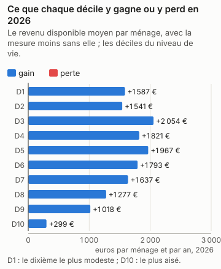
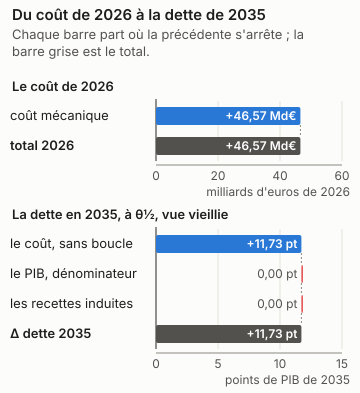
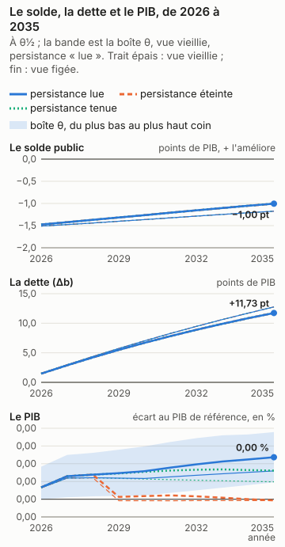
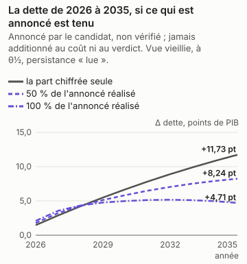
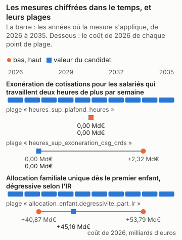

# Édouard Philippe : la part chiffrée du programme, en trois réponses

<!-- Généré par `impots etude ecrire presidentielle_philippe` depuis reports/etudes/presidentielle_philippe/ ; ne pas éditer à la main. -->

## Ce que dit cette étude

La part chiffrée du programme coûte 46,57 Md€ au budget sur le droit et les revenus de 2026, comme si elle s'appliquait cette année-là, avant tout changement de comportement. Les ménages y voient leur revenu disponible changer en moyenne de +1 587 € par an dans le dixième le plus modeste à +299 € dans le dixième le plus aisé, le plus touché étant le 3e dixième (+2 054 €). L'outil ne dit pas ce que les comportements y changent : aucune étude publiée ne le permet ici, et la page dit pourquoi. En 2035, la dette publique serait plus haute de 11,73 points de PIB, au milieu des fourchettes publiées et sous les hypothèses de croissance, de taux et de dépense de la page ; la dette monte dans 100 % des tirages du calcul d'incertitude, et l'outil conclut que cette part du programme augmente la dette. L'effet sur l'activité n'est lu que pour l'impôt sur le revenu et les cotisations des salariés. Sans aucun effet sur l'activité, la dette serait plus haute de 11,73 points de PIB : le coût seul, sans la boucle macro. La boucle lit les cotisations des salariés dans la variante « cotisations sociales salariés » de Mésange (G2017/04, folio 110). Elle porte sur les salariés des branches marchandes et rend son effet par une baisse du salaire brut (−2,49 % à dix ans) et du coût du travail ; le coût de l'outil, lui, tient le salaire brut fixe, et tout va au salaire net. Le retour que la boucle lit est donc probablement surestimé, et la dette de tête trop basse d'autant, d'un écart que l'outil ne mesure pas. Le choc vaut jusqu'à 0,00 fois celui de la variante, d'un point de PIB, que la boucle lit comme linéaire. En regard du chiffre de tête, à θ½ et vue vieillie : si les salaires se forment comme dans la variante salariale de Mésange (un super-brut visé, folios 137 et 138), la dette serait plus haute de 11,73 points. Ces nombres valent pour la seule part chiffrée, pas pour le programme entier.

Édouard Philippe, Horizons, a déclaré sa candidature à l'élection présidentielle de 2027. Son programme a été relevé le 12/11/2026 ; le relevé compte ses mesures, celles qui énoncent un paramètre, et celles que cet outil chiffre. Il dit plus bas pourquoi il ne chiffre pas les autres.

| mesures relevées | dont qui énoncent un paramètre | chiffrées par l'outil | part des mesures paramétrées |
|---|---|---|---|
| 23 | 16 | 2 | 12 % |

Pour la part chiffrée, ces mesures ensemble, trois réponses : ce qu'elle coûte et qui y gagne ; ce qu'elle coûte une fois les comportements et l'économie pris en compte ; ce qu'elle fait à la dette en 2035. **La dette porte sur la seule part du programme que l'outil chiffre, pas sur le programme : les mesures refusées, dites plus bas une à une avec leur « porte » (ce qui manque à l'outil pour les chiffrer), n'y sont pas, et un programme chiffré en partie peut paraître creuser ou baisser la dette pour une raison qui tient à l'outil (D-319).**

Chaque nombre dépend de ce qui est dit à côté de lui. Le coût de la première année est mécanique : personne ne change de comportement. La bande dit ce que les comportements y changent quand une étude publiée permet de le dire. La dette en 2035 dépend d'hypothèses de croissance, de taux et de dépenses nommées en bas de page, et de θ, la position de chaque réponse dans sa fourchette publiée : θ½ est le milieu, et les coins de la boîte placent chaque réponse aux deux bornes de sa fourchette. Le calcul d'incertitude (Monte-Carlo) tire aussi l'effet sur l'activité au-delà de ces bornes, de l'écart qui sépare les études entre elles : le verdict, qui le lit, et « selon θ », qui lit la boîte, peuvent donc différer.

## En bref

| programme | la première année | le chiffrage officiel | dette en 2035, à θ½ | verdict | selon θ |
|---|---|---|---|---|---|
| la part chiffrée (2 mesures sur 16 paramétrées, 23 relevées) | +46,57 Md€ | — | +11,73 pt | hausse (100 % des tirages en hausse) | hausse |

Le verdict se lit sur le Monte-Carlo (D-345) : « hausse » quand au moins 90 % des tirages font monter la dette, vue vieillie, « baisse » quand au moins 90 % la font baisser, « dépend » entre les deux. « Selon θ » dit ce que la boîte θ en dit, sans probabilité : un seul signe à θ½ et à chaque coin, ou non.

Un coût positif coûte au budget, un coût négatif lui rapporte. La dette est en points de PIB, dans la vue vieillie et sous la persistance « lue » de l'effet macro de chaque mesure, Mésange lu à ses horizons ; « selon θ » lit les deux vues sous cette persistance seule (D-336). « Éteint » et « tenu » sont des sensibilités, données plus bas, hors du verdict.

## La part chiffrée

*Édouard Philippe (Horizons), programme relevé le 2026-11-12 — la part chiffrée : p10_exoneration_deux_heures, p11_allocation_familiale_unique*

2 mesures chiffrées sur 16 paramétrées et 23 relevées. La réforme est celle des mesures chiffrées du programme, ensemble, à la valeur du candidat ; les autres n'y sont pas.

### 1. Ce qu'il coûte, et qui y gagne

*Source du graphique : `reports/etudes/presidentielle_philippe/premiere_annee_pres2027_philippe_programme.json` ; tracé par `impots.graphiques`. Ses nombres reposent sur : L2, la simulation mécanique ; les déciles sont ceux de la population (L1).*

La mesure coûte **46,57 Md€** la première année (2026), sur la population de 2024 au droit de 2026.

| décile | ménages | niveau de vie moyen | delta moyen | gagnants | perdants |
|---|---|---|---|---|---|
| 1 | 3 105 439 | 8 733 € | +1 587 € | 27 % | 0 % |
| 2 | 3 105 989 | 14 008 € | +1 541 € | 25 % | 0 % |
| 3 | 3 105 379 | 17 392 € | +2 054 € | 34 % | 0 % |
| 4 | 3 104 866 | 20 386 € | +1 821 € | 32 % | 0 % |
| 5 | 3 104 805 | 23 095 € | +1 967 € | 34 % | 0 % |
| 6 | 3 105 390 | 25 856 € | +1 793 € | 33 % | 0 % |
| 7 | 3 105 062 | 28 962 € | +1 637 € | 33 % | 0 % |
| 8 | 3 106 224 | 32 877 € | +1 277 € | 28 % | 0 % |
| 9 | 3 104 805 | 38 656 € | +1 018 € | 27 % | 0 % |
| 10 | 3 105 795 | 57 879 € | +299 € | 10 % | 3 % |

Les déciles sont ceux du niveau de vie de la population simulée. Toute structure
plus fine qu'un décile est un artefact de l'imputation, pas un résultat.

### 2. Avec les comportements et l'économie

*Source du graphique : `reports/etudes/presidentielle_philippe/premiere_annee_pres2027_philippe_programme.json` et `reports/etudes/presidentielle_philippe/predictif_pres2027_philippe_programme.json` (sa décomposition, D-349) ; tracé par `impots.graphiques`. Ses nombres reposent sur : L2 pour le coût mécanique, L3 pour les comportements, L4 pour la dette, sous hypothèses.*

**Bande comportementale : aucune, et la raison est donnée.** Aucun canal fondé sur des preuves ne couvre cet instrument : le chiffre reste purement mécanique.

**L'effet sur l'économie**, l'éventail macro (la fourchette de ce que des multiplicateurs publiés disent du PIB et de l'emploi), **dans l'étendue des estimations**, le choc ne dépassant pas ceux sur lesquels les multiplicateurs ont été estimés ; 0 % de la mesure a un multiplicateur publié ; conjoncture supposée normale, ni récession ni surchauffe :

* **PIB, à 1 an** : [-519 512 € ; +1 M€], central +436 232 €
* **PIB, à 2 ans** : [-186 509 € ; +2 M€], central +738 423 €
* **PIB, à 3 ans** : [-218 771 € ; +2 M€], central +778 840 €
* **emploi, à 1 an** : [-0,00 ; +0,00] milliers ETP, central +0,00
* **emploi, à 2 ans** : [-0,00 ; +0,01] milliers ETP, central +0,00
* **emploi, à 3 ans** : [-0,00 ; +0,02] milliers ETP, central +0,01

> Couche macro (L4) : ordre de grandeur et composition, pas une prévision. L'éventail des estimations crédibles pour un même choc est large — la dispersion entre études publiées est du même ordre que la valeur centrale elle-même. C'est une propriété de la littérature, pas de ce modèle.

Ce que la chaîne ne lit pas, et pourquoi :

* **IS et investissement des entreprises** — aucune variante d'IS dans Mésange 2017, et aucune réestimation publiée depuis.
* **transferts** — Mésange n'a pas de variante de transfert.
* **créations d'entreprises** — C8 est un indice illustratif de la couche entreprises, en points de taux de création de sociétés, jamais une recette : la trajectoire chiffre le coût d'une baisse d'IS (D-244), pas les sociétés qu'elle ferait naître (§6.3, D-221).
* **R&D et CIR** — C9 est un indice illustratif de la couche entreprises, en euros de R&D, jamais une recette.

### 3. La dette en 2035

*Source du graphique : `reports/etudes/presidentielle_philippe/predictif_pres2027_philippe_programme.json`, rejoué année par année par `impots.predictif.rejouer`, qui redonne chacun de ses Δb et chaque coin de sa boîte ; tracé par `impots.graphiques`. Ses nombres reposent sur : L4, sous hypothèses : le cadre nommé en bas de page, et θ.*

| persistance | vue | Δ dette 2035, à θ½ | aux coins de la boîte |
|---|---|---|---|
| Effet macro lu dans Mésange à 1, 2, 3, 5 et 10 ans (spécification centrale), interpolé linéairement entre eux | vieillie | +11,73 pt | de +11,73 pt à +11,73 pt |
| Effet macro lu dans Mésange à 1, 2, 3, 5 et 10 ans (spécification centrale), interpolé linéairement entre eux | figée | +12,76 pt | de +12,76 pt à +12,76 pt |

En points de PIB de 2035, la dette avec la mesure moins la dette sans elle, l'effet macro lu dans Mésange à ses horizons (persistance « lue », D-336). La vue vieillie fait vieillir la population chaque année avec les salaires ; la vue figée la garde telle qu'elle est. Sous cette persistance, elle **augmente la dette** en 2035, à θ½ comme à chaque coin de la boîte, dans les deux vues.

**Le verdict**, lu sur le Monte-Carlo (D-345) : elle **augmente la dette** en 2035 dans au moins 90 % des tirages, vue vieillie.

**Ce que la boucle lit, et ce que l'outil ne mesure pas.** La boucle lit les cotisations des salariés dans la variante « cotisations sociales salariés » de Mésange (G2017/04, folio 110). Elle porte sur les salariés des branches marchandes et rend son effet par une baisse du salaire brut (−2,49 % à dix ans) et du coût du travail ; le coût de l'outil, lui, tient le salaire brut fixe, et tout va au salaire net. Le retour que la boucle lit est donc probablement surestimé, et la dette de tête trop basse d'autant, d'un écart que l'outil ne mesure pas. Le choc vaut jusqu'à 0,00 fois celui de la variante, d'un point de PIB, que la boucle lit comme linéaire. En regard du chiffre de tête, à θ½ et vue vieillie : sans aucun effet sur l'activité, la dette serait plus haute de 11,73 points ; si les salaires se forment comme dans la variante salariale de Mésange (un super-brut visé, folios 137 et 138), la dette serait plus haute de 11,73 points.

**Les sensibilités, hors du verdict.** Les deux persistances que les pages lisaient avant la persistance « lue » (D-336), sur les mêmes passes : l'effet macro éteint après trois ans, ou tenu au niveau de la troisième année. Mésange ne porte ni l'une ni l'autre ; elles disent ce que le choix de la persistance pèse, et n'entrent pas dans le verdict.

| persistance | vue | Δ dette 2035, à θ½ | aux coins de la boîte |
|---|---|---|---|
| Effet macro éteint après trois ans | vieillie | +11,73 pt | de +11,73 pt à +11,73 pt |
| Effet macro éteint après trois ans | figée | +12,76 pt | de +12,76 pt à +12,76 pt |
| Effet macro tenu au niveau de la troisième année | vieillie | +11,73 pt | de +11,73 pt à +11,73 pt |
| Effet macro tenu au niveau de la troisième année | figée | +12,76 pt | de +12,76 pt à +12,76 pt |

**La distribution, à côté de la boîte.** La boîte dit jusqu'où Δb va quand chaque effet parcourt sa fourchette publiée : ce n'est pas une probabilité. Le Monte-Carlo en est une, sous des lois déclarées : Lois du magasin, ligne par ligne ; copule gaussienne de corrélation ρ entre les lignes d'un même article, indépendance entre articles ; décalage du multiplicateur normal centré réduit, multiplicateur Mésange + z × écart-type IMK censuré à zéro ; indépendant des lignes. (ρ = 0,8, 2000 tirages, persistance « lue », D-336). D'autres lois donneraient une autre réponse.

| vue | P(hausse de la dette en 2035) | quantile 5 % | médiane | quantile 95 % | ce qui pèse le plus (Sobol, total) |
|---|---|---|---|---|---|
| vieillie | 100 % | +11,73 pt | +11,73 pt | +11,73 pt | le multiplicateur 0,98 |
| figée | 100 % | +12,76 pt | +12,76 pt | +12,76 pt | le multiplicateur 0,98 |

**D'où vient Δb.** La dette de 2035 en trois marches, à θ½ sous la persistance « lue » : le coût après comportements, sans la boucle macro ; ce que le PIB plus haut ou plus bas change au seul ratio, comme dénominateur ; ce que les recettes induites par l'activité y changent. Les trois font la ligne du tableau (D-349).

| vue | le coût, sans boucle | le PIB, dénominateur | les recettes induites | Δ dette 2035 |
|---|---|---|---|---|
| vieillie | +11,73 pt | -0,00 pt | -0,00 pt | +11,73 pt |
| figée | +12,76 pt | -0,00 pt | -0,00 pt | +12,76 pt |

**Au taux de marché.** La dette ajoutée est chargée au taux implicite de 2025 (D-336). Chargée à 3,5 %, hypothèse déclarée d'une OAT à dix ans de fin 2026 : +12,66 pt en vue vieillie, contre +11,73 pt ; +13,74 pt en vue figée, contre +12,76 pt.

**Si les salaires se forment autrement.** Mésange publie une sensibilité de ses variantes à la formation des salaires (folios 137 et 138) : une courbe de Phillips pour les cotisations employeurs et la TVA, un super-brut visé pour les cotisations salariés, la CSG et l'IR. Le multiplicateur y est recentré, à écart-type, persistance et recettes induites par point de PIB inchangés ; Mésange n'imprime pas le solde de la variante, que la page suppose proportionnel au PIB (D-349). C'est une sensibilité, hors du verdict.

| vue | Δ dette 2035, à θ½ | aux coins de la boîte | P(hausse) | verdict |
|---|---|---|---|---|
| vieillie | +11,73 pt | de +11,73 pt à +11,73 pt | 100 % | hausse |
| figée | +12,76 pt | de +12,76 pt à +12,76 pt | 100 % | hausse |

### La dette en 2035, si les économies annoncées sont tenues et les dépenses annoncées faites

*Source du graphique : `reports/etudes/presidentielle_philippe/predictif_pres2027_philippe_programme.json`, `programmes/philippe.json` et `reports/macro/variante_depense_publique.json`, lus par `impots.predictif.annonce` ; tracé par `impots.graphiques`. Ses nombres reposent sur : L4 pour la part chiffrée, sous hypothèses ; annoncé pour le reste.*

**Une lecture à part : annoncée par le candidat, non vérifiée.** La dette plus haut est celle de la part chiffrée ; les économies de dépense que le programme annonce, que l'outil ne microsimule pas, n'y entrent pas, et ses dépenses non plus (D-319). Ici, les montants par an que le candidat attache lui-même à ses mesures de dépense publique sont lus par la variante « dépense publique » de Mésange, son effet sur le PIB et sur le solde, et s'ajoutent à la dette de la part chiffrée. Ni le coût de la part chiffrée ni le verdict ne les lisent (D-380).

| mesure | montant annoncé, par an | sens | calendrier annoncé |
|---|---|---|---|
| Fonds unique d'adaptation au changement climatique, qui fusionne le Fonds Barnier et le Fonds vert | +2,00 Md€ | dépense | par an |
| « Deal » : baisse des aides aux entreprises, contrepartie de la baisse des impôts de production (p3) | +50,00 Md€ | économie | par an ; contrepartie de p3 |

| part réalisée | solde annoncé, par an | Δ dette 2035, vue vieillie | Δ dette 2035, vue figée |
|---|---|---|---|
| 0 % | +0 € | +11,73 pt | +12,76 pt |
| 50 % | +24,00 Md€ | +8,24 pt | +9,27 pt |
| 100 % | +48,00 Md€ | +4,71 pt | +5,75 pt |

À θ½, sous la persistance « lue ». À une part réalisée nulle, la ligne est la dette de la part chiffrée, plus haut ; le solde est positif quand il améliore les comptes publics.

**Ce que la variante suppose.** La variante « dépense publique » de Mésange est un composite, pas un instrument (D-214, page 106 du PDF) : 8 % d'investissement public, 25 % de rémunérations publiques, 9 % de prestations en nature, 12 % de consommations intermédiaires, 46 % de prestations sociales en espèces. La lire suppose que chaque euro annoncé tombe sur la dépense dans ces proportions, quoi que la mesure dise ; les transferts n'ont pas de variante à eux, et une économie sur les prestations lit la même moyenne. Montant atteint dès la première année du chemin et tenu en part du PIB de cette année-là : le calendrier que le candidat énonce est montré, pas lu. Choc de la variante en volume, lu comme des euros : prix de la réforme tenus constants (D-214, condition 4). Ligne de solde lue sous la dépense gelée en volume seule (note 70, D-214). Variantes superposées : Mésange est linéaire (D-230), et ce qu'annonce le candidat s'ajoute à la part chiffrée sans interaction.

**Pas lues** — hors de la dépense publique : sa porte relève d'un autre module (retraites, prestations, salaires, entreprises) : Âge légal porté à 65 ans et durée de cotisation à 45 annuités, d'abord en reprenant le calendrier 2023 (64 ans, 43 ans).

*Annoncé par le candidat, non vérifié ; jamais additionné au coût de l'outil ni au verdict (D-319, D-380).*

### L'écart au chiffrage officiel

La part chiffrée n'est pas un cas enregistré : ses mesures le sont, une à une, avant que le juge ne publie. Le juge est le chiffrage des programmes de l'Institut Montaigne, attendu au premier trimestre 2027.

* `pres2027_philippe_p10_exoneration_deux_heures`, enregistré le 2026-11-12 : +1 M€ en 2026, tolérance de 25 % ou 200 M€ ; le juge n'a pas publié.
* `pres2027_philippe_p11_allocation_familiale_unique`, enregistré le 2026-11-12 : +45,56 Md€ en 2026, tolérance de 50 % ou 2,00 Md€ ; le juge n'a pas publié.

## Chaque mesure seule, et leur interaction

Chaque mesure chiffrée passe aussi seule, en entier : sa première année et son chemin annuel jusqu'en 2035, dans le cadre de la part chiffrée, sur la même population et le même code. La part chiffrée n'est pas la somme de ses mesures : deux mesures se rencontrent dans le barème, dans les prestations sous condition de ressources, dans la boucle macro, et dans la dette, que chacune creuse sur le PIB que l'autre a changé. L'écart, la part chiffrée moins la somme des mesures, est dit sur sa ligne, « interaction » : il n'est réparti entre aucune mesure.

**Les mesures seules : absentes, et la raison est donnée.** Les passes des mesures seules n'ont pas tourné : `impots etude lancer presidentielle_philippe` les lance, après celles de la part chiffrée. Les rapports de cette page viennent d'une série qui ne les avait pas.

## Ce que bouge chaque paramètre

Chaque mesure chiffrée a une plage : le lecteur peut la régler, du bas au haut. Trois points la parcourent, le bas, la valeur du candidat et le haut. Chaque point est la mesure seule, mécanique (personne ne change de comportement), sur la population vieillie jusqu'en 2026 ; sa dette reporte la première année en part de PIB jusqu'en 2035, un calcul rapide qui ne refait pas chaque année. Elle ne se compare donc pas à celle de la part chiffrée, plus haut, que le calcul complet chiffre année par année avec les comportements et la boucle macro. Leur coût diffère aussi de celui de la part chiffrée : celle-ci est chiffrée sur la population de 2024 au droit de 2026, les plages sur la population vieillie jusqu'en 2026. Quand un programme a plusieurs paramètres, chacun se règle seul, les autres restant à la valeur du candidat.

*Source du graphique : `programmes/philippe.json` et `reports/etudes/presidentielle_philippe/plages/`, ses 9 points de plage ; tracé par `impots.graphiques`. Ses nombres reposent sur : L2 pour les coûts ; la valeur du candidat est celle du programme, le bas et le haut des hypothèses.*

### Exonération de cotisations pour les salariés qui travaillent deux heures de plus par semaine

*Le programme : +2 h/semaine exonérées.*

Ce que l'outil en lit : « Exonérer de cotisations sociales les salariés qui accepteraient de travailler deux heures supplémentaires par semaine » : sur les heures supplémentaires imputées (D-383), les deux premières de chaque semaine travaillée, 94 heures par an sur 47 semaines (plage de 44 à 52 semaines). Les cotisations salariales que la loi laisse au-delà de sa réduction ; la CSG et la CRDS restent, la plage va jusqu'à les exonérer. Les patronales ne bougent pas : le texte parle des salariés. Seules les heures déjà faites : les deux heures neuves que la mesure veut faire faire, et les 1 000 € par an qu'elles rapporteraient, ne sont pas comptées. Contre le droit de 2026.

| `heures_sup_plafond_heures` | valeur | coût 2026 | dette en 2035, mécanique, sans comportements ni boucle |
|---|---|---|---|
| le bas | 88 | +1 M€ | +0,00 pt |
| le candidat | 94 | +1 M€ | +0,00 pt |
| le haut | 104 € | +1 M€ | +0,00 pt |

| `heures_sup_exoneration_csg_crds` | valeur | coût 2026 | dette en 2035, mécanique, sans comportements ni boucle |
|---|---|---|---|
| le bas | 0 | +1 M€ | +0,00 pt |
| le candidat | 0 | +1 M€ | +0,00 pt |
| le haut | 1 | +2,32 Md€ | +0,72 pt |

### Allocation familiale unique dès le premier enfant, dégressive selon l'IR

*Le programme : 350 €/mois.*

Ce que l'outil en lit : Une prestation neuve (D-382) : 350 € par mois pour chaque enfant à charge dès le premier, à la place des allocations familiales (avec leur majoration pour âge et leur forfait) et du complément familial, que « unique » fond ; l'allocation de rentrée scolaire reste. Hypothèses : par enfant, comme le dit « dès le premier enfant » (l'autre lecture, 350 € par famille, coûterait bien moins et n'est pas la valeur retenue) ; jusqu'à la veille de 20 ans, l'âge des allocations familiales. « Dégressif en fonction de l'impôt sur le revenu » n'a pas de barème : l'allocation annuelle de la famille baisse de la moitié de l'impôt de son foyer (un douzième par mois), sans plancher ; la plage va de 0 (pas de dégressivité) à 1 (un euro d'allocation par euro d'impôt). Ni imposable ni dans les ressources des minima et des aides au logement (D-382). Contre le droit de 2026.

| `allocation_enfant.degressivite_part_ir` | valeur | coût 2026 | dette en 2035, mécanique, sans comportements ni boucle |
|---|---|---|---|
| le bas | 0 | +53,79 Md€ | +16,61 pt |
| le candidat | 0,5 | +45,16 Md€ | +13,95 pt |
| le haut | 1 | +40,87 Md€ | +12,62 pt |

## Le programme, mesure par mesure

Une mesure est chiffrée, refusée ou vague. Une mesure refusée n'est pas une mesure à zéro : sa « porte » dit ce qui manque à l'outil, ce qu'il devrait savoir faire pour la chiffrer. Une mesure vague n'énonce ni taux ni montant.

| mesure | ce que dit le candidat | sort | pourquoi |
|---|---|---|---|
| Déficit public à 2 % du PIB en 2032 | 2 % du PIB en fin de quinquennat (2032), contre 5 % | refusée : une hypothèse du calcul de la dette (`chaine`) | Une trajectoire de déficit est une hypothèse du calcul de la dette, pas une réforme : aucun bouton ne la règle. |
| Règle d'or étendue à la Sécurité sociale, adoptée par référendum en début de quinquennat | non chiffrée | vague | Ni plafond de dépense ni solde chiffré : une règle d'or sans paramètre. |
| « Deal » : 50 Md€ par an de baisse des impôts de production (CVAE, C3S et CFE citées), contre 50 Md€ de baisse des aides aux entreprises | 50 Md€ par an, soit 250 Md€ sur le quinquennat ; « en un coup » dès le premier PLF (selon un conseiller) | refusée : un montant sans règle de calcul (`enveloppe`) | Une enveloppe de 50 Md€ par an sans dire de combien baisse chaque impôt. Le bouton de l'enveloppe (impots_production_baisse) ne la répartit qu'entre la CVAE et la C3S, les seuls impôts de production du moteur, qui rapportent moins de 50 Md€ en 2026 : il la refuse. La CFE, citée, et la taxe foncière des entreprises n'y sont pas. |
| Pacte pluriannuel de stabilité fiscale et réglementaire sur 5 ans | 5 ans | vague | Une durée sans taux ni montant : la stabilité promise ne règle aucun paramètre. |
| Âge légal porté à 65 ans et durée de cotisation à 45 annuités, d'abord en reprenant le calendrier 2023 (64 ans, 43 ans) | 65 ans et 45 annuités « en moins de 10 ans » | refusée : les droits à la retraite (`retraites`) | L'âge légal et la durée de cotisation ne se règlent pas : la population ne vieillit pas et ses pensions sont des données. |
| Départs anticipés entre 60 et 64 ans pour un Français sur trois ; âges handicap, incapacité et invalidité inchangés ; âge d'annulation de la décote (67 ans) inchangé | 1 sur 3 entre 60 et 64 ans ; 55, 60, 62 et 67 ans maintenus | refusée : les droits à la retraite (`retraites`) | Les départs anticipés et l'âge d'annulation de la décote ne se règlent pas : la population ne vieillit pas et ses pensions sont des données. |
| Capitalisation collective obligatoire alimentée par les excédents de l'Agirc-Arrco, plan d'épargne retraite généralisé, versement de l'État à la signature du premier contrat de travail | 500 € au premier contrat de travail | refusée : les droits à la retraite (`retraites`) | Un pilier par capitalisation et un versement de 500 € sur un plan d'épargne retraite : la population ne porte ni régime par capitalisation ni épargne retraite. |
| Objectif de part de la capitalisation dans les pensions | 10 à 15 % des pensions versées dans 15 ans | refusée : les droits à la retraite (`retraites`) | Une part cible des pensions servie par capitalisation : les pensions de la population sont des données, sans régime par capitalisation. |
| Les retraités contribuent davantage au financement de la protection sociale | non chiffré | vague | Ni taux ni montant : l'instrument de la contribution des retraités n'est pas dit. |
| Exonération de cotisations pour les salariés qui travaillent deux heures de plus par semaine | +2 h/semaine exonérées | chiffrée | « Exonérer de cotisations sociales les salariés qui accepteraient de travailler deux heures supplémentaires par semaine » : sur les heures supplémentaires imputées (D-383), les deux premières de chaque semaine travaillée, 94 heures par an sur 47 semaines (plage de 44 à 52 semaines). Les cotisations salariales que la loi laisse au-delà de sa réduction ; la CSG et la CRDS restent, la plage va jusqu'à les exonérer. Les patronales ne bougent pas : le texte parle des salariés. Seules les heures déjà faites : les deux heures neuves que la mesure veut faire faire, et les 1 000 € par an qu'elles rapporteraient, ne sont pas comptées. Contre le droit de 2026. |
| Allocation familiale unique dès le premier enfant, dégressive selon l'IR | 350 €/mois | chiffrée | Une prestation neuve (D-382) : 350 € par mois pour chaque enfant à charge dès le premier, à la place des allocations familiales (avec leur majoration pour âge et leur forfait) et du complément familial, que « unique » fond ; l'allocation de rentrée scolaire reste. Hypothèses : par enfant, comme le dit « dès le premier enfant » (l'autre lecture, 350 € par famille, coûterait bien moins et n'est pas la valeur retenue) ; jusqu'à la veille de 20 ans, l'âge des allocations familiales. « Dégressif en fonction de l'impôt sur le revenu » n'a pas de barème : l'allocation annuelle de la famille baisse de la moitié de l'impôt de son foyer (un douzième par mois), sans plancher ; la plage va de 0 (pas de dégressivité) à 1 (un euro d'allocation par euro d'impôt). Ni imposable ni dans les ressources des minima et des aides au logement (D-382). Contre le droit de 2026. |
| Réduction d'impôt pour les familles qui travaillent, pendant les trois années qui suivent chaque naissance | ≈ 3 000 € par an pendant 3 ans après la naissance ; les foyers qui paient moins de 3 000 € d'IR n'en paient plus | refusée : un réglage que le moteur n'a pas encore (`bouton_hors_but`) | Le bouton de la réduction d'impôt des familles (reduction_impot_familles_montant, _enfants_min) donne le montant à tout foyer qui travaille et a des enfants, chaque année ; la mesure ne vaut que pendant les trois années qui suivent une naissance. Il manque au bouton une condition sur l'âge du plus jeune enfant : le chiffrer sans elle chiffrerait une autre mesure, bien plus large. |
| Prêt à taux zéro pour acheter un logement plus grand à l'arrivée d'un enfant | aucun plafond ni montant | vague | Ni plafond ni montant de prêt. |
| Durée maximale d'indemnisation chômage ramenée de 18 à 12 mois pour les moins de 50 ans | 18 → 12 mois (moins de 50 ans) | refusée : une prestation que le moteur ne porte pas (`prestations_hors_modele`) | L'assurance chômage n'est pas dans le moteur : ni sa durée d'indemnisation ni ses allocataires. |
| Non-remplacement d'un départ sur trois dans la fonction publique | 1 départ sur 3 non remplacé, pendant le quinquennat | refusée : la dépense publique (`depense_publique`) | Les effectifs publics sont une dépense que le moteur ne microsimule pas : seulement un scénario de dépense du calcul de la dette. |
| Moitié de l'effort budgétaire portée par les dépenses sociales | 50 % de l'effort | refusée : la dépense publique (`depense_publique`) | Une part de l'effort sans montant ni prestation désignée : la dépense n'est qu'un scénario du calcul de la dette. |
| Baisser les dépenses plutôt qu'augmenter les impôts ; baisser les dépenses sociales ; supprimer des niches fiscales ; faire contribuer les plus aisés | non chiffré | vague | Aucune niche, aucune dépense ni aucun montant désignés. |
| Fonds unique d'adaptation au changement climatique, qui fusionne le Fonds Barnier et le Fonds vert | 2 Md€/an | refusée : la dépense publique (`depense_publique`) | Un fonds public de 2 Md€ par an est une dépense que le moteur ne microsimule pas. |
| « Deal » : baisse des aides aux entreprises, contrepartie de la baisse des impôts de production (p3) | 50 Md€ par an | refusée : la dépense publique (`depense_publique`) | Des aides aux entreprises baissées sans dispositif désigné : la dépense n'est qu'un scénario du calcul de la dette. |
| Arrêts de travail : jours de carence d'ordre public non indemnisés pour les arrêts ponctuels ; délai incompressible entre arrêt maladie et rupture conventionnelle | 1 à 2 jours de carence ; délai de 3, 5 ou 6 mois | refusée : la dépense publique (`depense_publique`) | Le moteur porte l'impôt des indemnités journalières, pas les arrêts ni leur carence : c'est une dépense qu'il ne microsimule pas. |
| Revalorisation des enseignants sur le quinquennat, financée par la baisse du nombre d'élèves | +20 % de la rémunération moyenne sur le quinquennat | refusée : la distribution des salaires (`salaires`) | Le traitement des enseignants est un salaire public : la population ne les distingue pas, et ses salaires sont des données. |
| Donations du vivant aux enfants et petits-enfants « massivement » facilitées | aucun abattement ni montant | vague | Ni abattement ni barème énoncés. |
| Grand plan fret ferroviaire | aucun montant | vague | Ni montant ni calendrier d'investissement. |

Les portes, de celle qui ouvrirait le plus de mesures à celle qui en ouvrirait le moins :

* 5 mesures — la dépense publique, que le moteur ne simule pas ménage par ménage : elle n'entre dans la dette que comme une hypothèse de dépense (`depense_publique`).
* 4 mesures — les droits à la retraite (âges, durées, régimes) : la population ne vieillit pas en âge et ses pensions sont des données (`retraites`).
* 1 mesure — un réglage que le moteur n'a pas encore et qui reste à écrire (l'imposition des revenus du capital au barème, une exonération par âge…) (`bouton_hors_but`).
* 1 mesure — une hypothèse du calcul de la dette année par année, pas une réforme : règle budgétaire, trajectoire de déficit (`chaine`).
* 1 mesure — une règle : le candidat dit combien (un montant global), pas comment (un taux, un seuil, une assiette) (`enveloppe`).
* 1 mesure — une prestation que le moteur ne porte pas : assurance chômage, prestation fusionnée ou neuve (`prestations_hors_modele`).
* 1 mesure — la distribution des salaires : SMIC, point d'indice, indexation des salaires (`salaires`).

## Ce que le candidat annonce, à part

Le programme annonce lui-même un montant pour 4 de ses mesures. Ces montants ne sont pas vérifiés et ne s'ajoutent jamais au chiffrage de l'outil : la part réalisée dit ce qui s'en réaliserait, de rien à tout. Le solde est l'effet annoncé sur les comptes publics, positif quand ils s'améliorent. Le relevé, fait à la main, ne retient que les montants que le programme attache à une mesure comme un effet annuel ; d'autres montants cités dans le tableau des mesures (des totaux sur plusieurs années, des enveloppes) n'y sont pas, et il peut en avoir manqué (D-378).

| part réalisée | solde annoncé |
|---|---|
| 0 % | +0 € |
| 50 % | +14,00 Md€ |
| 100 % | +28,00 Md€ |

*déclaré par le candidat, non vérifié ; jamais additionné au chiffrage du moteur (D-319)*

## D'où viennent ces nombres

Les passes ont tourné sur 2 commits, conteneur cloud, 15 Go, 4 cœurs, deux files ; chaque rapport nomme le sien. Un commit après le premier rejoint l'étude quand sa passe témoin, `plages/p10_exoneration_deux_heures__heures_sup_plafond_heures__bas.json` rejouée sur lui, redonne son rapport à l'identique, hors date, commit et lieu (D-335) :

* `aa22293`, le premier.
* `d4f3f7f`, rejoint par `reports/etudes/presidentielle_philippe/temoins/d4f3f7f.json`, témoin du 2026-11-13.

Cadre du calcul année par année jusqu'en 2035 : Croissance réelle 1 %, prix 2 % ; Taux implicite tenu à son niveau de 2025 ; Dépenses gelées en volume ; droit reconduit tel qu'openfisca le porte ; θ½ sur toutes les lignes ; comportements et boucle macro appliqués.

*Population vieillie mécaniquement de 2024 à 2035 — salaires 3,0 % par an, prix 2,0 % par an, hypothèses DÉCLARÉES et non prévues (3 % ronds, le rythme du PIB nominal du scénario). La structure des ménages, les âges et les poids n'ont PAS bougé : c'est la France de l'année de base avec l'argent de l'année d'arrivée, et cela biaise vers l'immobilité démographique. **Cette population n'est plus calibrée** : les totaux dépensés au registre le sont sur l'année de base, et il n'existe pas de total publié pour une année future. Toute ligne de réconciliation sur cette année refuse un verdict de tolérance plutôt que d'en donner un qui se lirait comme une validation.*

Le secteur public est modélisé statut par statut (D-346) : un titulaire est payé d'un traitement indiciaire et de primes, et cotise à son régime ; un contractuel cotise au régime général, sans allègement. L'enquête Emploi dit titulaire ou contractuel et la fonction publique, pas le corps ni l'indice : la part des primes est la moyenne qu'openfisca porte, la même pour tous.

**La vérification de ses instruments.** Le niveau que le moteur donne à chaque instrument que la page chiffre, contre son total publié, sur 2022, 2023 et 2024 (`docs/verification/GRILLE.md`, D-364) : l'écart moyen, son étendue, et les années qui tiennent la tolérance écrite avant le calcul.

* Allocations familiales, montant : −16,5 % en moyenne, de −17,1 % à −15,6 % ; 3 années sur 3 dans sa tolérance.
* Foyers allocataires de la prime d'activité, servis en espérance : −28,1 % en moyenne, de −30,0 % à −26,2 % ; 0 année sur 3 dans sa tolérance.
* Prime d'activité, montant servi en espérance (sans pont) : −25,1 % en moyenne, de −26,8 % à −23,5 % ; 0 année sur 3 dans sa tolérance.
* Foyers allocataires du RSA, servis en espérance : −0,6 % en moyenne, de −0,7 % à −0,4 % ; 2 années sur 2 dans sa tolérance.
* RSA, montant servi en espérance (sans pont) : +1,2 % en moyenne, de −0,6 % à +3,3 % ; 3 années sur 3 dans sa tolérance.

Le moteur calcule le droit de chaque famille, ce qu'elle toucherait si elle le demandait ; une part des ayants droit ne demande rien (le non-recours). « Servi en espérance » : chaque famille reçoit son droit multiplié par sa probabilité de le demander, calée sur le non-recours publié par la Drees. « Sans pont » : ce montant se compare tel quel au total versé. Un « pont de non-recours » est l'ancienne correction : un seul coefficient de non-recours, appliqué au total.

Un écart de niveau ne se reporte pas tel quel sur le chiffrage : le coût d'une mesure est la différence de deux passes sur la même population, et ce qui manque aux deux passes s'y annule en partie.

* `reports/etudes/presidentielle_philippe/premiere_annee_pres2027_philippe_programme.json`, `reports/etudes/presidentielle_philippe/predictif_pres2027_philippe_programme.json`
* `reports/etudes/presidentielle_philippe/plages/`, les 9 points des plages
* `reports/etudes/presidentielle_philippe/mesures/<mesure>/`, la première année et le chemin de chaque mesure seule
