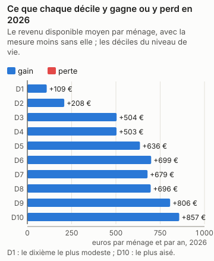
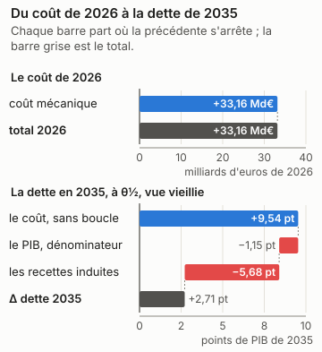
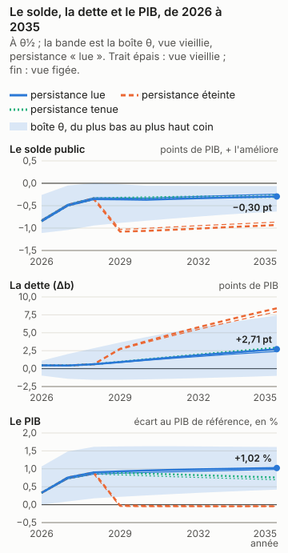
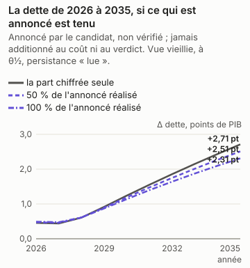
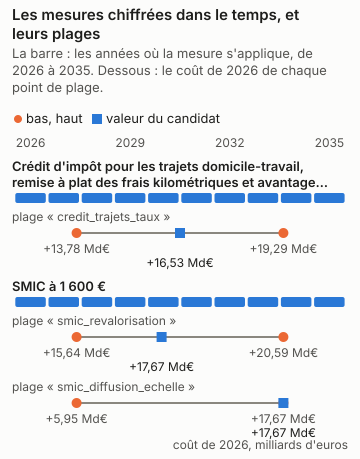

# François Ruffin : la part chiffrée du programme, en trois réponses

<!-- Généré par `impots etude ecrire presidentielle_ruffin` depuis reports/etudes/presidentielle_ruffin/ ; ne pas éditer à la main. -->

## Ce que dit cette étude

La part chiffrée du programme coûte 33,16 Md€ au budget sur le droit et les revenus de 2026, comme si elle s'appliquait cette année-là, avant tout changement de comportement. Les ménages y voient leur revenu disponible changer en moyenne de +109 € par an dans le dixième le plus modeste à +857 € dans le dixième le plus aisé. L'outil ne dit pas ce que les comportements y changent : aucune étude publiée ne le permet ici, et la page dit pourquoi. En 2035, la dette publique serait plus haute de 2,71 points de PIB, au milieu des fourchettes publiées et sous les hypothèses de croissance, de taux et de dépense de la page ; la dette monte dans 74 % des tirages du calcul d'incertitude, et l'outil ne tranche pas : cette part du programme peut faire monter ou baisser la dette selon les hypothèses. L'effet sur l'activité n'est lu que pour l'impôt sur le revenu, la CSG, les cotisations des salariés et les cotisations des employeurs. Sans aucun effet sur l'activité, la dette serait plus haute de 9,54 points de PIB : le coût seul, sans la boucle macro. La boucle lit les cotisations des salariés dans la variante « cotisations sociales salariés » de Mésange (G2017/04, folio 110). Elle porte sur les salariés des branches marchandes et rend son effet par une baisse du salaire brut (−2,49 % à dix ans) et du coût du travail ; le coût de l'outil, lui, tient le salaire brut fixe, et tout va au salaire net. Le retour que la boucle lit est donc probablement surestimé, et la dette de tête trop basse d'autant, d'un écart que l'outil ne mesure pas. Le choc vaut jusqu'à 0,01 fois celui de la variante, d'un point de PIB, que la boucle lit comme linéaire. En regard du chiffre de tête, à θ½ et vue vieillie : si les salaires se forment comme dans la variante salariale de Mésange (un super-brut visé, folios 137 et 138), la dette serait plus haute de 3,83 points. Ces nombres valent pour la seule part chiffrée, pas pour le programme entier.

François Ruffin, Debout !, a déclaré sa candidature à l'élection présidentielle de 2027. Son programme a été relevé le 12/11/2026 ; le relevé compte ses mesures, celles qui énoncent un paramètre, et celles que cet outil chiffre. Il dit plus bas pourquoi il ne chiffre pas les autres.

| mesures relevées | dont qui énoncent un paramètre | chiffrées par l'outil | part des mesures paramétrées |
|---|---|---|---|
| 37 | 28 | 2 | 7 % |

Pour la part chiffrée, ces mesures ensemble, trois réponses : ce qu'elle coûte et qui y gagne ; ce qu'elle coûte une fois les comportements et l'économie pris en compte ; ce qu'elle fait à la dette en 2035. **La dette porte sur la seule part du programme que l'outil chiffre, pas sur le programme : les mesures refusées, dites plus bas une à une avec leur « porte » (ce qui manque à l'outil pour les chiffrer), n'y sont pas, et un programme chiffré en partie peut paraître creuser ou baisser la dette pour une raison qui tient à l'outil (D-319).**

Chaque nombre dépend de ce qui est dit à côté de lui. Le coût de la première année est mécanique : personne ne change de comportement. La bande dit ce que les comportements y changent quand une étude publiée permet de le dire. La dette en 2035 dépend d'hypothèses de croissance, de taux et de dépenses nommées en bas de page, et de θ, la position de chaque réponse dans sa fourchette publiée : θ½ est le milieu, et les coins de la boîte placent chaque réponse aux deux bornes de sa fourchette. Le calcul d'incertitude (Monte-Carlo) tire aussi l'effet sur l'activité au-delà de ces bornes, de l'écart qui sépare les études entre elles : le verdict, qui le lit, et « selon θ », qui lit la boîte, peuvent donc différer.

## En bref

| programme | la première année | le chiffrage officiel | dette en 2035, à θ½ | verdict | selon θ |
|---|---|---|---|---|---|
| la part chiffrée (2 mesures sur 28 paramétrées, 37 relevées) | +33,16 Md€ | — | +2,71 pt | dépend (74 % des tirages en hausse) | dépend de θ |

Le verdict se lit sur le Monte-Carlo (D-345) : « hausse » quand au moins 90 % des tirages font monter la dette, vue vieillie, « baisse » quand au moins 90 % la font baisser, « dépend » entre les deux. « Selon θ » dit ce que la boîte θ en dit, sans probabilité : un seul signe à θ½ et à chaque coin, ou non.

Un coût positif coûte au budget, un coût négatif lui rapporte. La dette est en points de PIB, dans la vue vieillie et sous la persistance « lue » de l'effet macro de chaque mesure, Mésange lu à ses horizons ; « selon θ » lit les deux vues sous cette persistance seule (D-336). « Éteint » et « tenu » sont des sensibilités, données plus bas, hors du verdict.

## La part chiffrée

*François Ruffin (Debout !), programme relevé le 2026-11-12 — la part chiffrée : credit_impot_domicile_travail, smic_1600*

2 mesures chiffrées sur 28 paramétrées et 37 relevées. La réforme est celle des mesures chiffrées du programme, ensemble, à la valeur du candidat ; les autres n'y sont pas.

### 1. Ce qu'il coûte, et qui y gagne

*Source du graphique : `reports/etudes/presidentielle_ruffin/premiere_annee_pres2027_ruffin_programme.json` ; tracé par `impots.graphiques`. Ses nombres reposent sur : L2, la simulation mécanique ; les déciles sont ceux de la population (L1).*

La mesure coûte **33,16 Md€** la première année (2026), sur la population de 2024 au droit de 2026.

| décile | ménages | niveau de vie moyen | delta moyen | gagnants | perdants |
|---|---|---|---|---|---|
| 1 | 3 105 439 | 8 733 € | +109 € | 24 % | 4 % |
| 2 | 3 105 989 | 14 008 € | +208 € | 32 % | 7 % |
| 3 | 3 105 379 | 17 392 € | +504 € | 51 % | 5 % |
| 4 | 3 104 866 | 20 386 € | +503 € | 55 % | 5 % |
| 5 | 3 104 805 | 23 095 € | +636 € | 66 % | 1 % |
| 6 | 3 105 390 | 25 856 € | +699 € | 67 % | 0 % |
| 7 | 3 105 062 | 28 962 € | +679 € | 68 % | 0 % |
| 8 | 3 106 224 | 32 877 € | +696 € | 68 % | 0 % |
| 9 | 3 104 805 | 38 656 € | +806 € | 71 % | 0 % |
| 10 | 3 105 795 | 57 879 € | +857 € | 78 % | 0 % |

Les déciles sont ceux du niveau de vie de la population simulée. Toute structure
plus fine qu'un décile est un artefact de l'imputation, pas un résultat.

### 2. Avec les comportements et l'économie

*Source du graphique : `reports/etudes/presidentielle_ruffin/premiere_annee_pres2027_ruffin_programme.json` et `reports/etudes/presidentielle_ruffin/predictif_pres2027_ruffin_programme.json` (sa décomposition, D-349) ; tracé par `impots.graphiques`. Ses nombres reposent sur : L2 pour le coût mécanique, L3 pour les comportements, L4 pour la dette, sous hypothèses.*

**Bande comportementale : aucune, et la raison est donnée.** Cette réforme est plus grande que celles sur lesquelles les élasticités ont été estimées : la bande est une extrapolation, élargie et signalée comme telle.

**Éventail macro : refusé.** L'éventail ne se compose pas quand les mesures poussent l'activité en sens contraires : il mêlerait les produits de l'une et de l'autre. La dette, plus bas, lit l'effet de chaque mesure sur l'activité à part, dans Mésange.

Ce que la chaîne ne lit pas, et pourquoi :

* **IS et investissement des entreprises** — aucune variante d'IS dans Mésange 2017, et aucune réestimation publiée depuis.
* **transferts** — Mésange n'a pas de variante de transfert.
* **créations d'entreprises** — C8 est un indice illustratif de la couche entreprises, en points de taux de création de sociétés, jamais une recette : la trajectoire chiffre le coût d'une baisse d'IS (D-244), pas les sociétés qu'elle ferait naître (§6.3, D-221).
* **R&D et CIR** — C9 est un indice illustratif de la couche entreprises, en euros de R&D, jamais une recette.

### 3. La dette en 2035

*Source du graphique : `reports/etudes/presidentielle_ruffin/predictif_pres2027_ruffin_programme.json`, rejoué année par année par `impots.predictif.rejouer`, qui redonne chacun de ses Δb et chaque coin de sa boîte ; tracé par `impots.graphiques`. Ses nombres reposent sur : L4, sous hypothèses : le cadre nommé en bas de page, et θ.*

| persistance | vue | Δ dette 2035, à θ½ | aux coins de la boîte |
|---|---|---|---|
| Effet macro lu dans Mésange à 1, 2, 3, 5 et 10 ans (spécification centrale), interpolé linéairement entre eux | vieillie | +2,71 pt | de -1,01 pt à +7,42 pt |
| Effet macro lu dans Mésange à 1, 2, 3, 5 et 10 ans (spécification centrale), interpolé linéairement entre eux | figée | +2,39 pt | de -1,09 pt à +6,93 pt |

En points de PIB de 2035, la dette avec la mesure moins la dette sans elle, l'effet macro lu dans Mésange à ses horizons (persistance « lue », D-336). La vue vieillie fait vieillir la population chaque année avec les salaires ; la vue figée la garde telle qu'elle est. Sous cette persistance, son effet sur la dette en 2035 **dépend de θ** : son signe change d'un coin de la boîte, ou d'une vue, à l'autre.

**Le verdict**, lu sur le Monte-Carlo (D-345) : son effet sur la dette en 2035 **dépend des hypothèses** : moins de 90 % des tirages s'accordent sur son signe, vue vieillie.

**Ce que la boucle lit, et ce que l'outil ne mesure pas.** La boucle lit les cotisations des salariés dans la variante « cotisations sociales salariés » de Mésange (G2017/04, folio 110). Elle porte sur les salariés des branches marchandes et rend son effet par une baisse du salaire brut (−2,49 % à dix ans) et du coût du travail ; le coût de l'outil, lui, tient le salaire brut fixe, et tout va au salaire net. Le retour que la boucle lit est donc probablement surestimé, et la dette de tête trop basse d'autant, d'un écart que l'outil ne mesure pas. Le choc vaut jusqu'à 0,01 fois celui de la variante, d'un point de PIB, que la boucle lit comme linéaire. En regard du chiffre de tête, à θ½ et vue vieillie : sans aucun effet sur l'activité, la dette serait plus haute de 9,54 points ; si les salaires se forment comme dans la variante salariale de Mésange (un super-brut visé, folios 137 et 138), la dette serait plus haute de 3,83 points.

**Les sensibilités, hors du verdict.** Les deux persistances que les pages lisaient avant la persistance « lue » (D-336), sur les mêmes passes : l'effet macro éteint après trois ans, ou tenu au niveau de la troisième année. Mésange ne porte ni l'une ni l'autre ; elles disent ce que le choix de la persistance pèse, et n'entrent pas dans le verdict.

| persistance | vue | Δ dette 2035, à θ½ | aux coins de la boîte |
|---|---|---|---|
| Effet macro éteint après trois ans | vieillie | +8,42 pt | de +7,46 pt à +9,39 pt |
| Effet macro éteint après trois ans | figée | +7,93 pt | de +7,00 pt à +8,89 pt |
| Effet macro tenu au niveau de la troisième année | vieillie | +2,92 pt | de -1,12 pt à +8,34 pt |
| Effet macro tenu au niveau de la troisième année | figée | +2,67 pt | de -1,12 pt à +7,94 pt |

**La distribution, à côté de la boîte.** La boîte dit jusqu'où Δb va quand chaque effet parcourt sa fourchette publiée : ce n'est pas une probabilité. Le Monte-Carlo en est une, sous des lois déclarées : Lois du magasin, ligne par ligne ; copule gaussienne de corrélation ρ entre les lignes d'un même article, indépendance entre articles ; décalage du multiplicateur normal centré réduit, multiplicateur Mésange + z × écart-type IMK censuré à zéro ; indépendant des lignes. (ρ = 0,8, 2000 tirages, persistance « lue », D-336). D'autres lois donneraient une autre réponse.

| vue | P(hausse de la dette en 2035) | quantile 5 % | médiane | quantile 95 % | ce qui pèse le plus (Sobol, total) |
|---|---|---|---|---|---|
| vieillie | 74 % | -1,90 pt | +2,87 pt | +9,28 pt | le multiplicateur 0,98 |
| figée | 70 % | -1,85 pt | +2,54 pt | +8,75 pt | le multiplicateur 0,98 |

**D'où vient Δb.** La dette de 2035 en trois marches, à θ½ sous la persistance « lue » : le coût après comportements, sans la boucle macro ; ce que le PIB plus haut ou plus bas change au seul ratio, comme dénominateur ; ce que les recettes induites par l'activité y changent. Les trois font la ligne du tableau (D-349).

| vue | le coût, sans boucle | le PIB, dénominateur | les recettes induites | Δ dette 2035 |
|---|---|---|---|---|
| vieillie | +9,54 pt | -1,15 pt | -5,68 pt | +2,71 pt |
| figée | +9,02 pt | -1,10 pt | -5,53 pt | +2,39 pt |

**Au taux de marché.** La dette ajoutée est chargée au taux implicite de 2025 (D-336). Chargée à 3,5 %, hypothèse déclarée d'une OAT à dix ans de fin 2026 : +3,04 pt en vue vieillie, contre +2,71 pt ; +2,69 pt en vue figée, contre +2,39 pt.

**Si les salaires se forment autrement.** Mésange publie une sensibilité de ses variantes à la formation des salaires (folios 137 et 138) : une courbe de Phillips pour les cotisations employeurs et la TVA, un super-brut visé pour les cotisations salariés, la CSG et l'IR. Le multiplicateur y est recentré, à écart-type, persistance et recettes induites par point de PIB inchangés ; Mésange n'imprime pas le solde de la variante, que la page suppose proportionnel au PIB (D-349). C'est une sensibilité, hors du verdict.

| vue | Δ dette 2035, à θ½ | aux coins de la boîte | P(hausse) | verdict |
|---|---|---|---|---|
| vieillie | +3,83 pt | de -0,39 pt à +8,63 pt | 81 % | dépend |
| figée | +3,44 pt | de -0,51 pt à +8,09 pt | 80 % | dépend |

**Brut d'IS.** Les cotisations employeurs se déduisent du bénéfice : ce qu'elles changent, l'IS des entreprises bénéficiaires le change en sens inverse, jusqu'à 25 % du montant au taux normal. La passe des ménages ne le chiffre pas ; le coût de la première année et la dette en sont bruts, et l'effet net est plus petit.

### La dette en 2035, si les économies annoncées sont tenues et les dépenses annoncées faites

*Source du graphique : `reports/etudes/presidentielle_ruffin/predictif_pres2027_ruffin_programme.json`, `programmes/ruffin.json` et `reports/macro/variante_depense_publique.json`, lus par `impots.predictif.annonce` ; tracé par `impots.graphiques`. Ses nombres reposent sur : L4 pour la part chiffrée, sous hypothèses ; annoncé pour le reste.*

**Une lecture à part : annoncée par le candidat, non vérifiée.** La dette plus haut est celle de la part chiffrée ; les économies de dépense que le programme annonce, que l'outil ne microsimule pas, n'y entrent pas, et ses dépenses non plus (D-319). Ici, les montants par an que le candidat attache lui-même à ses mesures de dépense publique sont lus par la variante « dépense publique » de Mésange, son effet sur le PIB et sur le solde, et s'ajoutent à la dette de la part chiffrée. Ni le coût de la part chiffrée ni le verdict ne les lisent (D-380).

| mesure | montant annoncé, par an | sens | calendrier annoncé |
|---|---|---|---|
| Apprentissage dans le supérieur | +6,00 Md€ | économie | budget 2027 (plan de redressement) |
| Produits de santé, prévention, tarifs des secteurs très rentables | +3,00 Md€ | économie | 2027 (9 Md€ en 2030) |
| Leasing social public | +800 M€ | dépense | 2027 (2,5 Md€ par an en moyenne) |
| Rénovation des logements | +1,90 Md€ | dépense | 2027 (5,8 Md€ par an en moyenne) |
| Rénovation et adaptation des bâtiments publics (écoles, hôpitaux, Ehpad) | +1,60 Md€ | dépense | 2027 (2,4 Md€ par an en moyenne) |
| Sécurité civile : flotte aérienne, pompiers | +900 M€ | dépense | 2027 (1,3 Md€ par an en moyenne) |
| Plan « Salle des fêtes et maisons du peuple » | +1,00 Md€ | dépense | par an pendant cinq ans |
| Économies sur le budget de l'Élysée | +20 M€ | économie | par an (non précisé) |
| Gestion publique des forêts privées peu ou pas gérées | +40 M€ | dépense | 2027 (0,2 Md€ par an en moyenne sur cinq ans) |

| part réalisée | solde annoncé, par an | Δ dette 2035, vue vieillie | Δ dette 2035, vue figée |
|---|---|---|---|
| 0 % | +0 € | +2,71 pt | +2,39 pt |
| 50 % | +1,39 Md€ | +2,51 pt | +2,19 pt |
| 100 % | +2,78 Md€ | +2,31 pt | +1,98 pt |

À θ½, sous la persistance « lue ». À une part réalisée nulle, la ligne est la dette de la part chiffrée, plus haut ; le solde est positif quand il améliore les comptes publics.

**Ce que la variante suppose.** La variante « dépense publique » de Mésange est un composite, pas un instrument (D-214, page 106 du PDF) : 8 % d'investissement public, 25 % de rémunérations publiques, 9 % de prestations en nature, 12 % de consommations intermédiaires, 46 % de prestations sociales en espèces. La lire suppose que chaque euro annoncé tombe sur la dépense dans ces proportions, quoi que la mesure dise ; les transferts n'ont pas de variante à eux, et une économie sur les prestations lit la même moyenne. Montant atteint dès la première année du chemin et tenu en part du PIB de cette année-là : le calendrier que le candidat énonce est montré, pas lu. Choc de la variante en volume, lu comme des euros : prix de la réforme tenus constants (D-214, condition 4). Ligne de solde lue sous la dépense gelée en volume seule (note 70, D-214). Variantes superposées : Mésange est linéaire (D-230), et ce qu'annonce le candidat s'ajoute à la part chiffrée sans interaction.

**Pas lues** — hors de la dépense publique : sa porte relève d'un autre module (retraites, prestations, salaires, entreprises) : CIR recentré sur TPE, PME, ETI ; Rationalisation des aides aux entreprises.

**Pas lues** — un montant par an dans le paramètre, sans sens ni horizon déclarés : à porter dans `declare` pour être lu : Soutien public au logement social ramené au niveau d'avant 2018.

*Annoncé par le candidat, non vérifié ; jamais additionné au coût de l'outil ni au verdict (D-319, D-380).*

### L'écart au chiffrage officiel

La part chiffrée n'est pas un cas enregistré : ses mesures le sont, une à une, avant que le juge ne publie. Le juge est le chiffrage des programmes de l'Institut Montaigne, attendu au premier trimestre 2027.

* `pres2027_ruffin_credit_impot_domicile_travail`, enregistré le 2026-11-12 : +16,21 Md€ en 2026, tolérance de 25 % ou 200 M€ ; le juge n'a pas publié.
* `pres2027_ruffin_smic_1600`, enregistré le 2026-11-12 : +17,70 Md€ en 2026, tolérance de 40 % ou 200 M€ ; le juge n'a pas publié.

## Ce que bouge chaque paramètre

Chaque mesure chiffrée a une plage : le lecteur peut la régler, du bas au haut. Trois points la parcourent, le bas, la valeur du candidat et le haut. Chaque point est la mesure seule, mécanique (personne ne change de comportement), sur la population vieillie jusqu'en 2026 ; sa dette reporte la première année en part de PIB jusqu'en 2035, un calcul rapide qui ne refait pas chaque année. Elle ne se compare donc pas à celle de la part chiffrée, plus haut, que le calcul complet chiffre année par année avec les comportements et la boucle macro. Leur coût diffère aussi de celui de la part chiffrée : celle-ci est chiffrée sur la population de 2024 au droit de 2026, les plages sur la population vieillie jusqu'en 2026. Quand un programme a plusieurs paramètres, chacun se règle seul, les autres restant à la valeur du candidat.

*Source du graphique : `programmes/ruffin.json` et `reports/etudes/presidentielle_ruffin/plages/`, ses 9 points de plage ; tracé par `impots.graphiques`. Ses nombres reposent sur : L2 pour les coûts ; la valeur du candidat est celle du programme, le bas et le haut des hypothèses.*

### Crédit d'impôt pour les trajets domicile-travail, remise à plat des frais kilométriques et avantages véhicules

*Le programme : couverture « autour de 30% » des frais ; environ 700 € pour un gros rouleur.*

Ce que l'outil en lit : Un crédit d'impôt de 30 % des frais de trajet domicile-travail de chaque salarié (« autour de 30 % », plage de 25 à 35 %), sur les frais qu'impute la population (D-383), sans franchise ni plafond ni condition de revenu : les « gros rouleurs aux revenus moyens » ne sont pas définis. La remise à plat des frais kilométriques et des avantages en nature des véhicules n'est pas lue ; les frais réels déclarés restent. Contre le droit de 2026.

| `credit_trajets_taux` | valeur | coût 2026 | dette en 2035, mécanique, sans comportements ni boucle |
|---|---|---|---|
| le bas | 25 % | +13,78 Md€ | +4,26 pt |
| le candidat | 30 % | +16,53 Md€ | +5,11 pt |
| le haut | 35 % | +19,29 Md€ | +5,96 pt |

### SMIC à 1 600 €

*Le programme : 1 600 € (net ou brut non dit) ; écrit par Sophie Taillé-Polian dans le livret.*

Ce que l'outil en lit : Le SMIC porté à 1 600 € par mois. Le livret ne dit pas net ou brut ; 1 600 € bruts seraient sous le SMIC de 2026 (1 823,03 € dès janvier) : seule la lecture nette est une hausse. Le bouton est un coefficient sur le SMIC horaire brut de chaque mois de 2026, qui en porte deux : 12,02 € de janvier à mai (1 823,03 € bruts par mois), 12,31 € de juin à décembre (1 867,02 €), 1 848,69 € en moyenne. Le coefficient retenu, 1,0933, donne 1 600 € nets par mois en moyenne sur l'année ; la plage va de 1,0826 (1 600 € nets atteints depuis le SMIC de juin) à 1,1087 (depuis celui de janvier). Le net est le brut moins les prélèvements salariaux d'un non-cadre sous le plafond (vieillesse 7,30 %, Agirc-Arrco et CEG 4,01 %, CSG et CRDS 9,70 % sur 98,25 % du brut), soit 79,16 % du brut, sans mutuelle ni prévoyance. La diffusion au-dessus du nouveau SMIC, entre 1 et 1,5 SMIC dans le privé, est une hypothèse déclarée (D-380) : le profil à un an avec effets fixes d'entreprise de Koubi et Lhommeau (Insee, Les salaires en France 2007), le plus large des quatre publiés, à l'échelle 0 pour la valeur du candidat (le premier jour, la loi seule relève les salaires horaires sous le nouveau SMIC), sa plage allant jusqu'à 1 (le profil entier). La mesure se mesure contre le SMIC de l'arbre de 2026. Le coût ne compte pas le salaire que paie un employeur privé ; il compte celui que paie l'État employeur (les agents publics relevés au SMIC), les cotisations, la CSG et l'impôt qui montent, la prime d'activité qui bouge, et les allègements généraux, qui suivent le SMIC : un SMIC relevé les élargit aussi pour les salaires qui ne bougent pas.

| `smic_revalorisation` | valeur | coût 2026 | dette en 2035, mécanique, sans comportements ni boucle |
|---|---|---|---|
| le bas | 1,0826 | +15,64 Md€ | +4,83 pt |
| le candidat | 1,0933 | +17,67 Md€ | +5,46 pt |
| le haut | 1,1087 | +20,59 Md€ | +6,36 pt |

| `smic_diffusion_echelle` | valeur | coût 2026 | dette en 2035, mécanique, sans comportements ni boucle |
|---|---|---|---|
| le bas | 0 | +17,67 Md€ | +5,46 pt |
| le candidat | 0 | +17,67 Md€ | +5,46 pt |
| le haut | 1 | +5,95 Md€ | +1,84 pt |

## Le programme, mesure par mesure

Une mesure est chiffrée, refusée ou vague. Une mesure refusée n'est pas une mesure à zéro : sa « porte » dit ce qui manque à l'outil, ce qu'il devrait savoir faire pour la chiffrer. Une mesure vague n'énonce ni taux ni montant.

| mesure | ce que dit le candidat | sort | pourquoi |
|---|---|---|---|
| Taxe Zucman | 2 % par an au-delà de 100 M€, après déduction des impôts acquittés | refusée : le patrimoine des ménages (`patrimoine`) | La population ne porte pas le patrimoine des ménages, ni a fortiori celui qui dépasse 100 M€. |
| Refonte des droits de succession | abattement de 100 000 à 200 000 € ; assiette étendue aux transmissions reçues au cours de la vie ; réduction des avantages assurance-vie, démembrement, Dutreil ; taux marginal 50 % au-delà de 6 M€ | refusée : les donations et les reprises (`transmission`) | Le moteur n'a pas de module des transmissions. |
| PFU sur les plus-values latentes à la transmission | top 1 % des successions (celles supérieures à 4 M€) ; report jusqu'à la vente | refusée : les donations et les reprises (`transmission`) | Taxer à la transmission les plus-values latentes demande les patrimoines transmis et leurs plus-values, que le moteur ne porte pas. |
| « Dividende climatique » | 2 % des dividendes, toutes entreprises | refusée : le bilan des entreprises (`bilan_entreprises`) | Les dividendes que versent les entreprises ne sont pas une assiette du modèle des entreprises. |
| CIR recentré sur TPE, PME, ETI | aucun seuil | vague | Ni seuil de taille ni taux du CIR recentré ne sont énoncés. |
| Rationalisation des aides aux entreprises | aucun paramètre ; déclassement de niches | vague | Aucune aide ni niche n'est nommée, ni aucun montant par dispositif. |
| Allègements de cotisations patronales lissés et gelés | gel au niveau de 2026 | refusée : l'indexation année par année (`indexation`) | Sur le droit de 2026, un gel à leur niveau de 2026 ne change rien : il ne mord que d'une année à l'autre, ce que le moteur ne fait pas, et le lissage n'a pas de paramètre. |
| Apprentissage dans le supérieur | réduction d'environ 30 % des contrats ; recentrage secondaire et BTS | refusée : la dépense publique (`depense_publique`) | Une dépense publique, que le moteur ne microsimule pas : elle n'entre que par le scénario de dépense du calcul de la dette. |
| Produits de santé, prévention, tarifs des secteurs très rentables | aucun taux | vague | Aucun tarif ni taux n'est énoncé. |
| Contribution exceptionnelle sur les surprofits du raffinage | périmètre élargi (raffinage, stockage, commercialisation) ; taux non fixé | vague | Le taux de la contribution n'est pas fixé. |
| Lutte contre la fraude fiscale et sociale | horizon 3 à 5 ans | vague | Un horizon, sans paramètre de contrôle ni de sanction. |
| États généraux de la fiscalité | aucun paramètre | vague | Une procédure, sans paramètre. |
| Effort budgétaire 2027 | 48 à 62 Md€ par rapport à 2026 (1,5 à 2 points de PIB) | refusée : une hypothèse du calcul de la dette (`chaine`) | Un effort budgétaire d'ensemble est une hypothèse du calcul de la dette, pas une réforme. |
| Taxe flottante sur les carburants | accise ajustée pour un prix « autour de 2€/litre en 2027 jusqu'à 2,2€/litre en 2032 » | refusée : un prix administré (`prix`) | Une accise qui suit le prix du pétrole pour tenir un prix à la pompe : son taux dépend d'un prix futur que le moteur ne projette pas, et la consommation imputée ne réagit pas aux prix. |
| Crédit d'impôt pour les trajets domicile-travail, remise à plat des frais kilométriques et avantages véhicules | couverture « autour de 30% » des frais ; environ 700 € pour un gros rouleur | chiffrée | Un crédit d'impôt de 30 % des frais de trajet domicile-travail de chaque salarié (« autour de 30 % », plage de 25 à 35 %), sur les frais qu'impute la population (D-383), sans franchise ni plafond ni condition de revenu : les « gros rouleurs aux revenus moyens » ne sont pas définis. La remise à plat des frais kilométriques et des avantages en nature des véhicules n'est pas lue ; les frais réels déclarés restent. Contre le droit de 2026. |
| Leasing social public | 3 millions de voitures électriques en 5 ans ; 100 à 200 € par mois ; durées de 7 à 11 ans | refusée : la dépense publique (`depense_publique`) | Une dépense publique d'aide à la location de voitures électriques, sur un parc que le moteur n'a pas : elle n'est qu'un scénario du calcul de la dette. |
| Rénovation des logements | 3 millions de rénovations d'ampleur en 5 ans + au moins 2 millions de rénovations ciblées | refusée : la dépense publique (`depense_publique`) | Une dépense publique, que le moteur ne microsimule pas : elle n'entre que par le scénario de dépense du calcul de la dette. |
| Certificats d'économie d'énergie remplacés par une contribution budgétaire à l'Anah | 6 Md€ par an réorientés ; coût pour les consommateurs réduit de 3 Md€ par an | refusée : un prix administré (`prix`) | Les certificats d'économies d'énergie sont une obligation des fournisseurs, lue dans les prix : ni une taxe que la couche consommation chiffre, ni une recette de l'État. La contribution budgétaire qui les remplacerait est une dépense publique. |
| Rénovation et adaptation des bâtiments publics (écoles, hôpitaux, Ehpad) | subvention de 40 % du coût, travaux sur 2 ans | refusée : la dépense publique (`depense_publique`) | Une dépense publique, que le moteur ne microsimule pas : elle n'entre que par le scénario de dépense du calcul de la dette. |
| Sécurité civile : flotte aérienne, pompiers | 16 Canadair | refusée : la dépense publique (`depense_publique`) | Une dépense publique, que le moteur ne microsimule pas : elle n'entre que par le scénario de dépense du calcul de la dette. |
| Plan « Salle des fêtes et maisons du peuple » | 1 Md€ par an pendant 5 ans | refusée : la dépense publique (`depense_publique`) | Une dépense publique, que le moteur ne microsimule pas : elle n'entre que par le scénario de dépense du calcul de la dette. |
| Postes FONJEP doublés, BAFA gratuit | aide de 15 000 € par poste ; BAFA gratuit | refusée : la dépense publique (`depense_publique`) | Une dépense publique, que le moteur ne microsimule pas : elle n'entre que par le scénario de dépense du calcul de la dette. |
| Trimestres supplémentaires pour les métiers pénibles (« travailleurs essentiels ») | aucun nombre de trimestres | vague | Ni nombre de trimestres ni critère de pénibilité ne sont énoncés. |
| SMIC à 1 600 € | 1 600 € (net ou brut non dit) ; écrit par Sophie Taillé-Polian dans le livret | chiffrée | Le SMIC porté à 1 600 € par mois. Le livret ne dit pas net ou brut ; 1 600 € bruts seraient sous le SMIC de 2026 (1 823,03 € dès janvier) : seule la lecture nette est une hausse. Le bouton est un coefficient sur le SMIC horaire brut de chaque mois de 2026, qui en porte deux : 12,02 € de janvier à mai (1 823,03 € bruts par mois), 12,31 € de juin à décembre (1 867,02 €), 1 848,69 € en moyenne. Le coefficient retenu, 1,0933, donne 1 600 € nets par mois en moyenne sur l'année ; la plage va de 1,0826 (1 600 € nets atteints depuis le SMIC de juin) à 1,1087 (depuis celui de janvier). Le net est le brut moins les prélèvements salariaux d'un non-cadre sous le plafond (vieillesse 7,30 %, Agirc-Arrco et CEG 4,01 %, CSG et CRDS 9,70 % sur 98,25 % du brut), soit 79,16 % du brut, sans mutuelle ni prévoyance. La diffusion au-dessus du nouveau SMIC, entre 1 et 1,5 SMIC dans le privé, est une hypothèse déclarée (D-380) : le profil à un an avec effets fixes d'entreprise de Koubi et Lhommeau (Insee, Les salaires en France 2007), le plus large des quatre publiés, à l'échelle 0 pour la valeur du candidat (le premier jour, la loi seule relève les salaires horaires sous le nouveau SMIC), sa plage allant jusqu'à 1 (le profil entier). La mesure se mesure contre le SMIC de l'arbre de 2026. Le coût ne compte pas le salaire que paie un employeur privé ; il compte celui que paie l'État employeur (les agents publics relevés au SMIC), les cotisations, la CSG et l'impôt qui montent, la prime d'activité qui bouge, et les allègements généraux, qui suivent le SMIC : un SMIC relevé les élargit aussi pour les salaires qui ne bougent pas. |
| Retraite à 60 ans | 60 ans ; écrit par Sophie Taillé-Polian dans le livret | refusée : les droits à la retraite (`retraites`) | L'âge légal n'est pas un paramètre du moteur : la population ne vieillit pas en âge et ses pensions sont des données. |
| Doublement du prêt à taux zéro | PTZ moyen de 60 000 € à 120 000 € ; étendu aux bénéficiaires en cours | refusée : une donnée des ménages (`donnee_menages`) | Les accédants à la propriété et leurs prêts ne sont pas dans la population. |
| Suppression de l'abattement pour durée de détention sur les plus-values immobilières | abattement supprimé hors résidence principale ; déduction de l'inflation et des frais de notaire | refusée : une donnée des ménages (`donnee_menages`) | Les plus-values immobilières et la durée de détention ne sont pas dans la population. |
| Imposition des locations touristiques doublée | imposition des usages occasionnels « au moins deux fois plus qu'actuellement » ; abattements et amortissements supprimés | refusée : une donnée des ménages (`donnee_menages`) | La population ne distingue pas les revenus des meublés de tourisme des autres revenus locatifs. |
| Taxe d'habitation sur les résidences secondaires progressive selon les revenus | aucun barème | vague | Le barème selon les revenus n'est pas énoncé. |
| 200 000 places de logement pour étudiants et jeunes actifs | 200 000 places d'ici 2032 (150 000 étudiantes, 50 000 jeunes actifs) | refusée : la dépense publique (`depense_publique`) | La construction de logements est une dépense que le moteur ne microsimule pas. |
| Soutien public au logement social ramené au niveau d'avant 2018 | +2 à 3 Md€ par an à court terme | refusée : la dépense publique (`depense_publique`) | Une aide aux bailleurs sociaux est une dépense que le moteur ne microsimule pas ; le candidat donne une fourchette, pas un montant, d'où l'absence de montant déclaré. |
| Avantages fiscaux de l'assurance-vie conditionnés à 5 % en fonds propres non cotés | part minimale de 5 % en fonds propres d'industries non cotées | refusée : une donnée des ménages (`donnee_menages`) | Les contrats d'assurance-vie et leur composition ne sont pas dans la population. |
| Pompiers : effectifs et indemnités | professionnels +10 % par an (+20 000 en 2030) ; indemnité des volontaires +15 % | refusée : la dépense publique (`depense_publique`) | Les effectifs et les indemnités des pompiers sont une dépense que le moteur ne microsimule pas. |
| Prise en charge par l'État des surcoûts des friches industrielles | 100 % des surcoûts | refusée : la dépense publique (`depense_publique`) | Une subvention aux entreprises est une dépense que le moteur ne microsimule pas ; le montant que le livret donne est repris du Cerema, non déclaré ici. |
| Économies sur le budget de l'Élysée | 20 M€ | refusée : la dépense publique (`depense_publique`) | Le budget de l'Élysée est une dépense que le moteur ne microsimule pas. |
| Gestion publique des forêts privées peu ou pas gérées | régies publiques ; 0,04 Md€ en 2027, 0,2 Md€ par an en moyenne | refusée : la dépense publique (`depense_publique`) | La gestion des forêts est une dépense que le moteur ne microsimule pas. |
| Taxe « balai » sur les produits hors filières REP | aucun taux | vague | Ni le taux ni l'assiette de la taxe ne sont énoncés. |

Les portes, de celle qui ouvrirait le plus de mesures à celle qui en ouvrirait le moins :

* 13 mesures — la dépense publique, que le moteur ne simule pas ménage par ménage : elle n'entre dans la dette que comme une hypothèse de dépense (`depense_publique`).
* 4 mesures — une donnée des ménages : plus-values, épargne, logement (`donnee_menages`).
* 2 mesures — un prix fixé hors du marché, ou une obligation des fournisseurs lue dans les prix (énergie, carburants, certificats d'économies d'énergie) : ni une taxe ni une prestation, et la consommation imputée ne réagit pas aux prix (D-323) (`prix`).
* 2 mesures — un module de transmission : donations et reprises (`transmission`).
* 1 mesure — le bilan des entreprises : investissement, amortissement, provisions, capital (`bilan_entreprises`).
* 1 mesure — une hypothèse du calcul de la dette année par année, pas une réforme : règle budgétaire, trajectoire de déficit (`chaine`).
* 1 mesure — l'indexation des pensions et des prestations année par année (`indexation`).
* 1 mesure — le patrimoine des ménages : la population n'en porte pas (ISF, taxe sur les grandes fortunes, plus-values latentes) (`patrimoine`).
* 1 mesure — les droits à la retraite (âges, durées, régimes) : la population ne vieillit pas en âge et ses pensions sont des données (`retraites`).

## Ce que le candidat annonce, à part

Le programme annonce lui-même un montant pour 16 de ses mesures. Ces montants ne sont pas vérifiés et ne s'ajoutent jamais au chiffrage de l'outil : la part réalisée dit ce qui s'en réaliserait, de rien à tout. Le solde est l'effet annoncé sur les comptes publics, positif quand ils s'améliorent. Le relevé, fait à la main, ne retient que les montants que le programme attache à une mesure comme un effet annuel ; d'autres montants cités dans le tableau des mesures (des totaux sur plusieurs années, des enveloppes) n'y sont pas, et il peut en avoir manqué (D-378).

| part réalisée | solde annoncé |
|---|---|
| 0 % | +0 € |
| 50 % | +33,39 Md€ |
| 100 % | +66,78 Md€ |

*déclaré par le candidat, non vérifié ; jamais additionné au chiffrage du moteur (D-319)*

## D'où viennent ces nombres

Les passes ont tourné sur 2 commits, conteneur cloud, 15 Go, 4 cœurs, deux files ; chaque rapport nomme le sien. Un commit après le premier rejoint l'étude quand sa passe témoin, `plages/credit_impot_domicile_travail__credit_trajets_taux__bas.json` rejouée sur lui, redonne son rapport à l'identique, hors date, commit et lieu (D-335) :

* `aa22293`, le premier.
* `d4f3f7f`, rejoint par `reports/etudes/presidentielle_ruffin/temoins/d4f3f7f.json`, témoin du 2026-11-13.

Cadre du calcul année par année jusqu'en 2035 : Croissance réelle 1 %, prix 2 % ; Taux implicite tenu à son niveau de 2025 ; Dépenses gelées en volume ; droit reconduit tel qu'openfisca le porte ; θ½ sur toutes les lignes ; comportements et boucle macro appliqués.

*Population vieillie mécaniquement de 2024 à 2035 — salaires 3,0 % par an, prix 2,0 % par an, hypothèses DÉCLARÉES et non prévues (3 % ronds, le rythme du PIB nominal du scénario). La structure des ménages, les âges et les poids n'ont PAS bougé : c'est la France de l'année de base avec l'argent de l'année d'arrivée, et cela biaise vers l'immobilité démographique. **Cette population n'est plus calibrée** : les totaux dépensés au registre le sont sur l'année de base, et il n'existe pas de total publié pour une année future. Toute ligne de réconciliation sur cette année refuse un verdict de tolérance plutôt que d'en donner un qui se lirait comme une validation.*

Le secteur public est modélisé statut par statut (D-346) : un titulaire est payé d'un traitement indiciaire et de primes, et cotise à son régime ; un contractuel cotise au régime général, sans allègement. L'enquête Emploi dit titulaire ou contractuel et la fonction publique, pas le corps ni l'indice : la part des primes est la moyenne qu'openfisca porte, la même pour tous.

**La vérification de ses instruments.** Le niveau que le moteur donne à chaque instrument que la page chiffre, contre son total publié, sur 2022, 2023 et 2024 (`docs/verification/GRILLE.md`, D-364) : l'écart moyen, son étendue, et les années qui tiennent la tolérance écrite avant le calcul.

* Réduction générale dégressive : −17,5 % en moyenne, de −18,5 % à −16,7 % ; 0 année sur 3 dans sa tolérance.
* Cotisations effectives des employeurs au sens D121 (hors impôts sur les salaires, pension de l'État et salaires hors brut) : +3,1 % en moyenne, de +1,6 % à +4,3 % ; 3 années sur 3 dans sa tolérance.

Un écart de niveau ne se reporte pas tel quel sur le chiffrage : le coût d'une mesure est la différence de deux passes sur la même population, et ce qui manque aux deux passes s'y annule en partie.

* `reports/etudes/presidentielle_ruffin/premiere_annee_pres2027_ruffin_programme.json`, `reports/etudes/presidentielle_ruffin/predictif_pres2027_ruffin_programme.json`
* `reports/etudes/presidentielle_ruffin/plages/`, les 9 points des plages
