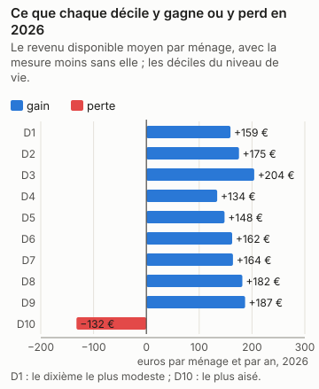
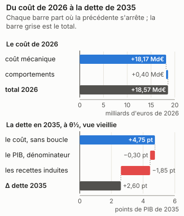
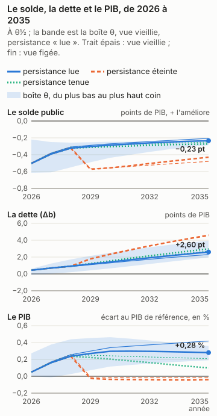
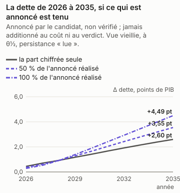
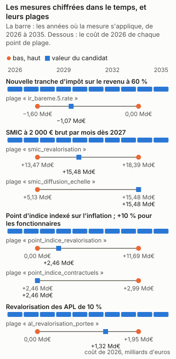

# Marine Tondelier : la part chiffrée du programme, en trois réponses

<!-- Généré par `impots etude ecrire presidentielle_tondelier` depuis reports/etudes/presidentielle_tondelier/ ; ne pas éditer à la main. -->

## Ce que dit cette étude

La part chiffrée du programme coûte 18,17 Md€ au budget sur le droit et les revenus de 2026, comme si elle s'appliquait cette année-là, avant tout changement de comportement. Les ménages y voient leur revenu disponible changer en moyenne de +159 € par an dans le dixième le plus modeste à -132 € dans le dixième le plus aisé, le plus touché étant le 3e dixième (+204 €). Une fois comptés les changements de comportement que des études publiées permettent de chiffrer, le coût irait de +18,34 Md€ à +18,84 Md€. En 2035, la dette publique serait plus haute de 2,60 points de PIB, au milieu des fourchettes publiées et sous les hypothèses de croissance, de taux et de dépense de la page ; la dette monte dans 100 % des tirages du calcul d'incertitude, et l'outil conclut que cette part du programme augmente la dette. L'effet sur l'activité n'est lu que pour l'impôt sur le revenu, la CSG, les cotisations des salariés et les cotisations des employeurs. Sans aucun effet sur l'activité, la dette serait plus haute de 4,75 points de PIB : le coût après les comportements, à θ½, sans la boucle macro. La boucle lit les cotisations des salariés dans la variante « cotisations sociales salariés » de Mésange (G2017/04, folio 110). Elle porte sur les salariés des branches marchandes et rend son effet par une baisse du salaire brut (−2,49 % à dix ans) et du coût du travail ; le coût de l'outil, lui, tient le salaire brut fixe, et tout va au salaire net. Le retour que la boucle lit est donc probablement surestimé, et la dette de tête trop basse d'autant, d'un écart que l'outil ne mesure pas. Le choc vaut jusqu'à 0,02 fois celui de la variante, d'un point de PIB, que la boucle lit comme linéaire. En regard du chiffre de tête, à θ½ et vue vieillie : si les salaires se forment comme dans la variante salariale de Mésange (un super-brut visé, folios 137 et 138), la dette serait plus haute de 3,06 points. Le revenu imposable répond aux taux (le canal C1, l'élasticité du revenu imposable), et la boucle lit aussi l'impôt sur le revenu dans Mésange. L'élasticité est mesurée sur le revenu déclaré, toutes réactions comprises, les heures travaillées avec ; le multiplicateur de Mésange passe lui aussi par l'emploi et l'activité. La même réaction peut donc être comptée deux fois, une fois dans le coût après comportements, une fois dans les recettes induites ; l'outil ne mesure pas ce recouvrement. Et l'élasticité pèse surtout dans le haut de la distribution, là où la population simulée est la plus faible : peu de foyers tirés, aucun revenu du capital. Ces nombres valent pour la seule part chiffrée, pas pour le programme entier.

Marine Tondelier, Les Écologistes, a déclaré sa candidature à l'élection présidentielle de 2027. Son programme a été relevé le 12/11/2026 ; le relevé compte ses mesures, celles qui énoncent un paramètre, et celles que cet outil chiffre. Il dit plus bas pourquoi il ne chiffre pas les autres.

| mesures relevées | dont qui énoncent un paramètre | chiffrées par l'outil | part des mesures paramétrées |
|---|---|---|---|
| 39 | 27 | 4 | 15 % |

Pour la part chiffrée, ces mesures ensemble, trois réponses : ce qu'elle coûte et qui y gagne ; ce qu'elle coûte une fois les comportements et l'économie pris en compte ; ce qu'elle fait à la dette en 2035. **La dette porte sur la seule part du programme que l'outil chiffre, pas sur le programme : les mesures refusées, dites plus bas une à une avec leur « porte » (ce qui manque à l'outil pour les chiffrer), n'y sont pas, et un programme chiffré en partie peut paraître creuser ou baisser la dette pour une raison qui tient à l'outil (D-319).**

Chaque nombre dépend de ce qui est dit à côté de lui. Le coût de la première année est mécanique : personne ne change de comportement. La bande dit ce que les comportements y changent quand une étude publiée permet de le dire. La dette en 2035 dépend d'hypothèses de croissance, de taux et de dépenses nommées en bas de page, et de θ, la position de chaque réponse dans sa fourchette publiée : θ½ est le milieu, et les coins de la boîte placent chaque réponse aux deux bornes de sa fourchette. Le calcul d'incertitude (Monte-Carlo) tire aussi l'effet sur l'activité au-delà de ces bornes, de l'écart qui sépare les études entre elles : le verdict, qui le lit, et « selon θ », qui lit la boîte, peuvent donc différer.

## En bref

| programme | la première année | le chiffrage officiel | dette en 2035, à θ½ | verdict | selon θ |
|---|---|---|---|---|---|
| la part chiffrée (4 mesures sur 27 paramétrées, 39 relevées) | +18,17 Md€ | — | +2,60 pt | hausse (100 % des tirages en hausse) | hausse |

Le verdict se lit sur le Monte-Carlo (D-345) : « hausse » quand au moins 90 % des tirages font monter la dette, vue vieillie, « baisse » quand au moins 90 % la font baisser, « dépend » entre les deux. « Selon θ » dit ce que la boîte θ en dit, sans probabilité : un seul signe à θ½ et à chaque coin, ou non.

Un coût positif coûte au budget, un coût négatif lui rapporte. La dette est en points de PIB, dans la vue vieillie et sous la persistance « lue » de l'effet macro de chaque mesure, Mésange lu à ses horizons ; « selon θ » lit les deux vues sous cette persistance seule (D-336). « Éteint » et « tenu » sont des sensibilités, données plus bas, hors du verdict.

## La part chiffrée

*Marine Tondelier (Les Écologistes), programme relevé le 2026-11-12 — la part chiffrée : tranche_ir_60, smic_2000_brut, point_indice_inflation, apl_plus_10*

4 mesures chiffrées sur 27 paramétrées et 39 relevées. La réforme est celle des mesures chiffrées du programme, ensemble, à la valeur du candidat ; les autres n'y sont pas.

### 1. Ce qu'il coûte, et qui y gagne

*Source du graphique : `reports/etudes/presidentielle_tondelier/premiere_annee_pres2027_tondelier_programme.json` ; tracé par `impots.graphiques`. Ses nombres reposent sur : L2, la simulation mécanique ; les déciles sont ceux de la population (L1).*

La mesure coûte **18,17 Md€** la première année (2026), sur la population de 2024 au droit de 2026.

| décile | ménages | niveau de vie moyen | delta moyen | gagnants | perdants |
|---|---|---|---|---|---|
| 1 | 3 105 392 | 9 086 € | +159 € | 50 % | 7 % |
| 2 | 3 106 035 | 14 127 € | +175 € | 47 % | 10 % |
| 3 | 3 105 379 | 17 504 € | +204 € | 40 % | 12 % |
| 4 | 3 104 866 | 20 518 € | +134 € | 27 % | 18 % |
| 5 | 3 104 805 | 23 184 € | +148 € | 26 % | 7 % |
| 6 | 3 105 390 | 25 938 € | +162 € | 27 % | 4 % |
| 7 | 3 105 062 | 29 037 € | +164 € | 27 % | 4 % |
| 8 | 3 105 369 | 32 966 € | +182 € | 28 % | 2 % |
| 9 | 3 105 660 | 38 679 € | +187 € | 28 % | 2 % |
| 10 | 3 105 795 | 57 952 € | -132 € | 23 % | 2 % |

Les déciles sont ceux du niveau de vie de la population simulée. Toute structure
plus fine qu'un décile est un artefact de l'imputation, pas un résultat.

### 2. Avec les comportements et l'économie

*Source du graphique : `reports/etudes/presidentielle_tondelier/premiere_annee_pres2027_tondelier_programme.json` et `reports/etudes/presidentielle_tondelier/predictif_pres2027_tondelier_programme.json` (sa décomposition, D-349) ; tracé par `impots.graphiques`. Ses nombres reposent sur : L2 pour le coût mécanique, L3 pour les comportements, L4 pour la dette, sous hypothèses.*

**Une fois les comportements pris en compte**, la mesure coûte de +18,34 Md€ à +18,84 Md€, central +18,57 Md€ (bande **extrapolée** : la réforme sort de l'étendue des variations sur lesquelles les élasticités publiées ont été estimées), pour +18,17 Md€ sans eux.

*Cette réforme est plus grande que celles sur lesquelles les élasticités ont été estimées : la bande est une extrapolation, élargie et signalée comme telle.*

**Éventail macro : refusé.** L'éventail ne se compose pas quand les mesures poussent l'activité en sens contraires : il mêlerait les produits de l'une et de l'autre. La dette, plus bas, lit l'effet de chaque mesure sur l'activité à part, dans Mésange.

Ce que la chaîne ne lit pas, et pourquoi :

* **IS et investissement des entreprises** — aucune variante d'IS dans Mésange 2017, et aucune réestimation publiée depuis.
* **transferts** — Mésange n'a pas de variante de transfert.
* **créations d'entreprises** — C8 est un indice illustratif de la couche entreprises, en points de taux de création de sociétés, jamais une recette : la trajectoire chiffre le coût d'une baisse d'IS (D-244), pas les sociétés qu'elle ferait naître (§6.3, D-221).
* **R&D et CIR** — C9 est un indice illustratif de la couche entreprises, en euros de R&D, jamais une recette.

### 3. La dette en 2035

*Source du graphique : `reports/etudes/presidentielle_tondelier/predictif_pres2027_tondelier_programme.json`, rejoué année par année par `impots.predictif.rejouer`, qui redonne chacun de ses Δb et chaque coin de sa boîte ; tracé par `impots.graphiques`. Ses nombres reposent sur : L4, sous hypothèses : le cadre nommé en bas de page, et θ.*

| persistance | vue | Δ dette 2035, à θ½ | aux coins de la boîte |
|---|---|---|---|
| Effet macro lu dans Mésange à 1, 2, 3, 5 et 10 ans (spécification centrale), interpolé linéairement entre eux | vieillie | +2,60 pt | de +1,95 pt à +3,95 pt |
| Effet macro lu dans Mésange à 1, 2, 3, 5 et 10 ans (spécification centrale), interpolé linéairement entre eux | figée | +2,30 pt | de +1,31 pt à +4,06 pt |

En points de PIB de 2035, la dette avec la mesure moins la dette sans elle, l'effet macro lu dans Mésange à ses horizons (persistance « lue », D-336). La vue vieillie fait vieillir la population chaque année avec les salaires ; la vue figée la garde telle qu'elle est. Sous cette persistance, elle **augmente la dette** en 2035, à θ½ comme à chaque coin de la boîte, dans les deux vues.

**Le verdict**, lu sur le Monte-Carlo (D-345) : elle **augmente la dette** en 2035 dans au moins 90 % des tirages, vue vieillie.

**Ce que la boucle lit, et ce que l'outil ne mesure pas.** La boucle lit les cotisations des salariés dans la variante « cotisations sociales salariés » de Mésange (G2017/04, folio 110). Elle porte sur les salariés des branches marchandes et rend son effet par une baisse du salaire brut (−2,49 % à dix ans) et du coût du travail ; le coût de l'outil, lui, tient le salaire brut fixe, et tout va au salaire net. Le retour que la boucle lit est donc probablement surestimé, et la dette de tête trop basse d'autant, d'un écart que l'outil ne mesure pas. Le choc vaut jusqu'à 0,02 fois celui de la variante, d'un point de PIB, que la boucle lit comme linéaire. En regard du chiffre de tête, à θ½ et vue vieillie : sans aucun effet sur l'activité, la dette serait plus haute de 4,75 points ; si les salaires se forment comme dans la variante salariale de Mésange (un super-brut visé, folios 137 et 138), la dette serait plus haute de 3,06 points. Le revenu imposable répond aux taux (le canal C1, l'élasticité du revenu imposable), et la boucle lit aussi l'impôt sur le revenu dans Mésange. L'élasticité est mesurée sur le revenu déclaré, toutes réactions comprises, les heures travaillées avec ; le multiplicateur de Mésange passe lui aussi par l'emploi et l'activité. La même réaction peut donc être comptée deux fois, une fois dans le coût après comportements, une fois dans les recettes induites ; l'outil ne mesure pas ce recouvrement. Et l'élasticité pèse surtout dans le haut de la distribution, là où la population simulée est la plus faible : peu de foyers tirés, aucun revenu du capital.

**Les sensibilités, hors du verdict.** Les deux persistances que les pages lisaient avant la persistance « lue » (D-336), sur les mêmes passes : l'effet macro éteint après trois ans, ou tenu au niveau de la troisième année. Mésange ne porte ni l'une ni l'autre ; elles disent ce que le choix de la persistance pèse, et n'entrent pas dans le verdict.

| persistance | vue | Δ dette 2035, à θ½ | aux coins de la boîte |
|---|---|---|---|
| Effet macro éteint après trois ans | vieillie | +4,56 pt | de +4,34 pt à +4,86 pt |
| Effet macro éteint après trois ans | figée | +4,64 pt | de +4,24 pt à +5,11 pt |
| Effet macro tenu au niveau de la troisième année | vieillie | +2,97 pt | de +2,20 pt à +4,69 pt |
| Effet macro tenu au niveau de la troisième année | figée | +2,71 pt | de +1,58 pt à +4,89 pt |

**La distribution, à côté de la boîte.** La boîte dit jusqu'où Δb va quand chaque effet parcourt sa fourchette publiée : ce n'est pas une probabilité. Le Monte-Carlo en est une, sous des lois déclarées : Lois du magasin, ligne par ligne ; copule gaussienne de corrélation ρ entre les lignes d'un même article, indépendance entre articles ; décalage du multiplicateur normal centré réduit, multiplicateur Mésange + z × écart-type IMK censuré à zéro ; indépendant des lignes. (ρ = 0,8, 2000 tirages, persistance « lue », D-336). D'autres lois donneraient une autre réponse.

| vue | P(hausse de la dette en 2035) | quantile 5 % | médiane | quantile 95 % | ce qui pèse le plus (Sobol, total) |
|---|---|---|---|---|---|
| vieillie | 100 % | +1,98 pt | +2,55 pt | +4,48 pt | le multiplicateur 1,03, les lignes de `eti.yaml` 0,00 |
| figée | 100 % | +1,31 pt | +2,22 pt | +4,77 pt | le multiplicateur 1,03, les lignes de `eti.yaml` 0,00 |

**D'où vient Δb.** La dette de 2035 en trois marches, à θ½ sous la persistance « lue » : le coût après comportements, sans la boucle macro ; ce que le PIB plus haut ou plus bas change au seul ratio, comme dénominateur ; ce que les recettes induites par l'activité y changent. Les trois font la ligne du tableau (D-349).

| vue | le coût, sans boucle | le PIB, dénominateur | les recettes induites | Δ dette 2035 |
|---|---|---|---|---|
| vieillie | +4,75 pt | -0,30 pt | -1,85 pt | +2,60 pt |
| figée | +5,06 pt | -0,45 pt | -2,31 pt | +2,30 pt |

**Au taux de marché.** La dette ajoutée est chargée au taux implicite de 2025 (D-336). Chargée à 3,5 %, hypothèse déclarée d'une OAT à dix ans de fin 2026 : +2,84 pt en vue vieillie, contre +2,60 pt ; +2,53 pt en vue figée, contre +2,30 pt.

**Si les salaires se forment autrement.** Mésange publie une sensibilité de ses variantes à la formation des salaires (folios 137 et 138) : une courbe de Phillips pour les cotisations employeurs et la TVA, un super-brut visé pour les cotisations salariés, la CSG et l'IR. Le multiplicateur y est recentré, à écart-type, persistance et recettes induites par point de PIB inchangés ; Mésange n'imprime pas le solde de la variante, que la page suppose proportionnel au PIB (D-349). C'est une sensibilité, hors du verdict.

| vue | Δ dette 2035, à θ½ | aux coins de la boîte | P(hausse) | verdict |
|---|---|---|---|---|
| vieillie | +3,06 pt | de +2,08 pt à +4,46 pt | 100 % | hausse |
| figée | +2,76 pt | de +1,46 pt à +4,61 pt | 100 % | hausse |

**Brut d'IS.** Les cotisations employeurs se déduisent du bénéfice : ce qu'elles changent, l'IS des entreprises bénéficiaires le change en sens inverse, jusqu'à 25 % du montant au taux normal. La passe des ménages ne le chiffre pas ; le coût de la première année et la dette en sont bruts, et l'effet net est plus petit.

### La dette en 2035, si les économies annoncées sont tenues et les dépenses annoncées faites

*Source du graphique : `reports/etudes/presidentielle_tondelier/predictif_pres2027_tondelier_programme.json`, `programmes/tondelier.json` et `reports/macro/variante_depense_publique.json`, lus par `impots.predictif.annonce` ; tracé par `impots.graphiques`. Ses nombres reposent sur : L4 pour la part chiffrée, sous hypothèses ; annoncé pour le reste.*

**Une lecture à part : annoncée par le candidat, non vérifiée.** La dette plus haut est celle de la part chiffrée ; les économies de dépense que le programme annonce, que l'outil ne microsimule pas, n'y entrent pas, et ses dépenses non plus (D-319). Ici, les montants par an que le candidat attache lui-même à ses mesures de dépense publique sont lus par la variante « dépense publique » de Mésange, son effet sur le PIB et sur le solde, et s'ajoutent à la dette de la part chiffrée. Ni le coût de la part chiffrée ni le verdict ne les lisent (D-380).

| mesure | montant annoncé, par an | sens | calendrier annoncé |
|---|---|---|---|
| Plan climat | +10,00 Md€ | dépense | contre-budget pour 2027 ; comprend MaPrimeRénov', le fonds vert et la part de l'État du bâti scolaire |
| 3 Md€ contre les violences faites aux femmes et aux enfants | +3,00 Md€ | dépense | non précisé par le candidat (« dotée de 3 milliards d'euros ») : ni annuel ni pluriannuel n'est dit |

| part réalisée | solde annoncé, par an | Δ dette 2035, vue vieillie | Δ dette 2035, vue figée |
|---|---|---|---|
| 0 % | +0 € | +2,60 pt | +2,30 pt |
| 50 % | -6,50 Md€ | +3,55 pt | +3,25 pt |
| 100 % | -13,00 Md€ | +4,49 pt | +4,19 pt |

À θ½, sous la persistance « lue ». À une part réalisée nulle, la ligne est la dette de la part chiffrée, plus haut ; le solde est positif quand il améliore les comptes publics.

**Ce que la variante suppose.** La variante « dépense publique » de Mésange est un composite, pas un instrument (D-214, page 106 du PDF) : 8 % d'investissement public, 25 % de rémunérations publiques, 9 % de prestations en nature, 12 % de consommations intermédiaires, 46 % de prestations sociales en espèces. La lire suppose que chaque euro annoncé tombe sur la dépense dans ces proportions, quoi que la mesure dise ; les transferts n'ont pas de variante à eux, et une économie sur les prestations lit la même moyenne. Montant atteint dès la première année du chemin et tenu en part du PIB de cette année-là : le calendrier que le candidat énonce est montré, pas lu. Choc de la variante en volume, lu comme des euros : prix de la réforme tenus constants (D-214, condition 4). Ligne de solde lue sous la dépense gelée en volume seule (note 70, D-214). Variantes superposées : Mésange est linéaire (D-230), et ce qu'annonce le candidat s'ajoute à la part chiffrée sans interaction.

**Pas lues** — hors de la dépense publique : sa porte relève d'un autre module (retraites, prestations, salaires, entreprises) : Chèque carburant financé par la taxe pétrolière.

**Pas lues** — un montant par an dans le paramètre, sans sens ni horizon déclarés : à porter dans `declare` pour être lu : Rénovation thermique des écoles.

*Annoncé par le candidat, non vérifié ; jamais additionné au coût de l'outil ni au verdict (D-319, D-380).*

### L'écart au chiffrage officiel

La part chiffrée n'est pas un cas enregistré : ses mesures le sont, une à une, avant que le juge ne publie. Le juge est le chiffrage des programmes de l'Institut Montaigne, attendu au premier trimestre 2027.

* `pres2027_tondelier_tranche_ir_60`, enregistré le 2026-11-01 : -975 M€ en 2026, tolérance de 40 % ou 200 M€ ; le juge n'a pas publié.
* `pres2027_tondelier_smic_2000_brut`, enregistré le 2026-11-12 : +15,53 Md€ en 2026, tolérance de 40 % ou 200 M€ ; le juge n'a pas publié.
* `pres2027_tondelier_point_indice_inflation`, enregistré le 2026-11-12 : +2,41 Md€ en 2026, tolérance de 40 % ou 200 M€ ; le juge n'a pas publié.
* `pres2027_tondelier_apl_plus_10`, enregistré le 2026-11-12 : +1,32 Md€ en 2026, tolérance de 25 % ou 200 M€ ; le juge n'a pas publié.

## Chaque mesure seule, et leur interaction

Chaque mesure chiffrée passe aussi seule, en entier : sa première année et son chemin annuel jusqu'en 2035, dans le cadre de la part chiffrée, sur la même population et le même code. La part chiffrée n'est pas la somme de ses mesures : deux mesures se rencontrent dans le barème, dans les prestations sous condition de ressources, dans la boucle macro, et dans la dette, que chacune creuse sur le PIB que l'autre a changé. L'écart, la part chiffrée moins la somme des mesures, est dit sur sa ligne, « interaction » : il n'est réparti entre aucune mesure.

**Les mesures seules : absentes, et la raison est donnée.** Les passes des mesures seules n'ont pas tourné : `impots etude lancer presidentielle_tondelier` les lance, après celles de la part chiffrée. Les rapports de cette page viennent d'une série qui ne les avait pas.

## Ce que bouge chaque paramètre

Chaque mesure chiffrée a une plage : le lecteur peut la régler, du bas au haut. Trois points la parcourent, le bas, la valeur du candidat et le haut. Chaque point est la mesure seule, mécanique (personne ne change de comportement), sur la population vieillie jusqu'en 2026 ; sa dette reporte la première année en part de PIB jusqu'en 2035, un calcul rapide qui ne refait pas chaque année. Elle ne se compare donc pas à celle de la part chiffrée, plus haut, que le calcul complet chiffre année par année avec les comportements et la boucle macro. Leur coût diffère aussi de celui de la part chiffrée : celle-ci est chiffrée sur la population de 2024 au droit de 2026, les plages sur la population vieillie jusqu'en 2026. Quand un programme a plusieurs paramètres, chacun se règle seul, les autres restant à la valeur du candidat.

*Source du graphique : `programmes/tondelier.json` et `reports/etudes/presidentielle_tondelier/plages/`, ses 18 points de plage ; tracé par `impots.graphiques`. Ses nombres reposent sur : L2 pour les coûts ; la valeur du candidat est celle du programme, le bas et le haut des hypothèses.*

### Nouvelle tranche d'impôt sur le revenu à 60 %

*Le programme : 60 % « au-delà de 250 000 € annuels ».*

Ce que l'outil en lit : Barème de 2026 et une 6e tranche à 60 % au-delà de 250 000 €. Le seuil s'applique au revenu par part, comme tous les seuils du barème, et c'est ce que fait la réforme : pour un couple, qui a deux parts, la tranche à 60 % commence au-delà de 500 000 € de revenu imposable. Le candidat ne dit pas s'il l'entend par foyer. La plage va du taux de la tranche supérieure actuelle, 45 % (la mesure retirée), à 67,5 %.

| `ir_bareme.5.rate` | valeur | coût 2026 | dette en 2035, mécanique, sans comportements ni boucle |
|---|---|---|---|
| le bas | 45 % | +0 € | +0,00 pt |
| le candidat | 60 % | -1,07 Md€ | -0,33 pt |
| le haut | 67,5 % | -1,60 Md€ | -0,49 pt |

### SMIC à 2 000 € brut par mois dès 2027

*Le programme : 2 000 € brut mensuels, dès 2027.*

Ce que l'outil en lit : Le SMIC porté à 2 000 € bruts par mois. Le bouton est un coefficient sur le SMIC horaire brut de chaque mois de 2026, qui en porte deux : 12,02 € de janvier à mai (1 823,03 € bruts par mois), 12,31 € de juin à décembre (1 867,02 €), 1 848,69 € en moyenne. Le coefficient retenu, 1,0818, donne 2 000 € bruts par mois en moyenne sur l'année ; la plage va de 1,0712 (2 000 € bruts atteints depuis le SMIC de juin) à 1,0971 (depuis celui de janvier). La diffusion au-dessus du nouveau SMIC, entre 1 et 1,5 SMIC dans le privé, est une hypothèse déclarée (D-380) : le profil à un an avec effets fixes d'entreprise de Koubi et Lhommeau (Insee, Les salaires en France 2007), le plus large des quatre publiés, à l'échelle 0 pour la valeur du candidat (le premier jour, la loi seule relève les salaires horaires sous le nouveau SMIC), sa plage allant jusqu'à 1 (le profil entier). La mesure se mesure contre le SMIC de l'arbre de 2026. Le coût ne compte pas le salaire que paie un employeur privé ; il compte celui que paie l'État employeur (les agents publics relevés au SMIC), les cotisations, la CSG et l'impôt qui montent, la prime d'activité qui bouge, et les allègements généraux, qui suivent le SMIC : un SMIC relevé les élargit aussi pour les salaires qui ne bougent pas.

| `smic_revalorisation` | valeur | coût 2026 | dette en 2035, mécanique, sans comportements ni boucle |
|---|---|---|---|
| le bas | 1,0712 | +13,47 Md€ | +4,16 pt |
| le candidat | 1,0818 | +15,48 Md€ | +4,78 pt |
| le haut | 1,0971 | +18,39 Md€ | +5,68 pt |

| `smic_diffusion_echelle` | valeur | coût 2026 | dette en 2035, mécanique, sans comportements ni boucle |
|---|---|---|---|
| le bas | 0 | +15,48 Md€ | +4,78 pt |
| le candidat | 0 | +15,48 Md€ | +4,78 pt |
| le haut | 1 | +5,13 Md€ | +1,58 pt |

### Point d'indice indexé sur l'inflation ; +10 % pour les fonctionnaires

*Le programme : indexation du point d'indice sur l'inflation ; +10 % pour les fonctionnaires autres que les enseignants (presse).*

Ce que l'outil en lit : Le point d'indice indexé sur l'inflation, ce que dit le programme : la première année, il monte de l'inflation de l'année. L'inflation de 2026 est celle des hypothèses du PLFSS 2027 (annexe B, IPC hors tabac : 2,1 %), les hypothèses de la population vieillie des cas (plf2027). La presse ajoute +10 % pour les fonctionnaires autres que les enseignants (+15 % en cinq ans pour ceux-ci, une mesure à part) : c'est le haut de la plage du point (1,10), qui va du droit (1, le point gelé) à cette lecture, appliquée à tous les titulaires, enseignants compris. Le bouton multiplie le traitement indiciaire des fonctionnaires titulaires, leur brut sur 1,195 (le taux de prime du moteur) ; leurs primes ne bougent pas. La part du salaire des contractuels qui suit le point n'est pas publiée : 0 pour la valeur retenue, la plage allant jusqu'à 1 (tous payés sur une grille indiciaire). La mesure se mesure contre le droit de 2026, où le point est gelé depuis le 1er janvier 2024 : il n'a pas d'indexation légale. Le coût compte le salaire que paient l'État, les collectivités et les hôpitaux, moins les cotisations, la CSG et l'impôt qui en reviennent ; les collectivités sont comptées comme l'État, leur compensation éventuelle ne change pas le coût public.

| `point_indice_revalorisation` | valeur | coût 2026 | dette en 2035, mécanique, sans comportements ni boucle |
|---|---|---|---|
| le bas | 1 | +1 035 € | +0,00 pt |
| le candidat | 1,021 | +2,46 Md€ | +0,76 pt |
| le haut | 1,1 | +11,69 Md€ | +3,61 pt |

| `point_indice_contractuels` | valeur | coût 2026 | dette en 2035, mécanique, sans comportements ni boucle |
|---|---|---|---|
| le bas | 0 | +2,46 Md€ | +0,76 pt |
| le candidat | 0 | +2,46 Md€ | +0,76 pt |
| le haut | 1 | +2,99 Md€ | +0,92 pt |

### Revalorisation des APL de 10 %

*Le programme : +10 % ; mécanisme anti-répercussion sur les loyers non décrit.*

Ce que l'outil en lit : Les paramètres des aides au logement que le droit révise en octobre (loyers plafonds, forfaits de charges, équivalences de loyer, participation minimale) relevés de 10 %, portés sur toute l'année chiffrée (D-301). La mesure se mesure contre l'indexation légale sur les prix, la référence du but 21 : les 10 % s'ajoutent à elle. Le mécanisme contre la répercussion sur les loyers n'est pas décrit ; les loyers ne bougent pas, ce qu'il viserait. Plage : du droit (1) à 10 % prolongé de la moitié de l'écart (1,15).

| `al_revalorisation_portee` | valeur | coût 2026 | dette en 2035, mécanique, sans comportements ni boucle |
|---|---|---|---|
| le bas | 1 | +0 € | +0,00 pt |
| le candidat | 1,1 | +1,32 Md€ | +0,41 pt |
| le haut | 1,15 | +1,95 Md€ | +0,60 pt |

## Le programme, mesure par mesure

Une mesure est chiffrée, refusée ou vague. Une mesure refusée n'est pas une mesure à zéro : sa « porte » dit ce qui manque à l'outil, ce qu'il devrait savoir faire pour la chiffrer. Une mesure vague n'énonce ni taux ni montant.

| mesure | ce que dit le candidat | sort | pourquoi |
|---|---|---|---|
| Taxe Zucman | 2 % au-delà de 100 M€ de patrimoine ; impôt plancher différentiel (2 % du patrimoine, tous impôts confondus) | refusée : le patrimoine des ménages (`patrimoine`) | La population ne porte pas le patrimoine des ménages, ni a fortiori celui qui dépasse 100 M€. |
| Rétablir l'impôt sur la fortune, « ISF climatique » | seuil d'entrée à 1,3 M€ ; assiette de l'IFI étendue aux placements financiers, aux biens meubles et aux crypto-actifs (amendement I-47 du groupe au PLF 2027) ; volet climatique sans barème | refusée : le patrimoine des ménages (`patrimoine`) | La population ne porte pas le patrimoine financier et immobilier des ménages, et le volet climatique n'a pas de barème. |
| Impôt minimal sur les bénéfices des sociétés | sociétés de plus de 1 Md€ de chiffre d'affaires, au prorata de l'activité en France | refusée : une dimension des entreprises (`dimension_entreprises`) | Un impôt au prorata de l'activité en France demande les bénéfices mondiaux des groupes et leur partage par territoire, que le modèle des entreprises ne porte pas, et son taux n'est pas cité. |
| Taxe exceptionnelle sur les superprofits pétroliers, gaziers et maritimes | aucun taux | vague | Ni la définition du superprofit ni le taux ne sont énoncés. |
| Taxe sur le chiffre d'affaires additionnel des groupes pétroliers | 33 % du chiffre d'affaires additionnel réalisé en France en 2026 et 2027 par rapport à 2025 | refusée : un secteur hors du modèle (`secteur`) | Le chiffre d'affaires des groupes pétroliers en France et sa hausse depuis 2025 ne sont pas une assiette du modèle des entreprises. |
| Chèque carburant financé par la taxe pétrolière | 450 € pour environ 6 millions de ménages | refusée : une prestation que le moteur ne porte pas (`prestations_hors_modele`) | Un chèque carburant est une prestation neuve, dont le moteur ne porte ni le montant ni le ciblage des quelque 6 millions de ménages. |
| Contribution additionnelle sur les gros héritages | 10 % au-delà de 4 M€ ; 10 points de plus au-delà de 13 M€ | refusée : les donations et les reprises (`transmission`) | Le moteur n'a pas de module des transmissions. |
| Pacte Dutreil | abattement passé à 50 % au-delà de 50 M€ ; suppression de la réduction additionnelle de 50 % des droits pour une donation avant 70 ans | refusée : les donations et les reprises (`transmission`) | Le pacte Dutreil exonère des transmissions d'entreprises, que le moteur ne porte pas. |
| Fin des avantages fiscaux du démembrement de propriété | aucun paramètre | vague | Les avantages fiscaux supprimés ne sont pas nommés, ni le barème qui les remplacerait. |
| Suppression de l'abattement spécifique de l'assurance-vie | suppression | refusée : les donations et les reprises (`transmission`) | L'abattement de l'assurance-vie, lu ici à la transmission comme le reste du volet héritages, n'est pas porté par le moteur, qui n'a pas de module des transmissions. |
| Taxation des plus-values latentes | au barème actuel, sur les héritages de plus de 4 M€, avec report d'imposition transféré aux héritiers jusqu'à la revente et déduction des droits de mutation | refusée : les donations et les reprises (`transmission`) | La taxe frappe les plus-values latentes à la transmission des héritages de plus de 4 M€ : le moteur n'a pas de module des transmissions, et la population ne porte pas ces plus-values. |
| Nouvelle tranche d'impôt sur le revenu à 60 % | 60 % « au-delà de 250 000 € annuels » | chiffrée | Barème de 2026 et une 6e tranche à 60 % au-delà de 250 000 €. Le seuil s'applique au revenu par part, comme tous les seuils du barème, et c'est ce que fait la réforme : pour un couple, qui a deux parts, la tranche à 60 % commence au-delà de 500 000 € de revenu imposable. Le candidat ne dit pas s'il l'entend par foyer. La plage va du taux de la tranche supérieure actuelle, 45 % (la mesure retirée), à 67,5 %. |
| Extension de l'exit tax | rétablir l'exit tax : délai de taxation porté de deux à quinze ans après le départ (amendement I-462 du groupe au PLF 2027, adopté en première lecture) | refusée : le patrimoine des ménages (`patrimoine`) | L'exit tax frappe les plus-values latentes des contribuables qui quittent la France, que la population ne porte pas. |
| « TVA verte » | 20 % sur les biens et services à fort impact (comme l'aérien) ; 5,5 % sur ceux de la transition (comme le train, le bio, la réparation) | refusée : la consommation (`consommation`) | Les biens visés ne sont donnés que par exemples (« comme »), et le bio ou la réparation ne sont pas des postes de la consommation que la population porte. |
| Fiscalité des transports : renchérir l'aérien, favoriser le rail | tarifs de solidarité de la taxe sur les billets d'avion relevés, de 20 € à 3 000 € selon la destination, la classe et l'aviation d'affaires (amendement I-3551 du groupe au PLF 2027, rejeté) | refusée : un secteur hors du modèle (`secteur`) | Le transport aérien de passagers et sa taxe de solidarité ne sont pas une assiette du modèle. |
| Retour à 62 ans, 60 ans selon la pénibilité | 62 ans « immédiat » ; viser 60 ans pour carrières longues et métiers pénibles | refusée : les droits à la retraite (`retraites`) | L'âge légal n'est pas un paramètre du moteur : la population ne vieillit pas en âge et ses pensions sont des données. |
| Blocage des prix réservé à l'« inflation anormale » | aucun seuil | vague | Aucun seuil d'inflation ni prix bloqué n'est énoncé. |
| Sortie progressive du nucléaire | environ vingt ans ; neutralité carbone en 2040 | refusée : un secteur hors du modèle (`secteur`) | Le nucléaire et la production d'électricité sont hors du modèle. |
| Plan climat | environ 10 Md€ dès 2027 (rail, RER métropolitains, vélo, leasing social, outre-mer, biodiversité, MaPrimeRénov', fonds vert, bâti scolaire, sécurité civile) | refusée : la dépense publique (`depense_publique`) | Une dépense publique, que le moteur ne microsimule pas : elle n'entre que par le scénario de dépense du calcul de la dette. |
| Rénovation thermique des écoles | 2 Md€ par an de l'État dès 2027, chaque euro de l'État déclenchant un euro des collectivités (besoin total 4 Md€ par an sur 10 ans) ; compris dans les 10 Md€ du plan climat | refusée : la dépense publique (`depense_publique`) | Une dépense publique, que le moteur ne microsimule pas : elle n'entre que par le scénario de dépense du calcul de la dette. |
| Fonds vert et MaPrimeRénov' | fonds vert +1,9 Md€ ; MaPrimeRénov' +1,4 Md€ ; compris dans les 10 Md€ du plan climat | refusée : la dépense publique (`depense_publique`) | Une dépense publique, que le moteur ne microsimule pas : elle n'entre que par le scénario de dépense du calcul de la dette. |
| SMIC à 2 000 € brut par mois dès 2027 | 2 000 € brut mensuels, dès 2027 | chiffrée | Le SMIC porté à 2 000 € bruts par mois. Le bouton est un coefficient sur le SMIC horaire brut de chaque mois de 2026, qui en porte deux : 12,02 € de janvier à mai (1 823,03 € bruts par mois), 12,31 € de juin à décembre (1 867,02 €), 1 848,69 € en moyenne. Le coefficient retenu, 1,0818, donne 2 000 € bruts par mois en moyenne sur l'année ; la plage va de 1,0712 (2 000 € bruts atteints depuis le SMIC de juin) à 1,0971 (depuis celui de janvier). La diffusion au-dessus du nouveau SMIC, entre 1 et 1,5 SMIC dans le privé, est une hypothèse déclarée (D-380) : le profil à un an avec effets fixes d'entreprise de Koubi et Lhommeau (Insee, Les salaires en France 2007), le plus large des quatre publiés, à l'échelle 0 pour la valeur du candidat (le premier jour, la loi seule relève les salaires horaires sous le nouveau SMIC), sa plage allant jusqu'à 1 (le profil entier). La mesure se mesure contre le SMIC de l'arbre de 2026. Le coût ne compte pas le salaire que paie un employeur privé ; il compte celui que paie l'État employeur (les agents publics relevés au SMIC), les cotisations, la CSG et l'impôt qui montent, la prime d'activité qui bouge, et les allègements généraux, qui suivent le SMIC : un SMIC relevé les élargit aussi pour les salaires qui ne bougent pas. |
| Baisse du taux réduit de l'IS et de la taxe sur les salaires pour les TPE, PME et associations | aucun taux | vague | Ni le taux réduit visé ni le barème de la taxe sur les salaires ne sont énoncés. |
| Point d'indice indexé sur l'inflation ; +10 % pour les fonctionnaires | indexation du point d'indice sur l'inflation ; +10 % pour les fonctionnaires autres que les enseignants (presse) | chiffrée | Le point d'indice indexé sur l'inflation, ce que dit le programme : la première année, il monte de l'inflation de l'année. L'inflation de 2026 est celle des hypothèses du PLFSS 2027 (annexe B, IPC hors tabac : 2,1 %), les hypothèses de la population vieillie des cas (plf2027). La presse ajoute +10 % pour les fonctionnaires autres que les enseignants (+15 % en cinq ans pour ceux-ci, une mesure à part) : c'est le haut de la plage du point (1,10), qui va du droit (1, le point gelé) à cette lecture, appliquée à tous les titulaires, enseignants compris. Le bouton multiplie le traitement indiciaire des fonctionnaires titulaires, leur brut sur 1,195 (le taux de prime du moteur) ; leurs primes ne bougent pas. La part du salaire des contractuels qui suit le point n'est pas publiée : 0 pour la valeur retenue, la plage allant jusqu'à 1 (tous payés sur une grille indiciaire). La mesure se mesure contre le droit de 2026, où le point est gelé depuis le 1er janvier 2024 : il n'a pas d'indexation légale. Le coût compte le salaire que paient l'État, les collectivités et les hôpitaux, moins les cotisations, la CSG et l'impôt qui en reviennent ; les collectivités sont comptées comme l'État, leur compensation éventuelle ne change pas le coût public. |
| Salaires des enseignants +15 % en cinq ans, en plus de l'inflation | +15 % en 5 ans, en plus de l'inflation | refusée : la distribution des salaires (`salaires`) | Les enseignants ne sont pas distingués dans les salaires de la population, et la hausse est étalée sur cinq ans. |
| Exonérations de cotisations conditionnées à la hausse des salaires de moins de 2 000 € net | condition sans taux ni barème | vague | La condition (une augmentation, sans taux) ne dit ni quelles exonérations tombent ni de combien. |
| Revalorisation des APL de 10 % | +10 % ; mécanisme anti-répercussion sur les loyers non décrit | chiffrée | Les paramètres des aides au logement que le droit révise en octobre (loyers plafonds, forfaits de charges, équivalences de loyer, participation minimale) relevés de 10 %, portés sur toute l'année chiffrée (D-301). La mesure se mesure contre l'indexation légale sur les prix, la référence du but 21 : les 10 % s'ajoutent à elle. Le mécanisme contre la répercussion sur les loyers n'est pas décrit ; les loyers ne bougent pas, ce qu'il viserait. Plage : du droit (1) à 10 % prolongé de la moitié de l'écart (1,15). |
| Allocations familiales d'un même montant dès le premier enfant | aucun montant | vague | Le montant par enfant n'est pas énoncé. |
| Pensions alimentaires défiscalisées pour le parent qui les perçoit, sous plafond | plafond par enfant non chiffré | vague | Le plafond par enfant et par an n'est pas chiffré. |
| Crédit d'impôt automatisé remplaçant le chèque énergie | aucun montant | vague | Ni le montant ni les conditions de revenu du crédit d'impôt ne sont énoncés. |
| Baisse des taxes sur l'électricité, harmonisation avec le gaz | aucun taux | vague | Ni le tarif d'accise visé ni le sens de l'harmonisation ne sont énoncés. |
| Allocations chômage indexées sur l'inflation, réformes depuis 2017 abrogées | indexation sur l'inflation ; abrogation des réformes adoptées depuis 2017 | refusée : une prestation que le moteur ne porte pas (`prestations_hors_modele`) | L'assurance chômage n'est pas une prestation que le moteur porte. |
| Congé d'accueil de l'enfant de 16 semaines à 100 % pour chaque parent | 16 semaines à 100 % du salaire de base ; congé de naissance à 80 % et trois mois par parent | refusée : une prestation que le moteur ne porte pas (`prestations_hors_modele`) | Les indemnités de congé de maternité, de paternité et de naissance ne sont pas portées par le moteur. |
| Cantine à 1 euro, repas à 1 euro à l'université | 1 € le repas | refusée : la dépense publique (`depense_publique`) | Une dépense publique, que le moteur ne microsimule pas : elle n'entre que par le scénario de dépense du calcul de la dette. |
| Ticket climat mensuel à tarif unique, gratuit pour les jeunes et les ménages précaires | aucun tarif | vague | Ni le tarif unique ni le coût pour l'État ne sont énoncés. |
| Barème de frais kilométriques commun à tous les modes de transport | aucun barème | vague | Le barème n'est pas énoncé. |
| Crédit d'impôt pour l'achat d'un vélo électrique | aucun montant | vague | Ni le taux ni le plafond du crédit d'impôt ne sont énoncés. |
| Parc social de voitures électriques | 1 million de véhicules en cinq ans ; +1 Md€ de leasing social en 2027, compris dans le plan climat | refusée : la dépense publique (`depense_publique`) | Une dépense publique, que le moteur ne microsimule pas : elle n'entre que par le scénario de dépense du calcul de la dette. |
| 3 Md€ contre les violences faites aux femmes et aux enfants | 3 Md€ (horizon non précisé) | refusée : la dépense publique (`depense_publique`) | Une dépense publique, que le moteur ne microsimule pas : elle n'entre que par le scénario de dépense du calcul de la dette. |

Les portes, de celle qui ouvrirait le plus de mesures à celle qui en ouvrirait le moins :

* 6 mesures — la dépense publique, que le moteur ne simule pas ménage par ménage : elle n'entre dans la dette que comme une hypothèse de dépense (`depense_publique`).
* 4 mesures — un module de transmission : donations et reprises (`transmission`).
* 3 mesures — le patrimoine des ménages : la population n'en porte pas (ISF, taxe sur les grandes fortunes, plus-values latentes) (`patrimoine`).
* 3 mesures — une prestation que le moteur ne porte pas : assurance chômage, prestation fusionnée ou neuve (`prestations_hors_modele`).
* 3 mesures — l'assiette d'un secteur hors du modèle : audiovisuel, nucléaire, aérien, infrastructures, dépôts, justice (`secteur`).
* 1 mesure — la consommation et le parc : TVA par taux, accises, véhicules (`consommation`).
* 1 mesure — une dimension des entreprises : territoire, département, secteur agricole (`dimension_entreprises`).
* 1 mesure — les droits à la retraite (âges, durées, régimes) : la population ne vieillit pas en âge et ses pensions sont des données (`retraites`).
* 1 mesure — la distribution des salaires : SMIC, point d'indice, indexation des salaires (`salaires`).

## Ce que le candidat annonce, à part

Le programme annonce lui-même un montant pour 5 de ses mesures. Ces montants ne sont pas vérifiés et ne s'ajoutent jamais au chiffrage de l'outil : la part réalisée dit ce qui s'en réaliserait, de rien à tout. Le solde est l'effet annoncé sur les comptes publics, positif quand ils s'améliorent. Le relevé, fait à la main, ne retient que les montants que le programme attache à une mesure comme un effet annuel ; d'autres montants cités dans le tableau des mesures (des totaux sur plusieurs années, des enveloppes) n'y sont pas, et il peut en avoir manqué (D-378).

| part réalisée | solde annoncé |
|---|---|
| 0 % | +0 € |
| 50 % | +1,00 Md€ |
| 100 % | +2,00 Md€ |

*déclaré par le candidat, non vérifié ; jamais additionné au chiffrage du moteur (D-319)*

## Ce qui a bougé depuis la série précédente

La série précédente a tourné sur `601b442` ; ce qu'elle disait est figé dans `reports/etudes/presidentielle_tondelier/avant/serie.json` avant que celle-ci ne remplace ses rapports (D-350). Son verdict lisait la boîte θ ; celui-ci lit le Monte-Carlo.

| | la première année, avant → après | dette à θ½, avant → après | verdict, avant → après |
|---|---|---|---|
| la part chiffrée (4 mesures sur 27 paramétrées, 39 relevées) | -917 M€ → +18,17 Md€ | +0,01 pt → +2,60 pt | dépend de θ → hausse |

Ce qui touche chaque ligne :

* **la part chiffrée (4 mesures sur 27 paramétrées, 39 relevées)** : le secteur public modélisé statut par statut (D-346), le verdict lu sur le Monte-Carlo (D-345).

Là où une seule correction touche une ligne, l'écart avant → après est ce qu'elle pèse (D-352) ; ailleurs, les corrections ne se séparent pas sans un calcul refait sans chacune, qui n'est pas fait.

## D'où viennent ces nombres

Les passes ont tourné sur le commit `aa22293`, conteneur cloud, 15 Go, 4 cœurs, deux files. Cadre du calcul année par année jusqu'en 2035 : Croissance réelle 1 %, prix 2 % ; Taux implicite tenu à son niveau de 2025 ; Dépenses gelées en volume ; droit reconduit tel qu'openfisca le porte ; θ½ sur toutes les lignes ; comportements et boucle macro appliqués.

*Population vieillie mécaniquement de 2024 à 2035 — salaires 3,0 % par an, prix 2,0 % par an, hypothèses DÉCLARÉES et non prévues (3 % ronds, le rythme du PIB nominal du scénario). La structure des ménages, les âges et les poids n'ont PAS bougé : c'est la France de l'année de base avec l'argent de l'année d'arrivée, et cela biaise vers l'immobilité démographique. **Cette population n'est plus calibrée** : les totaux dépensés au registre le sont sur l'année de base, et il n'existe pas de total publié pour une année future. Toute ligne de réconciliation sur cette année refuse un verdict de tolérance plutôt que d'en donner un qui se lirait comme une validation.*

Le secteur public est modélisé statut par statut (D-346) : un titulaire est payé d'un traitement indiciaire et de primes, et cotise à son régime ; un contractuel cotise au régime général, sans allègement. L'enquête Emploi dit titulaire ou contractuel et la fonction publique, pas le corps ni l'indice : la part des primes est la moyenne qu'openfisca porte, la même pour tous.

**La vérification de ses instruments.** Le niveau que le moteur donne à chaque instrument que la page chiffre, contre son total publié, sur 2022, 2023 et 2024 (`docs/verification/GRILLE.md`, D-364) : l'écart moyen, son étendue, et les années qui tiennent la tolérance écrite avant le calcul.

* Cotisations à la charge des salariés : −9,7 % en moyenne, de −11,0 % à −8,2 % ; 2 années sur 3 dans sa tolérance.
* Réduction générale dégressive : −17,5 % en moyenne, de −18,5 % à −16,7 % ; 0 année sur 3 dans sa tolérance.
* Foyers imposés : +6,2 % en moyenne, de +2,1 % à +9,4 % ; 3 années sur 3 dans sa tolérance.
* Aides au logement, montant versé : −28,1 % en moyenne, de −28,9 % à −27,0 % ; 0 année sur 3 dans sa tolérance.
* Impôt sur le revenu au barème, avant réductions et crédits : −7,9 % en moyenne, de −9,8 % à −6,0 % ; 2 années sur 2 dans sa tolérance.
* Cotisations effectives des employeurs au sens D121 (hors impôts sur les salaires, pension de l'État et salaires hors brut) : +3,1 % en moyenne, de +1,6 % à +4,3 % ; 3 années sur 3 dans sa tolérance.
* Foyers allocataires de la prime d'activité, servis en espérance : −28,1 % en moyenne, de −30,0 % à −26,2 % ; 0 année sur 3 dans sa tolérance.
* Prime d'activité, montant servi en espérance (sans pont) : −25,1 % en moyenne, de −26,8 % à −23,5 % ; 0 année sur 3 dans sa tolérance.

Le moteur calcule le droit de chaque famille, ce qu'elle toucherait si elle le demandait ; une part des ayants droit ne demande rien (le non-recours). « Servi en espérance » : chaque famille reçoit son droit multiplié par sa probabilité de le demander, calée sur le non-recours publié par la Drees. « Sans pont » : ce montant se compare tel quel au total versé. Un « pont de non-recours » est l'ancienne correction : un seul coefficient de non-recours, appliqué au total.

Un écart de niveau ne se reporte pas tel quel sur le chiffrage : le coût d'une mesure est la différence de deux passes sur la même population, et ce qui manque aux deux passes s'y annule en partie.

* `reports/etudes/presidentielle_tondelier/premiere_annee_pres2027_tondelier_programme.json`, `reports/etudes/presidentielle_tondelier/predictif_pres2027_tondelier_programme.json`
* `reports/etudes/presidentielle_tondelier/plages/`, les 18 points des plages
* `reports/etudes/presidentielle_tondelier/mesures/<mesure>/`, la première année et le chemin de chaque mesure seule
