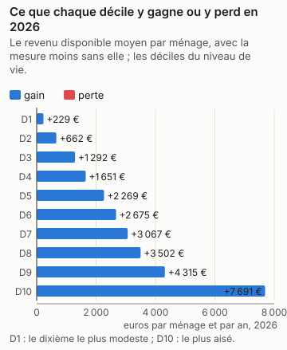
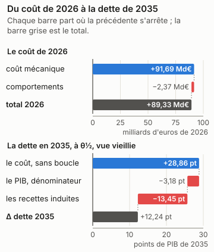
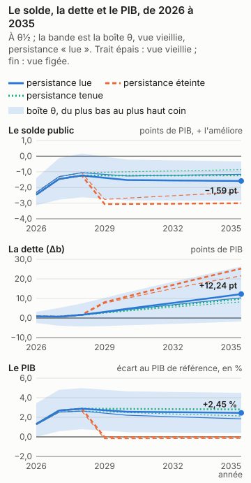
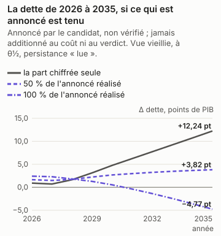
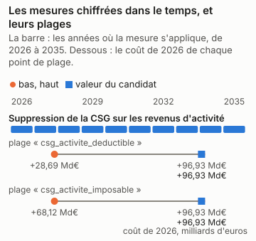

# Éric Zemmour : la part chiffrée du programme, en trois réponses

<!-- Généré par `impots etude ecrire presidentielle_zemmour` depuis reports/etudes/presidentielle_zemmour/ ; ne pas éditer à la main. -->

## Ce que dit cette étude

La part chiffrée du programme coûte 91,69 Md€ au budget sur le droit et les revenus de 2026, comme si elle s'appliquait cette année-là, avant tout changement de comportement. Les ménages y voient leur revenu disponible changer en moyenne de +229 € par an dans le dixième le plus modeste à +7 691 € dans le dixième le plus aisé. Une fois comptés les changements de comportement que des études publiées permettent de chiffrer, le coût irait de +88,16 Md€ à +90,48 Md€. En 2035, la dette publique serait plus haute de 12,24 points de PIB, au milieu des fourchettes publiées et sous les hypothèses de croissance, de taux et de dépense de la page ; la dette monte dans 83 % des tirages du calcul d'incertitude, et l'outil ne tranche pas : cette part du programme peut faire monter ou baisser la dette selon les hypothèses. L'effet sur l'activité n'est lu que pour l'impôt sur le revenu et la CSG. Sans aucun effet sur l'activité, la dette serait plus haute de 28,86 points de PIB : le coût après les comportements, à θ½, sans la boucle macro. Ces nombres valent pour la seule part chiffrée, pas pour le programme entier.

Éric Zemmour, Reconquête, a déclaré sa candidature à l'élection présidentielle de 2027. Son programme a été relevé le 12/11/2026 ; le relevé compte ses mesures, celles qui énoncent un paramètre, et celles que cet outil chiffre. Il dit plus bas pourquoi il ne chiffre pas les autres.

| mesures relevées | dont qui énoncent un paramètre | chiffrées par l'outil | part des mesures paramétrées |
|---|---|---|---|
| 33 | 32 | 1 | 3 % |

Pour la part chiffrée, cette seule mesure, trois réponses : ce qu'elle coûte et qui y gagne ; ce qu'elle coûte une fois les comportements et l'économie pris en compte ; ce qu'elle fait à la dette en 2035. **La dette porte sur la seule part du programme que l'outil chiffre, pas sur le programme : les mesures refusées, dites plus bas une à une avec leur « porte » (ce qui manque à l'outil pour les chiffrer), n'y sont pas, et un programme chiffré en partie peut paraître creuser ou baisser la dette pour une raison qui tient à l'outil (D-319).**

Chaque nombre dépend de ce qui est dit à côté de lui. Le coût de la première année est mécanique : personne ne change de comportement. La bande dit ce que les comportements y changent quand une étude publiée permet de le dire. La dette en 2035 dépend d'hypothèses de croissance, de taux et de dépenses nommées en bas de page, et de θ, la position de chaque réponse dans sa fourchette publiée : θ½ est le milieu, et les coins de la boîte placent chaque réponse aux deux bornes de sa fourchette. Le calcul d'incertitude (Monte-Carlo) tire aussi l'effet sur l'activité au-delà de ces bornes, de l'écart qui sépare les études entre elles : le verdict, qui le lit, et « selon θ », qui lit la boîte, peuvent donc différer.

## En bref

| programme | la première année | le chiffrage officiel | dette en 2035, à θ½ | verdict | selon θ |
|---|---|---|---|---|---|
| la part chiffrée (1 mesure sur 32 paramétrées, 33 relevées) | +91,69 Md€ | — | +12,24 pt | dépend (83 % des tirages en hausse) | dépend de θ |

Le verdict se lit sur le Monte-Carlo (D-345) : « hausse » quand au moins 90 % des tirages font monter la dette, vue vieillie, « baisse » quand au moins 90 % la font baisser, « dépend » entre les deux. « Selon θ » dit ce que la boîte θ en dit, sans probabilité : un seul signe à θ½ et à chaque coin, ou non.

Un coût positif coûte au budget, un coût négatif lui rapporte. La dette est en points de PIB, dans la vue vieillie et sous la persistance « lue » de l'effet macro de chaque mesure, Mésange lu à ses horizons ; « selon θ » lit les deux vues sous cette persistance seule (D-336). « Éteint » et « tenu » sont des sensibilités, données plus bas, hors du verdict.

## La part chiffrée

*Éric Zemmour (Reconquête), programme relevé le 2026-11-12 — la part chiffrée : ez4_suppression_csg_activite*

1 mesures chiffrées sur 32 paramétrées et 33 relevées. La réforme est celle des mesures chiffrées du programme, ensemble, à la valeur du candidat ; les autres n'y sont pas.

### 1. Ce qu'il coûte, et qui y gagne

*Source du graphique : `reports/etudes/presidentielle_zemmour/premiere_annee_pres2027_zemmour_programme.json` ; tracé par `impots.graphiques`. Ses nombres reposent sur : L2, la simulation mécanique ; les déciles sont ceux de la population (L1).*

La mesure coûte **91,69 Md€** la première année (2026), sur la population de 2024 au droit de 2026.

| décile | ménages | niveau de vie moyen | delta moyen | gagnants | perdants |
|---|---|---|---|---|---|
| 1 | 3 105 392 | 9 086 € | +229 € | 28 % | 0 % |
| 2 | 3 106 035 | 14 127 € | +662 € | 41 % | 0 % |
| 3 | 3 105 379 | 17 504 € | +1 292 € | 57 % | 0 % |
| 4 | 3 104 866 | 20 518 € | +1 651 € | 59 % | 0 % |
| 5 | 3 104 805 | 23 184 € | +2 269 € | 69 % | 0 % |
| 6 | 3 105 390 | 25 938 € | +2 675 € | 69 % | 0 % |
| 7 | 3 105 062 | 29 037 € | +3 067 € | 70 % | 0 % |
| 8 | 3 105 369 | 32 966 € | +3 502 € | 70 % | 0 % |
| 9 | 3 105 660 | 38 679 € | +4 315 € | 73 % | 0 % |
| 10 | 3 105 795 | 57 952 € | +7 691 € | 82 % | 0 % |

Les déciles sont ceux du niveau de vie de la population simulée. Toute structure
plus fine qu'un décile est un artefact de l'imputation, pas un résultat.

### 2. Avec les comportements et l'économie

*Source du graphique : `reports/etudes/presidentielle_zemmour/premiere_annee_pres2027_zemmour_programme.json` et `reports/etudes/presidentielle_zemmour/predictif_pres2027_zemmour_programme.json` (sa décomposition, D-349) ; tracé par `impots.graphiques`. Ses nombres reposent sur : L2 pour le coût mécanique, L3 pour les comportements, L4 pour la dette, sous hypothèses.*

**Une fois les comportements pris en compte**, la mesure coûte de +88,16 Md€ à +90,48 Md€, central +89,33 Md€ (bande **extrapolée** : la réforme sort de l'étendue des variations sur lesquelles les élasticités publiées ont été estimées), pour +91,69 Md€ sans eux.

*Cette réforme est plus grande que celles sur lesquelles les élasticités ont été estimées : la bande est une extrapolation, élargie et signalée comme telle.*

**Éventail macro : refusé.** L'éventail ne se compose pas quand les mesures poussent l'activité en sens contraires : il mêlerait les produits de l'une et de l'autre. La dette, plus bas, lit l'effet de chaque mesure sur l'activité à part, dans Mésange.

Ce que la chaîne ne lit pas, et pourquoi :

* **IS et investissement des entreprises** — aucune variante d'IS dans Mésange 2017, et aucune réestimation publiée depuis.
* **transferts** — Mésange n'a pas de variante de transfert.
* **créations d'entreprises** — C8 est un indice illustratif de la couche entreprises, en points de taux de création de sociétés, jamais une recette : la trajectoire chiffre le coût d'une baisse d'IS (D-244), pas les sociétés qu'elle ferait naître (§6.3, D-221).
* **R&D et CIR** — C9 est un indice illustratif de la couche entreprises, en euros de R&D, jamais une recette.

### 3. La dette en 2035

*Source du graphique : `reports/etudes/presidentielle_zemmour/predictif_pres2027_zemmour_programme.json`, rejoué année par année par `impots.predictif.rejouer`, qui redonne chacun de ses Δb et chaque coin de sa boîte ; tracé par `impots.graphiques`. Ses nombres reposent sur : L4, sous hypothèses : le cadre nommé en bas de page, et θ.*

| persistance | vue | Δ dette 2035, à θ½ | aux coins de la boîte |
|---|---|---|---|
| Effet macro lu dans Mésange à 1, 2, 3, 5 et 10 ans (spécification centrale), interpolé linéairement entre eux | vieillie | +12,24 pt | de -1,71 pt à +26,37 pt |
| Effet macro lu dans Mésange à 1, 2, 3, 5 et 10 ans (spécification centrale), interpolé linéairement entre eux | figée | +10,34 pt | de -1,35 pt à +22,12 pt |

En points de PIB de 2035, la dette avec la mesure moins la dette sans elle, l'effet macro lu dans Mésange à ses horizons (persistance « lue », D-336). La vue vieillie fait vieillir la population chaque année avec les salaires ; la vue figée la garde telle qu'elle est. Sous cette persistance, son effet sur la dette en 2035 **dépend de θ** : son signe change d'un coin de la boîte, ou d'une vue, à l'autre.

**Le verdict**, lu sur le Monte-Carlo (D-345) : son effet sur la dette en 2035 **dépend des hypothèses** : moins de 90 % des tirages s'accordent sur son signe, vue vieillie.

**Les sensibilités, hors du verdict.** Les deux persistances que les pages lisaient avant la persistance « lue » (D-336), sur les mêmes passes : l'effet macro éteint après trois ans, ou tenu au niveau de la troisième année. Mésange ne porte ni l'une ni l'autre ; elles disent ce que le choix de la persistance pèse, et n'entrent pas dans le verdict.

| persistance | vue | Δ dette 2035, à θ½ | aux coins de la boîte |
|---|---|---|---|
| Effet macro éteint après trois ans | vieillie | +25,30 pt | de +21,44 pt à +28,77 pt |
| Effet macro éteint après trois ans | figée | +21,59 pt | de +18,74 pt à +24,16 pt |
| Effet macro tenu au niveau de la troisième année | vieillie | +9,86 pt | de -4,61 pt à +24,50 pt |
| Effet macro tenu au niveau de la troisième année | figée | +8,25 pt | de -3,93 pt à +20,50 pt |

**La distribution, à côté de la boîte.** La boîte dit jusqu'où Δb va quand chaque effet parcourt sa fourchette publiée : ce n'est pas une probabilité. Le Monte-Carlo en est une, sous des lois déclarées : Lois du magasin, ligne par ligne ; copule gaussienne de corrélation ρ entre les lignes d'un même article, indépendance entre articles ; décalage du multiplicateur normal centré réduit, multiplicateur Mésange + z × écart-type IMK censuré à zéro ; indépendant des lignes. (ρ = 0,8, 2000 tirages, persistance « lue », D-336). D'autres lois donneraient une autre réponse.

| vue | P(hausse de la dette en 2035) | quantile 5 % | médiane | quantile 95 % | ce qui pèse le plus (Sobol, total) |
|---|---|---|---|---|---|
| vieillie | 83 % | -6,13 pt | +12,63 pt | +28,84 pt | le multiplicateur 0,97, les lignes de `labour_supply.yaml` 0,00 |
| figée | 83 % | -5,00 pt | +10,67 pt | +24,14 pt | le multiplicateur 0,97, les lignes de `labour_supply.yaml` 0,00 |

**D'où vient Δb.** La dette de 2035 en trois marches, à θ½ sous la persistance « lue » : le coût après comportements, sans la boucle macro ; ce que le PIB plus haut ou plus bas change au seul ratio, comme dénominateur ; ce que les recettes induites par l'activité y changent. Les trois font la ligne du tableau (D-349).

| vue | le coût, sans boucle | le PIB, dénominateur | les recettes induites | Δ dette 2035 |
|---|---|---|---|---|
| vieillie | +28,86 pt | -3,18 pt | -13,45 pt | +12,24 pt |
| figée | +24,15 pt | -2,32 pt | -11,49 pt | +10,34 pt |

**Au taux de marché.** La dette ajoutée est chargée au taux implicite de 2025 (D-336). Chargée à 3,5 %, hypothèse déclarée d'une OAT à dix ans de fin 2026 : +13,35 pt en vue vieillie, contre +12,24 pt ; +11,31 pt en vue figée, contre +10,34 pt.

**Si les salaires se forment autrement.** Mésange publie une sensibilité de ses variantes à la formation des salaires (folios 137 et 138) : une courbe de Phillips pour les cotisations employeurs et la TVA, un super-brut visé pour les cotisations salariés, la CSG et l'IR. Le multiplicateur y est recentré, à écart-type, persistance et recettes induites par point de PIB inchangés ; Mésange n'imprime pas le solde de la variante, que la page suppose proportionnel au PIB (D-349). C'est une sensibilité, hors du verdict.

| vue | Δ dette 2035, à θ½ | aux coins de la boîte | P(hausse) | verdict |
|---|---|---|---|---|
| vieillie | +13,81 pt | de -0,21 pt à +27,98 pt | 86 % | dépend |
| figée | +11,75 pt | de -0,00 pt à +23,54 pt | 86 % | dépend |

### La dette en 2035, si les économies annoncées sont tenues

*Source du graphique : `reports/etudes/presidentielle_zemmour/predictif_pres2027_zemmour_programme.json`, `programmes/zemmour.json` et `reports/macro/variante_depense_publique.json`, lus par `impots.predictif.annonce` ; tracé par `impots.graphiques`. Ses nombres reposent sur : L4 pour la part chiffrée, sous hypothèses ; annoncé pour le reste.*

**Une lecture à part : annoncée par le candidat, non vérifiée.** La dette plus haut est celle de la part chiffrée ; les économies de dépense que le programme annonce, que l'outil ne microsimule pas, n'y entrent pas, et ses dépenses non plus (D-319). Ici, les montants par an que le candidat attache lui-même à ses mesures de dépense publique sont lus par la variante « dépense publique » de Mésange, son effet sur le PIB et sur le solde, et s'ajoutent à la dette de la part chiffrée. Ni le coût de la part chiffrée ni le verdict ne les lisent (D-380).

| mesure | montant annoncé, par an | sens | calendrier annoncé |
|---|---|---|---|
| Suppression de l'aide médicale d'État | +1,30 Md€ | économie | par an |
| Non-remplacement de 800 000 départs dans la fonction publique administrative | +40,00 Md€ | économie | par an |
| Gains de productivité de l'intelligence artificielle dans l'administration | +5,00 Md€ | économie | par an |
| Lutte contre la fraude sociale, retrait des aides aux délinquants | +2,00 Md€ | économie | par an (fourchette de 2 à 3 Md€ ; le bas est retenu) |
| Fin du soutien public aux énergies renouvelables intermittentes | +8,00 Md€ | économie | par an |
| Fin de la politique de la Ville | +8,00 Md€ | économie | par an |
| Suppression de l'Anah | +6,00 Md€ | économie | par an |
| Suppression de l'Ademe | +3,40 Md€ | économie | par an |
| Suppression de la mise en relation de France Travail | +4,00 Md€ | économie | par an |
| Suppression des agences régionales de santé | +1,00 Md€ | économie | par an |
| Suppression d'autres agences et structures (Arcom…) | +1,00 Md€ | économie | par an |
| Suppression du CESE et des Ceser | +66 M€ | économie | par an |
| Suppression de l'aide publique au développement et de l'AFD | +14,00 Md€ | économie | par an |
| Retour au budget de l'UE d'avant le Covid | +14,00 Md€ | économie | par an |
| Fin de la gratuité des études pour les étudiants étrangers | +4,00 Md€ | économie | par an |
| Hébergement d'urgence interdit aux étrangers en situation irrégulière | +700 M€ | économie | par an |
| Aide juridictionnelle réservée aux Français | +100 M€ | économie | par an |
| Privatisation de l'audiovisuel public | +4,00 Md€ | économie | par an, plus des cessions d'actifs non chiffrées |
| Suppression des subventions aux associations « politisées » | +1,00 Md€ | économie | par an (fourchette de 1 à 2 Md€ ; le bas est retenu) |
| Suppression des subventions à la presse | +200 M€ | économie | par an |
| Suppression des subventions aux syndicats | +100 M€ | économie | par an |

| part réalisée | solde annoncé, par an | Δ dette 2035, vue vieillie | Δ dette 2035, vue figée |
|---|---|---|---|
| 0 % | +0 € | +12,24 pt | +10,34 pt |
| 50 % | +58,93 Md€ | +3,82 pt | +1,85 pt |
| 100 % | +117,87 Md€ | -4,77 pt | -6,81 pt |

À θ½, sous la persistance « lue ». À une part réalisée nulle, la ligne est la dette de la part chiffrée, plus haut ; le solde est positif quand il améliore les comptes publics.

**Ce que la variante suppose.** La variante « dépense publique » de Mésange est un composite, pas un instrument (D-214, page 106 du PDF) : 8 % d'investissement public, 25 % de rémunérations publiques, 9 % de prestations en nature, 12 % de consommations intermédiaires, 46 % de prestations sociales en espèces. La lire suppose que chaque euro annoncé tombe sur la dépense dans ces proportions, quoi que la mesure dise ; les transferts n'ont pas de variante à eux, et une économie sur les prestations lit la même moyenne. Montant atteint dès la première année du chemin et tenu en part du PIB de cette année-là : le calendrier que le candidat énonce est montré, pas lu. Choc de la variante en volume, lu comme des euros : prix de la réforme tenus constants (D-214, condition 4). Ligne de solde lue sous la dépense gelée en volume seule (note 70, D-214). Variantes superposées : Mésange est linéaire (D-230), et ce qu'annonce le candidat s'ajoute à la part chiffrée sans interaction.

**Pas lues** — hors de la dépense publique : sa porte relève d'un autre module (retraites, prestations, salaires, entreprises) : Prestations non contributives, allocations familiales et logement social réservés aux Français ; RSA limité à trois ans pour les bénéficiaires en capacité de travailler.

**Pas lues** — un montant par an dans le paramètre, sans sens ni horizon déclarés : à porter dans `declare` pour être lu : Plan de 140 Md€ d'économies par an.

*Annoncé par le candidat, non vérifié ; jamais additionné au coût de l'outil ni au verdict (D-319, D-380).*

### L'écart au chiffrage officiel

La part chiffrée n'est pas un cas enregistré : ses mesures le sont, une à une, avant que le juge ne publie. Le juge est le chiffrage des programmes de l'Institut Montaigne, attendu au premier trimestre 2027.

* `pres2027_zemmour_ez4_suppression_csg_activite`, enregistré le 2026-11-12 : +95,16 Md€ en 2026, tolérance de 25 % ou 200 M€ ; le juge n'a pas publié.

## Ce que bouge chaque paramètre

Chaque mesure chiffrée a une plage : le lecteur peut la régler, du bas au haut. Trois points la parcourent, le bas, la valeur du candidat et le haut. Chaque point est la mesure seule, mécanique (personne ne change de comportement), sur la population vieillie jusqu'en 2026 ; sa dette reporte la première année en part de PIB jusqu'en 2035, un calcul rapide qui ne refait pas chaque année. Elle ne se compare donc pas à celle de la part chiffrée, plus haut, que le calcul complet chiffre année par année avec les comportements et la boucle macro. Leur coût diffère aussi de celui de la part chiffrée : celle-ci est chiffrée sur la population de 2024 au droit de 2026, les plages sur la population vieillie jusqu'en 2026. Quand un programme a plusieurs paramètres, chacun se règle seul, les autres restant à la valeur du candidat.

*Source du graphique : `programmes/zemmour.json` et `reports/etudes/presidentielle_zemmour/plages/`, ses 6 points de plage ; tracé par `impots.graphiques`. Ses nombres reposent sur : L2 pour les coûts ; la valeur du candidat est celle du programme, le bas et le haut des hypothèses.*

### Suppression de la CSG sur les revenus d'activité

*Le programme : CSG d'activité à 0 ; « 10 % de hausse de revenus pour tous les actifs ».*

Ce que l'outil en lit : La CSG sur les revenus d'activité à zéro, ses deux parts : la déductible (6,8 %) et l'imposable (2,4 %). L'impôt sur le revenu en reprend une part, la part déductible ne venant plus en déduction. La CSG des revenus de remplacement et du capital, et la CRDS, ne bougent pas. Plages : de la mesure (0) au droit de 2026. Contre le droit de 2026.

| `csg_activite_deductible` | valeur | coût 2026 | dette en 2035, mécanique, sans comportements ni boucle |
|---|---|---|---|
| le bas | 0 % | +96,93 Md€ | +29,94 pt |
| le candidat | 0 % | +96,93 Md€ | +29,94 pt |
| le haut | 6,8 % | +28,69 Md€ | +8,86 pt |

| `csg_activite_imposable` | valeur | coût 2026 | dette en 2035, mécanique, sans comportements ni boucle |
|---|---|---|---|
| le bas | 0 % | +96,93 Md€ | +29,94 pt |
| le candidat | 0 % | +96,93 Md€ | +29,94 pt |
| le haut | 2,4 % | +68,12 Md€ | +21,04 pt |

## Le programme, mesure par mesure

Une mesure est chiffrée, refusée ou vague. Une mesure refusée n'est pas une mesure à zéro : sa « porte » dit ce qui manque à l'outil, ce qu'il devrait savoir faire pour la chiffrer. Une mesure vague n'énonce ni taux ni montant.

| mesure | ce que dit le candidat | sort | pourquoi |
|---|---|---|---|
| Report de l'âge légal | « 64, voire 65 ans », progressivement jusqu'en 2030 | refusée : les droits à la retraite (`retraites`) | L'âge légal : la population ne vieillit pas en âge et ses pensions sont des données. |
| Alignement des régimes public et privé | « sans toucher aux régimes spéciaux » | vague | Un alignement qui ne dit ni quelles règles ni à quel niveau. |
| Expulsion des étrangers, même en situation régulière, après un an de chômage ; vise aussi les « bénéficiaires exclusifs des aides sociales » | 1 an de chômage | refusée : une donnée des ménages (`donnee_menages`) | La population ne porte ni la nationalité ni le titre de séjour, et le moteur ne retire pas de ménages de son échantillon. |
| Suppression de la CSG sur les revenus d'activité | CSG d'activité à 0 ; « 10 % de hausse de revenus pour tous les actifs » | chiffrée | La CSG sur les revenus d'activité à zéro, ses deux parts : la déductible (6,8 %) et l'imposable (2,4 %). L'impôt sur le revenu en reprend une part, la part déductible ne venant plus en déduction. La CSG des revenus de remplacement et du capital, et la CRDS, ne bougent pas. Plages : de la mesure (0) au droit de 2026. Contre le droit de 2026. |
| Baisse de 40 centimes des taxes sur les carburants, suppression des certificats d'économies d'énergie | −40 c par litre, entre l'accise et les CEE sans répartition dite | refusée : un prix administré (`prix`) | La baisse mêle l'accise et les certificats d'économies d'énergie sans dire la part de chacun ; les certificats sont une obligation des fournisseurs, lue dans les prix (D-323). |
| Suppression des droits de succession | Suppression (taux 0) | refusée : les donations et les reprises (`transmission`) | Les droits de succession demandent un module de transmission que le moteur n'a pas. |
| Suppression de l'impôt sur la fortune immobilière | Suppression (taux 0) | refusée : le patrimoine des ménages (`patrimoine`) | La population ne porte pas le patrimoine immobilier des ménages, assiette de l'IFI. |
| Prestations non contributives, allocations familiales et logement social réservés aux Français | Condition de nationalité ; 15 à 20 Md€ par an (plan de Sarah Knafo, secrétaire générale de Reconquête, sur budget2027.fr, page non datée consultée le 12/11/2026) | refusée : une donnée des ménages (`donnee_menages`) | La population ne porte pas la nationalité des membres du ménage. |
| Suppression de l'aide médicale d'État | Suppression ; 1,3 Md€ par an (plan de Sarah Knafo, secrétaire générale de Reconquête, sur budget2027.fr, page non datée consultée le 12/11/2026) | refusée : la dépense publique (`depense_publique`) | L'AME est une dépense de soins que le moteur ne microsimule pas. |
| Construction de 100 000 places de prison | 100 000 places en 24 mois | refusée : la dépense publique (`depense_publique`) | Une dépense d'investissement public, que le moteur ne microsimule pas. |
| RSA limité à trois ans pour les bénéficiaires en capacité de travailler | Durée maximale de 3 ans ; 4,8 Md€ par an (plan de Sarah Knafo, secrétaire générale de Reconquête, sur budget2027.fr, page non datée consultée le 12/11/2026) | refusée : une donnée des ménages (`donnee_menages`) | La population ne porte ni l'ancienneté dans le RSA ni la capacité de travailler. |
| Non-remplacement de 800 000 départs dans la fonction publique administrative | 800 000 départs non remplacés sur le quinquennat ; 40 Md€ par an | refusée : la dépense publique (`depense_publique`) | Les effectifs publics sont une dépense que le moteur ne microsimule pas. |
| Gains de productivité de l'intelligence artificielle dans l'administration | 5 Md€ par an (plan de Sarah Knafo, secrétaire générale de Reconquête, sur budget2027.fr, page non datée consultée le 12/11/2026) | refusée : la dépense publique (`depense_publique`) | Une dépense que le moteur ne microsimule pas : elle n'entre qu'en scénario du calcul de la dette. |
| Lutte contre la fraude sociale, retrait des aides aux délinquants | 2 Md€ par an (plan de Sarah Knafo, secrétaire générale de Reconquête, sur budget2027.fr, page non datée consultée le 12/11/2026) | refusée : la dépense publique (`depense_publique`) | Le moteur calcule les droits, pas la fraude, et la population ne porte pas les condamnations : un objectif d'économies n'est qu'un scénario de dépense. |
| Fin du soutien public aux énergies renouvelables intermittentes | 8 Md€ par an (plan de Sarah Knafo, secrétaire générale de Reconquête, sur budget2027.fr, page non datée consultée le 12/11/2026) | refusée : la dépense publique (`depense_publique`) | Une dépense que le moteur ne microsimule pas : elle n'entre qu'en scénario du calcul de la dette. |
| Fin de la politique de la Ville | 8 Md€ par an (plan de Sarah Knafo, secrétaire générale de Reconquête, sur budget2027.fr, page non datée consultée le 12/11/2026) | refusée : la dépense publique (`depense_publique`) | Une dépense que le moteur ne microsimule pas : elle n'entre qu'en scénario du calcul de la dette. |
| Suppression de l'Anah | 6 Md€ par an (plan de Sarah Knafo, secrétaire générale de Reconquête, sur budget2027.fr, page non datée consultée le 12/11/2026) | refusée : la dépense publique (`depense_publique`) | Une dépense que le moteur ne microsimule pas : elle n'entre qu'en scénario du calcul de la dette. |
| Suppression de l'Ademe | 3,4 Md€ par an (plan de Sarah Knafo, secrétaire générale de Reconquête, sur budget2027.fr, page non datée consultée le 12/11/2026) | refusée : la dépense publique (`depense_publique`) | Une dépense que le moteur ne microsimule pas : elle n'entre qu'en scénario du calcul de la dette. |
| Suppression de la mise en relation de France Travail | 4 Md€ par an (plan de Sarah Knafo, secrétaire générale de Reconquête, sur budget2027.fr, page non datée consultée le 12/11/2026) | refusée : la dépense publique (`depense_publique`) | Une dépense que le moteur ne microsimule pas : elle n'entre qu'en scénario du calcul de la dette. |
| Suppression des agences régionales de santé | 1 Md€ par an (plan de Sarah Knafo, secrétaire générale de Reconquête, sur budget2027.fr, page non datée consultée le 12/11/2026) | refusée : la dépense publique (`depense_publique`) | Une dépense que le moteur ne microsimule pas : elle n'entre qu'en scénario du calcul de la dette. |
| Suppression d'autres agences et structures (Arcom…) | 1 Md€ par an (plan de Sarah Knafo, secrétaire générale de Reconquête, sur budget2027.fr, page non datée consultée le 12/11/2026) | refusée : la dépense publique (`depense_publique`) | Une dépense que le moteur ne microsimule pas : elle n'entre qu'en scénario du calcul de la dette. |
| Suppression du CESE et des Ceser | 0,066 Md€ par an (plan de Sarah Knafo, secrétaire générale de Reconquête, sur budget2027.fr, page non datée consultée le 12/11/2026) | refusée : la dépense publique (`depense_publique`) | Une dépense que le moteur ne microsimule pas : elle n'entre qu'en scénario du calcul de la dette. |
| Suppression de l'aide publique au développement et de l'AFD | 14 Md€ par an (plan de Sarah Knafo, secrétaire générale de Reconquête, sur budget2027.fr, page non datée consultée le 12/11/2026) | refusée : la dépense publique (`depense_publique`) | Une dépense que le moteur ne microsimule pas : elle n'entre qu'en scénario du calcul de la dette. |
| Retour au budget de l'UE d'avant le Covid | 14 Md€ par an (plan de Sarah Knafo, secrétaire générale de Reconquête, sur budget2027.fr, page non datée consultée le 12/11/2026) | refusée : la dépense publique (`depense_publique`) | Une dépense que le moteur ne microsimule pas : elle n'entre qu'en scénario du calcul de la dette. |
| Fin de la gratuité des études pour les étudiants étrangers | 4 Md€ par an (plan de Sarah Knafo, secrétaire générale de Reconquête, sur budget2027.fr, page non datée consultée le 12/11/2026) | refusée : la dépense publique (`depense_publique`) | Une dépense que le moteur ne microsimule pas : elle n'entre qu'en scénario du calcul de la dette. |
| Augmentation du coût des visas | 0,7 Md€ par an (plan de Sarah Knafo, secrétaire générale de Reconquête, sur budget2027.fr, page non datée consultée le 12/11/2026) | refusée : un montant sans règle de calcul (`enveloppe`) | Un montant de recettes sans tarif des visas : le candidat dit combien, pas comment. |
| Hébergement d'urgence interdit aux étrangers en situation irrégulière | 0,7 Md€ par an (plan de Sarah Knafo, secrétaire générale de Reconquête, sur budget2027.fr, page non datée consultée le 12/11/2026) | refusée : la dépense publique (`depense_publique`) | Une dépense que le moteur ne microsimule pas : elle n'entre qu'en scénario du calcul de la dette. |
| Aide juridictionnelle réservée aux Français | 0,1 Md€ par an (plan de Sarah Knafo, secrétaire générale de Reconquête, sur budget2027.fr, page non datée consultée le 12/11/2026) | refusée : la dépense publique (`depense_publique`) | Une dépense que le moteur ne microsimule pas : elle n'entre qu'en scénario du calcul de la dette. |
| Privatisation de l'audiovisuel public | 4 Md€ par an (plan de Sarah Knafo, secrétaire générale de Reconquête, sur budget2027.fr, page non datée consultée le 12/11/2026) | refusée : la dépense publique (`depense_publique`) | Une dépense que le moteur ne microsimule pas : elle n'entre qu'en scénario du calcul de la dette. |
| Suppression des subventions aux associations « politisées » | 1 Md€ par an (plan de Sarah Knafo, secrétaire générale de Reconquête, sur budget2027.fr, page non datée consultée le 12/11/2026) | refusée : la dépense publique (`depense_publique`) | Une dépense que le moteur ne microsimule pas : elle n'entre qu'en scénario du calcul de la dette. |
| Suppression des subventions à la presse | 0,2 Md€ par an (plan de Sarah Knafo, secrétaire générale de Reconquête, sur budget2027.fr, page non datée consultée le 12/11/2026) | refusée : la dépense publique (`depense_publique`) | Une dépense que le moteur ne microsimule pas : elle n'entre qu'en scénario du calcul de la dette. |
| Suppression des subventions aux syndicats | 0,1 Md€ par an (plan de Sarah Knafo, secrétaire générale de Reconquête, sur budget2027.fr, page non datée consultée le 12/11/2026) | refusée : la dépense publique (`depense_publique`) | Une dépense que le moteur ne microsimule pas : elle n'entre qu'en scénario du calcul de la dette. |
| Plan de 140 Md€ d'économies par an | 140 Md€ par an « au minimum », somme des 24 mesures (plan de Sarah Knafo, secrétaire générale de Reconquête, sur budget2027.fr, page non datée consultée le 12/11/2026) — montant annoncé : 140 Md€ (par an, au minimum ; total des 24 mesures du plan, qui sont aussi déclarées une à une) ; non lu comme montant annuel : le total des 24 lignes, déclarées une à une (D-381). | refusée : une hypothèse du calcul de la dette (`chaine`) | Un effort d'ensemble est une trajectoire de dépense du calcul de la dette ; ses lignes chiffrées sont relevées une à une. |

Les portes, de celle qui ouvrirait le plus de mesures à celle qui en ouvrirait le moins :

* 22 mesures — la dépense publique, que le moteur ne simule pas ménage par ménage : elle n'entre dans la dette que comme une hypothèse de dépense (`depense_publique`).
* 3 mesures — une donnée des ménages : plus-values, épargne, logement (`donnee_menages`).
* 1 mesure — une hypothèse du calcul de la dette année par année, pas une réforme : règle budgétaire, trajectoire de déficit (`chaine`).
* 1 mesure — une règle : le candidat dit combien (un montant global), pas comment (un taux, un seuil, une assiette) (`enveloppe`).
* 1 mesure — le patrimoine des ménages : la population n'en porte pas (ISF, taxe sur les grandes fortunes, plus-values latentes) (`patrimoine`).
* 1 mesure — un prix fixé hors du marché, ou une obligation des fournisseurs lue dans les prix (énergie, carburants, certificats d'économies d'énergie) : ni une taxe ni une prestation, et la consommation imputée ne réagit pas aux prix (D-323) (`prix`).
* 1 mesure — les droits à la retraite (âges, durées, régimes) : la population ne vieillit pas en âge et ses pensions sont des données (`retraites`).
* 1 mesure — un module de transmission : donations et reprises (`transmission`).

## Ce que le candidat annonce, à part

Le programme annonce lui-même un montant pour 24 de ses mesures. Ces montants ne sont pas vérifiés et ne s'ajoutent jamais au chiffrage de l'outil : la part réalisée dit ce qui s'en réaliserait, de rien à tout. Le solde est l'effet annoncé sur les comptes publics, positif quand ils s'améliorent. Le relevé, fait à la main, ne retient que les montants que le programme attache à une mesure comme un effet annuel ; d'autres montants cités dans le tableau des mesures (des totaux sur plusieurs années, des enveloppes) n'y sont pas, et il peut en avoir manqué (D-378).

| part réalisée | solde annoncé |
|---|---|
| 0 % | +0 € |
| 50 % | +69,18 Md€ |
| 100 % | +138,37 Md€ |

*déclaré par le candidat, non vérifié ; jamais additionné au chiffrage du moteur (D-319)*

## D'où viennent ces nombres

Les passes ont tourné sur 2 commits, conteneur cloud, 15 Go, 4 cœurs, deux files ; chaque rapport nomme le sien. Un commit après le premier rejoint l'étude quand sa passe témoin, `plages/ez4_suppression_csg_activite__csg_activite_deductible__bas.json` rejouée sur lui, redonne son rapport à l'identique, hors date, commit et lieu (D-335) :

* `aa22293`, le premier.
* `d4f3f7f`, rejoint par `reports/etudes/presidentielle_zemmour/temoins/d4f3f7f.json`, témoin du 2026-11-13.

Cadre du calcul année par année jusqu'en 2035 : Croissance réelle 1 %, prix 2 % ; Taux implicite tenu à son niveau de 2025 ; Dépenses gelées en volume ; droit reconduit tel qu'openfisca le porte ; θ½ sur toutes les lignes ; comportements et boucle macro appliqués.

*Population vieillie mécaniquement de 2024 à 2035 — salaires 3,0 % par an, prix 2,0 % par an, hypothèses DÉCLARÉES et non prévues (3 % ronds, le rythme du PIB nominal du scénario). La structure des ménages, les âges et les poids n'ont PAS bougé : c'est la France de l'année de base avec l'argent de l'année d'arrivée, et cela biaise vers l'immobilité démographique. **Cette population n'est plus calibrée** : les totaux dépensés au registre le sont sur l'année de base, et il n'existe pas de total publié pour une année future. Toute ligne de réconciliation sur cette année refuse un verdict de tolérance plutôt que d'en donner un qui se lirait comme une validation.*

Le secteur public est modélisé statut par statut (D-346) : un titulaire est payé d'un traitement indiciaire et de primes, et cotise à son régime ; un contractuel cotise au régime général, sans allègement. L'enquête Emploi dit titulaire ou contractuel et la fonction publique, pas le corps ni l'indice : la part des primes est la moyenne qu'openfisca porte, la même pour tous.

**La vérification de ses instruments.** Le niveau que le moteur donne à chaque instrument que la page chiffre, contre son total publié, sur 2022, 2023 et 2024 (`docs/verification/GRILLE.md`, D-364) : l'écart moyen, son étendue, et les années qui tiennent la tolérance écrite avant le calcul.

* CSG sur les revenus de remplacement : −3,1 % en moyenne, de −5,4 % à −1,0 % ; 3 années sur 3 dans sa tolérance.
* Foyers imposés : +6,2 % en moyenne, de +2,1 % à +9,4 % ; 3 années sur 3 dans sa tolérance.
* Impôt sur le revenu au barème, avant réductions et crédits : −7,9 % en moyenne, de −9,8 % à −6,0 % ; 2 années sur 2 dans sa tolérance.
* CSG sur les revenus d'activité, avec celle des non-salariés : −1,6 % en moyenne, de −2,0 % à −1,4 % ; 3 années sur 3 dans sa tolérance.

Un écart de niveau ne se reporte pas tel quel sur le chiffrage : le coût d'une mesure est la différence de deux passes sur la même population, et ce qui manque aux deux passes s'y annule en partie.

* `reports/etudes/presidentielle_zemmour/premiere_annee_pres2027_zemmour_programme.json`, `reports/etudes/presidentielle_zemmour/predictif_pres2027_zemmour_programme.json`
* `reports/etudes/presidentielle_zemmour/plages/`, les 6 points des plages
